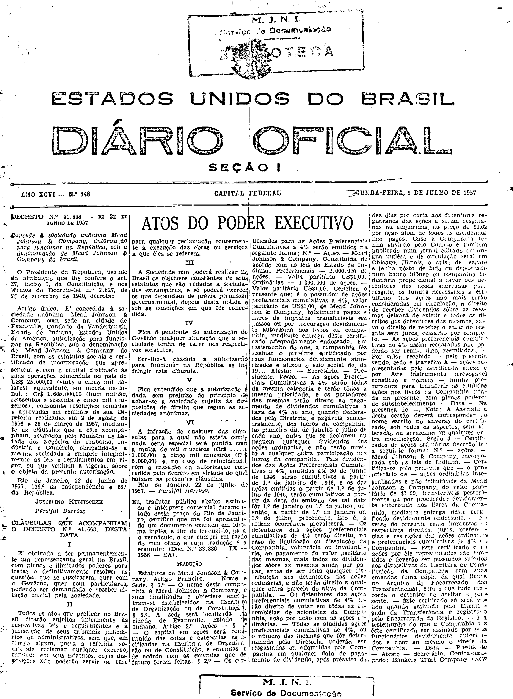

###DEC-041668-0-000-22-06-1957@@@

<strong>DECRETO Nº 41.668, DE 22 DE JUNHO DE 1957.</strong>

<em><strong>Concede á sociedade anônima Mead Johnson & Company, autorização para funcionar na República, sob a denominação de Mead Johnson & Company do Brasil.</strong></em>

<strong>O PRESIDENTE DA REPÚBLICA</strong>, usando da atribuição que lhe confere o art. 87, inciso I, da Constituição, e nos têrmos do Decreto-lei nº 2.627, de 26 de setembro de 1940,

<strong>DECRETA:</strong>

Artigo único. É concedida à sociedade anônima <em>Mead Johnson & Company</em>, com sede na cidade de Evansville, Condado de Vanderburgh, Estado de Indiana, Estados Unidos da América, autorização para funcionar na República, sob a denominação de <em>Mead</em> <em>Johnson</em> <em>&</em> <em>Company</em> do Brasil, com os estatutos sociais e certificados de incorporação que apresentou, e com o capital destinado às suas operações comerciais no país de US$25.000,00 (vinte e cinco mil dólares) equivalente, em moeda nacional a Cr$1.665,000,00 (hum milhão, seiscentos e sessenta e cinco mil cruzeiros), consoante resoluções tomadas e aprovadas em reuniões de sua Diretoria realizadas em 2 de agôsto de 1956 e 28 de março de 1957, mediante as cláusulas que a êste acompanham, assinadas pelo Ministro de Estado dos Negócios do Trabalho, Indústria e Comércio, obrigando-se a mesma sociedade a cumprir integralmente as leis e regulamentos em vigor, ou que venham a vigorar, sôbre o objeto da presente autorização.

Rio de Janeiro, 22 de Junho de 1957: 136º da Independência e 69º da República.

<strong>JUSCELINO KUBITSCHEK</strong>

Parsifal Barroso

<!-- fac-simile-oficial:inicio -->

## Fac-símile oficial: clausulas

A peça vinculada ao Decreto nº 41.668 é reproduzida nas imagens abaixo, a partir da publicação oficial da Imprensa Nacional. A reprodução é em fac-símile, sem transcrição por OCR nem reconstrução do conteúdo.

As imagens mostram páginas inteiras do Diário Oficial da União e podem conter outras matérias. Essas matérias vizinhas não são atribuídas a este decreto. A peça é identificada pelo seu título e pela referência ao ato nas páginas indicadas.

SHA-256 desta imagem: `eb4551b691abbac6e208dee2ee358299b9281c38ac3811a6bd31ca4aaeefc6e5`.

Fontes oficiais da publicação:

- [DO_1_19570701_148.PDF](https://biblioteca.in.gov.br/documents/271518/581394/DO_1_19570701_148.PDF/5f018e74-162a-1bcf-1b16-c01166c38d59?t=1574963443687&download=true) — SHA-256 do PDF: `f9ee0b4f880e5164b424ba377ff36b6cb33f0da65d13691c12392b9109c5689b`.

<!-- fac-simile-oficial:fim -->
