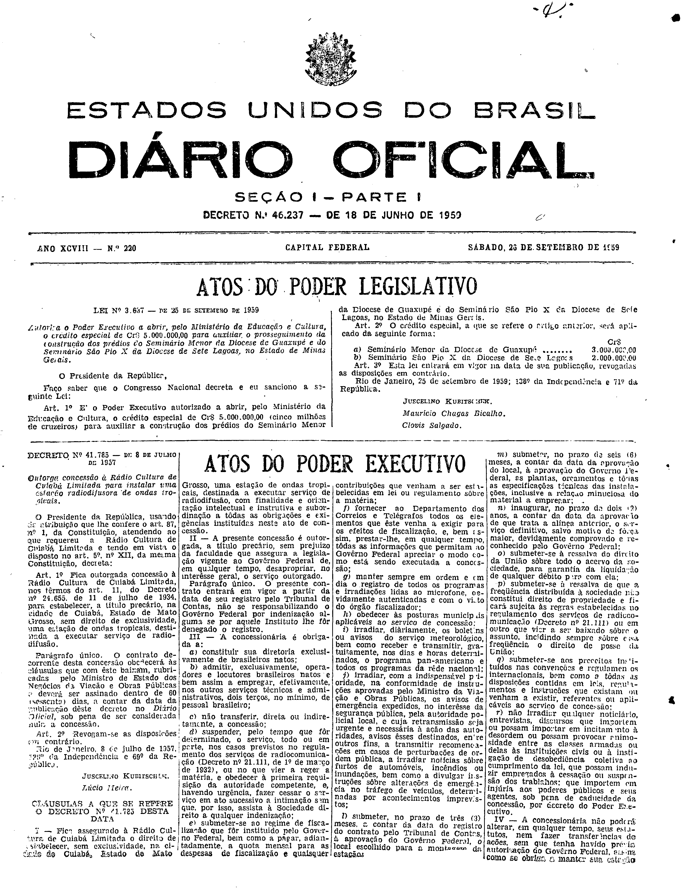
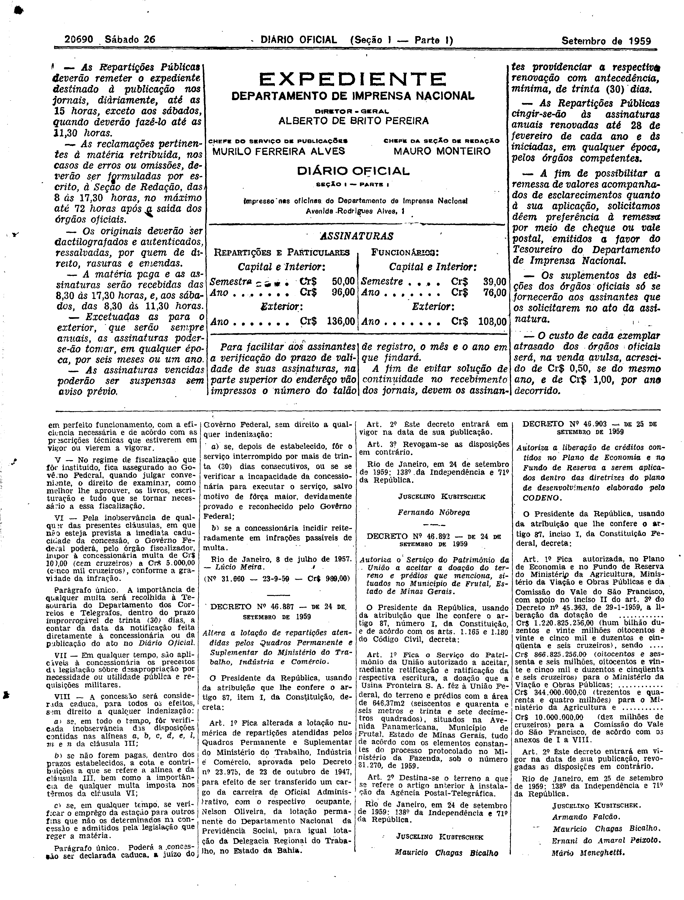

###DEC-041785-0-000-08-07-1957@@@

<strong>DECRETO Nº 41.785, DE 08 DE JULHO DE 1957.</strong>

<!-- fac-simile-oficial:inicio -->

## Fac-símile oficial: decreto e cláusulas

O decreto e as cláusulas são reproduzidos integralmente nas páginas abaixo da edição indicada do Diário Oficial da União. A primeira publicação não foi verificada. As páginas inteiras também contêm matérias vizinhas, que não são atribuídas a este ato. Não há transcrição por OCR.

SHA-256 da imagem: `0e54c050f0d18992ff752c5e0017f4ab14041aa9628d81e2375aaeb168e41791`.

Fonte: [DO_1_19590926_220.PDF](https://biblioteca.in.gov.br/documents/271518/581456/DO_1_19590926_220.PDF/efaccdf3-f8ef-41e9-52e9-9f593b4f9a65?t=1574964305010&download=true), edição 1959-09-26; SHA-256 do PDF: `86a40d1ee43b6d27c074e422978c8cea2450d2a6a03c3c9306c656061947e427`.

SHA-256 da imagem: `de19d68ea9958f8f89bada316f53a46ecb7797d737f7a3592c2069665cb02262`.

Fonte: [DO_1_19590926_220.PDF](https://biblioteca.in.gov.br/documents/271518/581456/DO_1_19590926_220.PDF/efaccdf3-f8ef-41e9-52e9-9f593b4f9a65?t=1574964305010&download=true), edição 1959-09-26; SHA-256 do PDF: `86a40d1ee43b6d27c074e422978c8cea2450d2a6a03c3c9306c656061947e427`.

<!-- fac-simile-oficial:fim -->
