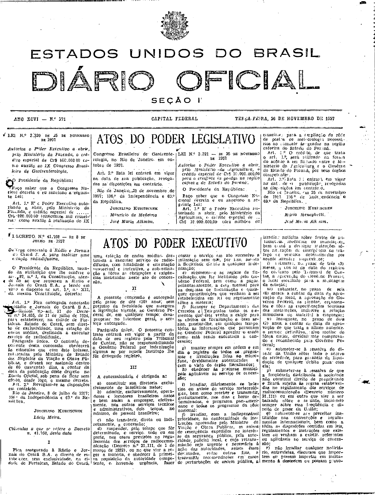
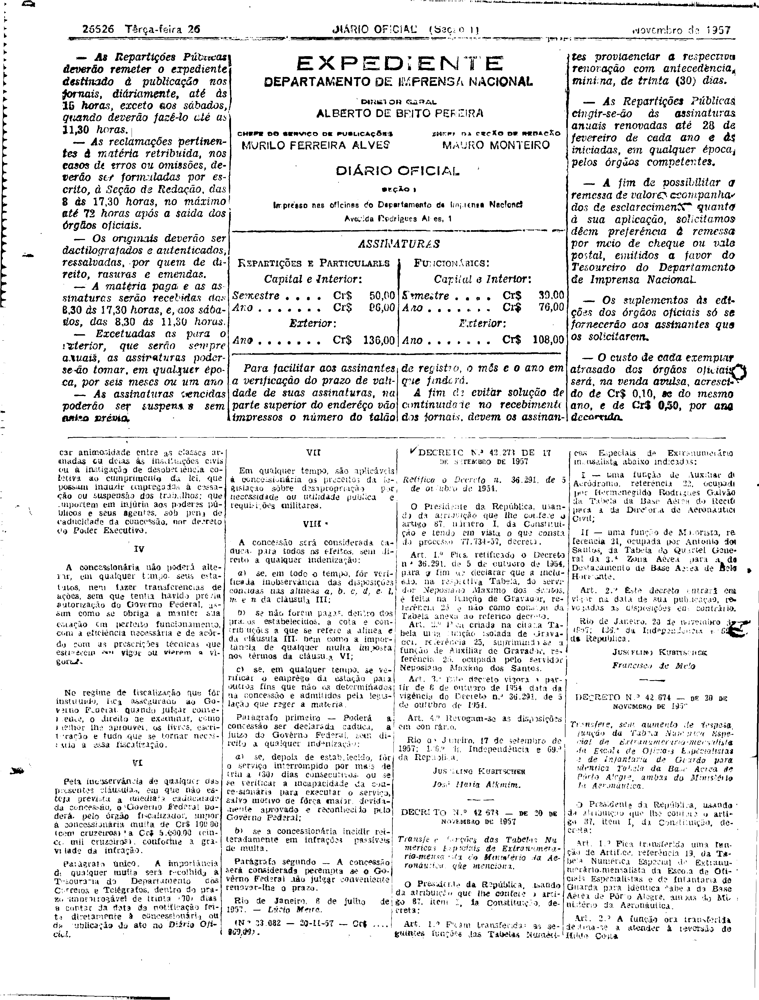

###DEC-041798-0-000-08-07-1957@@@

<strong>DECRETO Nº 41.798, DE 8 DE JULHO DE 1957.</strong>

<em><strong>Outorga concessão à</strong></em>  <em><strong>Rádio e Jornais do Ceará S. A. para instalar uma estação radiodifusora.</strong></em>

<strong>O PRESIDENTE DA REPÚBLICA</strong>, usando da atribuição que lhe confere o art. 87, nº I, da Constituição, atendendo ao que requereu a Rádio e Jornais do Ceará S.A. e tendo em vista o disposto no art. 5º nº XII, da mesma Constituição,

<strong>DECRETA:</strong>

<strong>Art</strong>. 1º Fica outorgada concessão à Rádio e Jornais do Ceará S.A., nos têrmos do art. 11 do Decreto do nº 24.655, de 11 de julho de 1934, para estabelecer, na cidade de Fortaleza, Estado do Ceará, sem direito de exclusividade, uma estação de ondas médias, destinada a executar serviço de radiodifusão.

Parágrafo único. O contrato decorrente desta concessão obedecerá às cláusulas que com êste baixam, rubricadas pelo Ministro de Estado dos Negócios da Viação e Obras Públicas, e deverá ser assinado dentro de 60 (sessenta ) dias, a contar da data da publicação dêste decreto no <em>Diário</em> <em>Oficial</em>, sob pena de ficar sem efeito, deste logo, o mesmo decreto.

<strong>Art</strong>. 2º Revogam-se as disposições em contrário.

Rio de Janeiro, 8 de julho de 1957; 136º da Independência e 69º da República.

<strong>JUSCELINO KUBITSCHEK</strong>

Lúcio Meira

<!-- fac-simile-oficial:inicio -->

## Fac-símile oficial: cláusulas

O texto acima não inclui as cláusulas a que se refere este decreto. A publicação oficial do anexo está em imagem, nas páginas do _Diário Oficial da União_ (Seção I) de 26 de novembro de 1957: página 1 do PDF (capa do caderno) (a partir de «Cláusulas a que se refere o Decreto n. 41.798, desta data»); página 2 do PDF (até «N. 23.082 — 20-11-57 — Cr$ 969,00»).

As imagens são as páginas inteiras, tal como digitalizadas pela Imprensa Nacional, sem recorte, sem redesenho e sem transcrição. Cada página traz também outros atos do mesmo dia; a peça deste decreto está apenas no trecho indicado, e o texto do anexo só existe na imagem. Não há OCR validado.

Fonte: Imprensa Nacional, Biblioteca Machado de Assis, arquivo `DO_1_19571126_271.PDF` (SHA-256 `1507f0af7bd5ea413cfb9b094fa511511f550930f5fd6b55ed6425927c50f1ab`), páginas 1, 2 do PDF. SHA-256 das imagens, na ordem: `d44a67a5b322b8e3bdc196653d0f090b053795e770076b76f272649784611628`, `f6f8e82dfac20a4db35b1529a622bc8a77776c82e0ed2a4a684bab82b54f1dc9`.

<!-- fac-simile-oficial:fim -->
