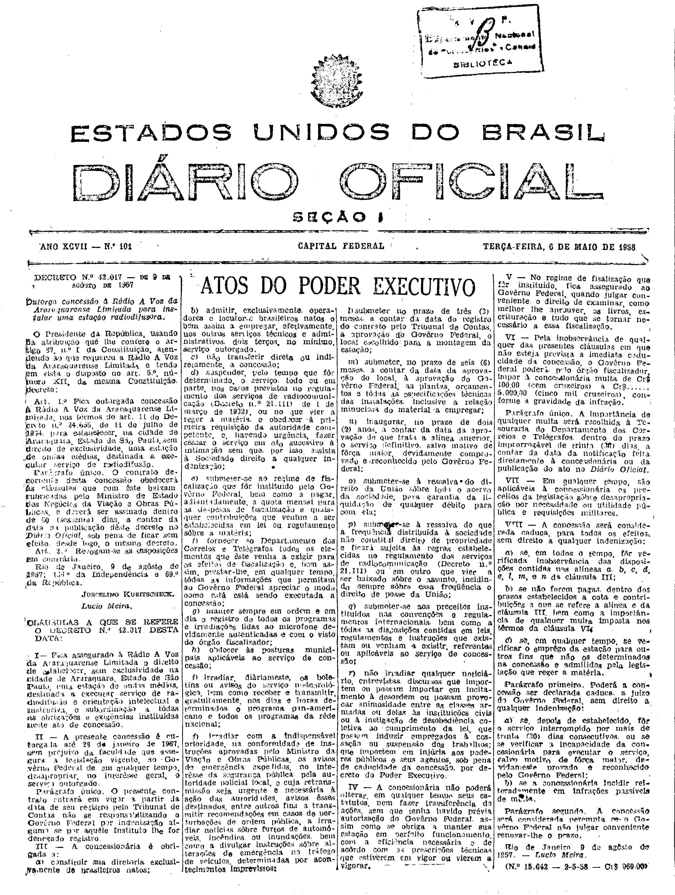

###DEC-042017-0-000-09-08-1957@@@

<strong>DECRETO Nº 42.017, DE 9 DE AGÔSTO DE 1957.</strong>

<em><strong>Outorga concessão à Rádio A Voz da Araraquarense Limitada, para instalar uma estação radiodifusora.</strong></em>

<strong>O PRESIDENTE DA REPÚBLICA</strong>, usando da atribuição que lhe confere o artigo 87, nº I da Constituição, atendendo ao que requereu à Rádio A Voz da Araraquarense Limitada e tendo em vista o disposto no art. 5º, número XII, da mesma Constituição,

<strong>DECRETA:</strong>

<strong>Art</strong>. 1º Fica outorgada concessão à Rádio A Voz da Araraquarense Limitada, nos têrmos do art. 11 do Decreto nº 24.655, de 11 de julho de 1934, para estabelecer, na cidade de Araraquara, Estado de São Paulo, sem direito de exclusividade, uma estação de ondas médias, destinada a executar serviço de radiodifusão.

Parágrafo único. O contrato decorrente desta concessão obedecerá às cláusulas que com êste baixam, rubricadas pelo Ministro de Estado dos Negócios da Viação e Obras Públicas, e deverá ser assinado dentro de 60 (sessenta) dias, a contar da data da publicação dêste decreto no <em>Diário</em> <em>Oficial</em>, sob pena de ficar sem efeito desde logo, o mesmo decreto.

<strong>Art</strong>. 2º Revogam-se as disposições em contrário.

Rio de Janeiro, 9 agôsto de 1957; 136º da Independência e 69º da República.

<strong>JUSCELINO KUBITSCHEK</strong>

Lucio Meira

<!-- fac-simile-oficial:inicio -->

## Fac-símile oficial: cláusulas

O texto acima não inclui as cláusulas a que se refere este decreto. A publicação oficial do anexo está em imagem, nas páginas do _Diário Oficial da União_ (Seção I) de 6 de maio de 1958: página 1 do PDF (capa do caderno) (a partir de «CLÁUSULAS A QUE SE REFERE O DECRETO N.º 42.017 DESTA DATA», até «N.º 15.642 — 2-5-58 — Cr$ 969,00»).

As imagens são as páginas inteiras, tal como digitalizadas pela Imprensa Nacional, sem recorte, sem redesenho e sem transcrição. Cada página traz também outros atos do mesmo dia; a peça deste decreto está apenas no trecho indicado, e o texto do anexo só existe na imagem. Não há OCR validado.

Fonte: Imprensa Nacional, Biblioteca Machado de Assis, arquivo `DO_1_19580506_101.PDF` (SHA-256 `3a8a94e4a6e2c5ab14b7b7a5055d3eec483dd62a21d378b2f361379e57af0b46`), páginas 1 do PDF. SHA-256 das imagens, na ordem: `ad85ce5dc19835d28dc2eb7edeaabd6b99ac0c4ba0d774a48f4c416a47e03810`.

<!-- fac-simile-oficial:fim -->
