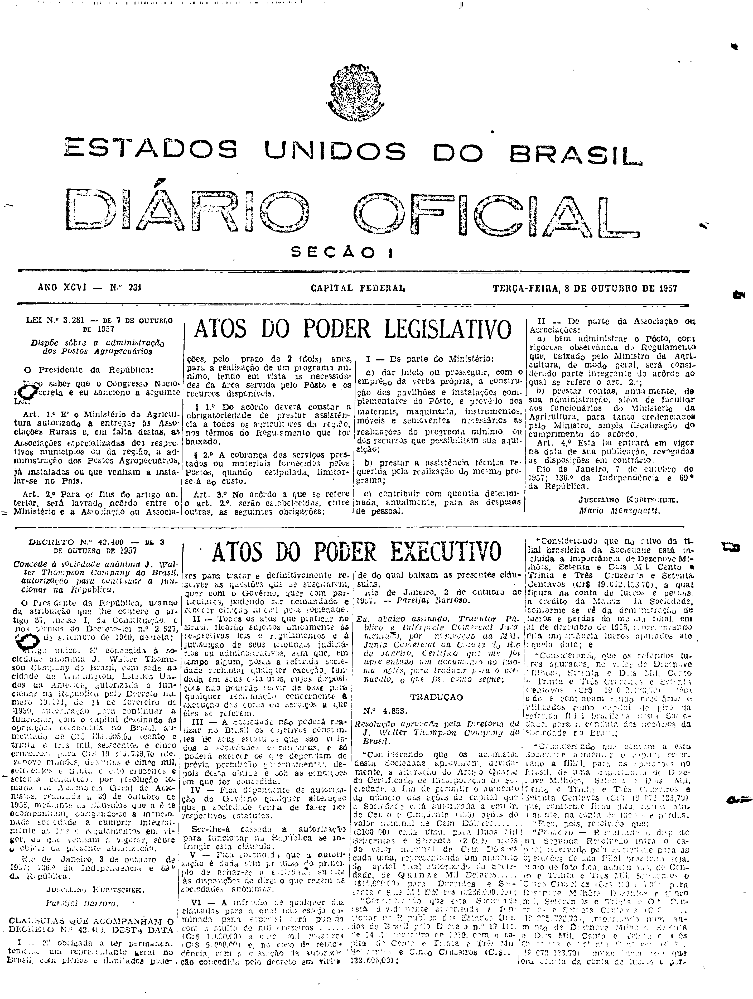

###DEC-042400-0-000-03-10-1957@@@

<strong>DECRETO N° 42.400, DE 3 DE OUTUBRO DE 1957.</strong>

<em><strong>Concede à sociedade anônima J Walter Thompson Company do Brasil, autorização para continuar a funcionar na República.</strong></em>

<strong>O PREDIDENTE DA REPÚBLICA,</strong> usando da atribuição que lhe confere o artigo 87, inciso I, da Constituição e nos têrmos do Decreto-lei nº 2.627, de 26 de setembro de 1940,

<strong>DECRETA:</strong>

Artigo único. É concedido a sociedade anônima J Walter Thompson Company do Brasil, com sede na cidade de Wilmington, Estado Unidos da América, autorização a funcionar na República pelo Decreto número 19.111 de 14 de fevereiro de 1930, autorização para continuar a funcionar, com o capital destinado as operações comerciais no Brasil aumentando de Cr$133.605,00 (cento e trinta e três mil seiscentos e cinco cruzeiros) para Cr$19.205.738,70 (dezenove milhões, duzentos e cinco mil, setecentos e trinta e oito cruzeiros e setenta centavos), por resolução tomada em Assembléia Geral de Acionistas, realizada a 30 de outubro de 1956, mediante as cláusulas que a êste acompanham, obrigando-se a mencionada sociedade a cumprir integralmente as leis e regulamentos em vigor, ou que venham a vigorar sôbre o objetivo da presente autorização.

Rio de Janeiro, 3 de outubro de 1957; 136º da Independência e 69º da República.

<strong>JUSCELINO KUBITSCHEK</strong>

Parsifal Barroso

<!-- fac-simile-oficial:inicio -->

## Fac-símile oficial: clausulas

A peça vinculada ao Decreto nº 42.400 é reproduzida nas imagens abaixo, a partir da publicação oficial da Imprensa Nacional. A reprodução é em fac-símile, sem transcrição por OCR nem reconstrução do conteúdo.

As imagens mostram páginas inteiras do Diário Oficial da União e podem conter outras matérias. Essas matérias vizinhas não são atribuídas a este decreto. A peça é identificada pelo seu título e pela referência ao ato nas páginas indicadas.

SHA-256 desta imagem: `660ec44db158d44293e45c77038496e4cb957cf532d557db45f0a3405f588767`.

Fontes oficiais da publicação:

- [DO_1_19571008_231.PDF](https://biblioteca.in.gov.br/documents/271518/581394/DO_1_19571008_231.PDF/3824a8de-0e26-3c59-b269-7ca8ba2a2e0f?t=1574964015503&download=true) — SHA-256 do PDF: `d1cefa0036495c1645e39ffad83ffa34e5f6fc0948933edfa1d15a3e98e06d35`.

<!-- fac-simile-oficial:fim -->
