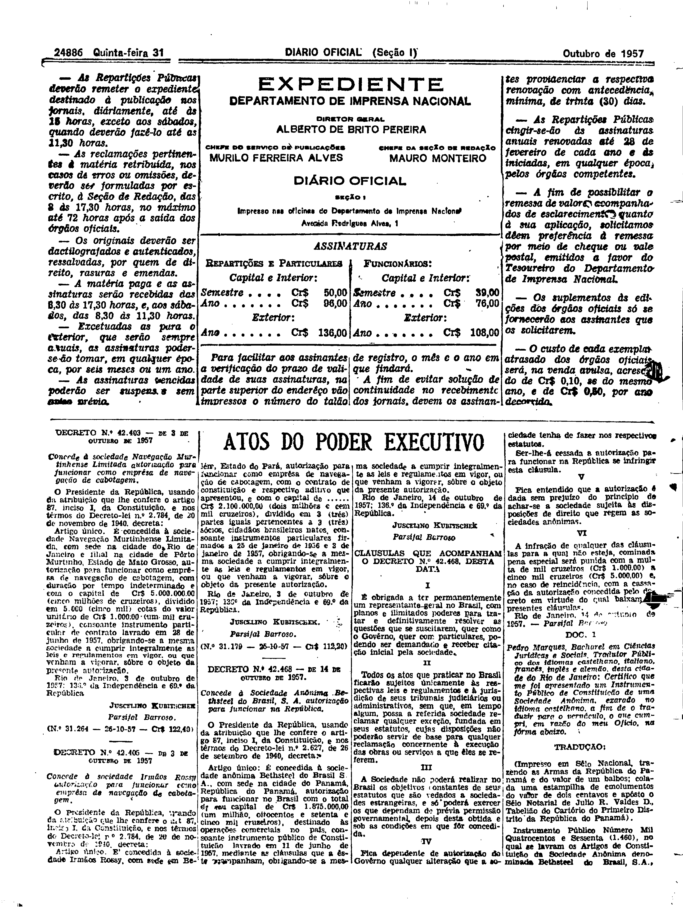

###DEC-042468-0-000-14-10-1957@@@

<strong>DECRETO Nº 42.468, DE 14 DE OUTUBRO DE 1957.</strong>

<em><strong>Concede à sociedade Anônima Bethsteel do Brasil, S. A. autorização para funcionar na República.</strong></em>

<strong>O PRESIDENTE DA REPÚBLICA</strong>, usando da atribuição que lhe confere o artigo 87, inciso I, da Constituição, e nos têrmos do Decreto-lei nº 2.627. de 26 de setembro de 1940,

<strong>DECRETA:</strong>

Artigo único. É concedida a sociedade anônima Bethsteel do Brasil S. A., com sede na cidade do Panamá, República do Panamá, autorização para funcionar no Brasil com o total do seu capital Cr$1.875.000,00 (um milhão e oitocentos e cinco mil cruzeiro), destinado às operações comerciais do país, consoante instrumento público de Constituição lavrado em 11 junho de 1957, mediante as cláusulas que a êste acompanham, obrigando-se a mesma sociedade a cumprir integralmente as leis e regulamentos em vigor, ou que venham a vigorar, sôbre o objeto da presente autorização.

Rio de janeiro, 14 de outubro de 1957; 136º da Independência e 69º da República.

<strong>JUSCELINO KUBITSCHEK</strong>

Parsifal Barroso

<!-- fac-simile-oficial:inicio -->

## Fac-símile oficial: clausulas

A peça vinculada ao Decreto nº 42.468 é reproduzida nas imagens abaixo, a partir da publicação oficial da Imprensa Nacional. A reprodução é em fac-símile, sem transcrição por OCR nem reconstrução do conteúdo.

As imagens mostram páginas inteiras do Diário Oficial da União e podem conter outras matérias. Essas matérias vizinhas não são atribuídas a este decreto. A peça é identificada pelo seu título e pela referência ao ato nas páginas indicadas.

SHA-256 desta imagem: `417f22b57ab5fdd4fd1ce1c7884a5b37e5971d15d4b50027cc53f28392d9c485`.

Fontes oficiais da publicação:

- [DO_1_19571031_251.PDF](https://biblioteca.in.gov.br/documents/271518/581394/DO_1_19571031_251.PDF/5aeb39f4-ca43-e694-2dbf-de54a6b9815f?t=1574964210277&download=true) — SHA-256 do PDF: `2f2230776805d23dc343a36c0bed391d5e48dd4994708489ac469f826b128513`.

<!-- fac-simile-oficial:fim -->
