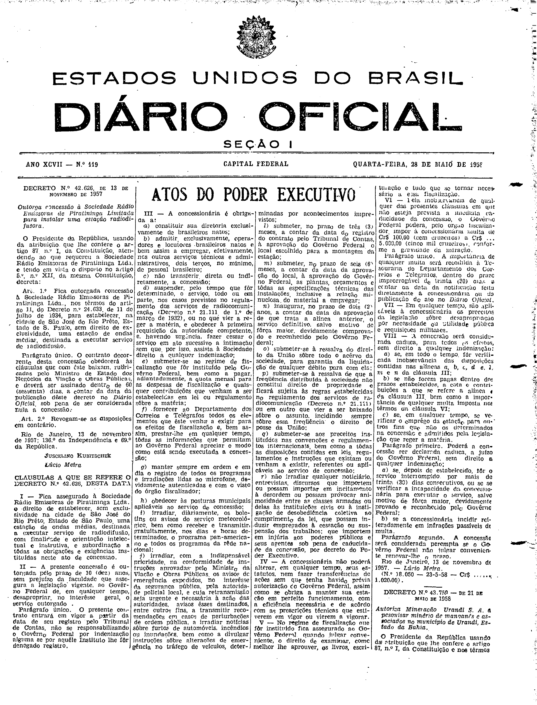

###DEC-042626-0-000-13-11-1957@@@

<strong>DECRETO Nº 42.626, DE 13 DE NOVEMBRO DE 1957.</strong>

<em><strong>Outorga concessão à Sociedade Rádio Emissoras de Piratininga Limitada para instalar uma estação radiodifusora.</strong></em>

<strong>O PRESIDENTE DA REPÚBLICA</strong>, usando da atribuição que lhe confere o artigo 87, nº I, da Constituição, atendendo ao que requereu a Sociedade Rádio Emissoras de Piratininga Ltda., e tendo em vista o disposto no artigo 5º, nº XII, da mesma Constituição,

<strong>DECRETA:</strong>

<strong>Art</strong>. 1º Fica outorgada concessão à Sociedade Rádio Emissoras de Piratininga Ltda., nos têrmos do artigo 11, do Decreto nº 24.633, de 11 de julho de 1934, para estabelecer na cidade de São José do Rio Prêto, Estado de S. Paulo, sem direito de exclusividade, uma estação de ondas médias, destinada a executar serviço de radiodifusão.

Parágrafo único. O contrato decorrente desta concessão obedecerá às cláusulas que com êste baixam, rubricada pelo Ministro de Estado dos Negócios da Viação e Obras Públicas, e deverá ser assinado dentro de 60 (sessenta) dias, a contar da data da publicação dêste decreto no Diário Oficial, sob pena de ser considerada nula a concessão.

<strong>Art</strong>. 2º Revogam-se as disposições em contrário.

Rio de Janeiro, 13 de novembro de 1957; 136º da Independência e 69º da República.

<strong>JUSCELINO KUBITSCHEK</strong>

Lúcio Meira

<!-- fac-simile-oficial:inicio -->

## Fac-símile oficial: cláusulas

O texto acima não inclui as cláusulas a que se refere este decreto. A publicação oficial do anexo está em imagem, nas páginas do _Diário Oficial da União_ (Seção I) de 28 de maio de 1958: página 1 do PDF (capa do caderno) (a partir de «CLÁUSULAS A QUE SE REFERE O DECRETO N.º 42.626, DESTA DATA», até «N.º 18.060 — 23-5-58»).

As imagens são as páginas inteiras, tal como digitalizadas pela Imprensa Nacional, sem recorte, sem redesenho e sem transcrição. Cada página traz também outros atos do mesmo dia; a peça deste decreto está apenas no trecho indicado, e o texto do anexo só existe na imagem. Não há OCR validado.

Fonte: Imprensa Nacional, Biblioteca Machado de Assis, arquivo `DO_1_19580528_119.PDF` (SHA-256 `00e9c02fa0f3d89af248303a8de53ef284dfe593861453387153d6cd9c339918`), páginas 1 do PDF. SHA-256 das imagens, na ordem: `0c35da61bf29fa42f3933b80465ec60b17fc9f26d947a14c5cf786454a4ce216`.

<!-- fac-simile-oficial:fim -->
