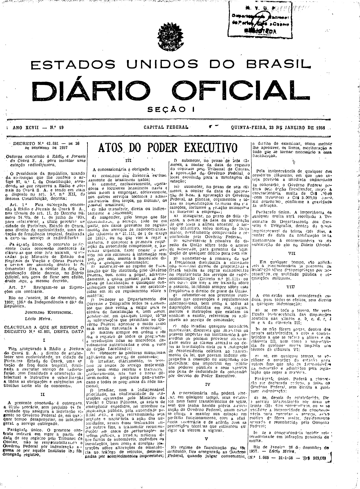

###DEC-042881-0-000-26-12-1957@@@

<strong>DECRETO Nº 42.881, DE 26 DE DEZEMBRO DE 1957.</strong>

<em><strong>Outorga concessão à Rádio e Jornais do Ceará S.A. para instalar uma estação radiodifusora.</strong></em>

<strong>O PRESIDENTE DA REPÚBLICA</strong>, usando da atribuição que lhe confere o artigo 87, nº I, da Constituição, atendendo ao que requereu a Rádio e Jornais do Ceará S.A. e tendo em vista o disposto no art. 5º, nº XII, da mesma Constituição,

<strong>DECRETA:</strong>

<strong>Art</strong>. 1º Fica outorgada concessão à Rádio e Jornais do Ceará S.A., nos têrmos do art. 11, do Decreto nº 24.655, de 11 de julho de 1934, para estabelecer, a título precário, na cidade de Fortaleza, Estado do Ceará, sem direito de exclusividade, uma estação de freqüência tropical, destinada a executar serviço de radiodifusão.

Parágrafo único. O contrato decorrente desta concessão obedecerá às cláusulas que com êste baixam, rubricadas pelo Ministro de Estado dos Negócios da Viação e Obras Públicas, e deverá ser assinado dentro de 60 (sessenta) dias, a contar da data da publicação dêste decreto, no <em>Diário Oficial</em>, sob pena de ficar sem efeito, desde logo, o mesmo decreto.

<strong>Art</strong>. 2º Revogam-se as disposições em contrário.

Rio de Janeiro, 26 de dezembro de 1957; 136º da Independência e 69º da República.

<strong>JUSCELINO KUBITSCHEK</strong>

Lúcio Meira

<!-- fac-simile-oficial:inicio -->

## Fac-símile oficial: cláusulas

O texto acima não inclui as cláusulas a que se refere este decreto. A publicação oficial do anexo está em imagem, nas páginas do _Diário Oficial da União_ (Seção I) de 23 de janeiro de 1958: página 1 do PDF (capa do caderno) (a partir de «CLÁUSULAS A QUE SE REFERE O DECRETO N.º 42.881, DESTA DATA», até «N.º 1.665 — 21-1-58 — Cr$ 969,00»).

As imagens são as páginas inteiras, tal como digitalizadas pela Imprensa Nacional, sem recorte, sem redesenho e sem transcrição. Cada página traz também outros atos do mesmo dia; a peça deste decreto está apenas no trecho indicado, e o texto do anexo só existe na imagem. Não há OCR validado.

Fonte: Imprensa Nacional, Biblioteca Machado de Assis, arquivo `DO_1_19580123_019.PDF` (SHA-256 `1259d71e8ce673bfccff124f039319eef4c5e22b40fae7a0d41aaccb5ffa7d9c`), páginas 1 do PDF. SHA-256 das imagens, na ordem: `827f10196c600531a46821eee05b6f12a7d65ea74e15483455d49a248478855e`.

<!-- fac-simile-oficial:fim -->
