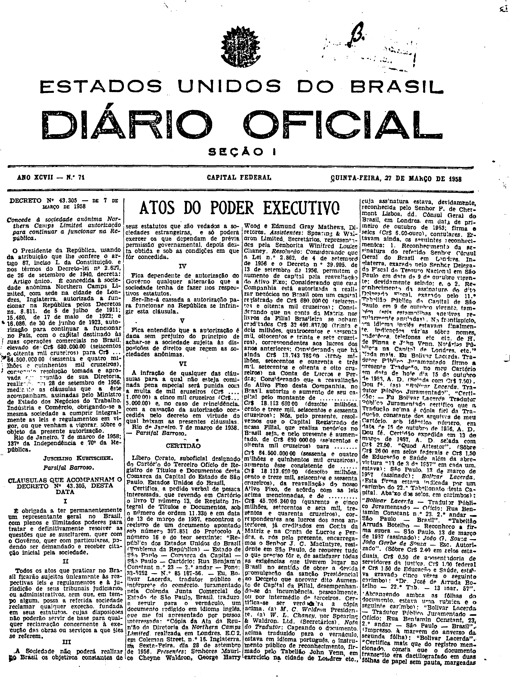

###DEC-043305-0-000-07-03-1958@@@

<strong>DECRETO Nº 43.305, DE 7 DE MARÇO DE 1958.</strong>

<em><strong>Concede à sociedade anônima Northern Camps Limited autorização para continuar a funcionar na República.</strong></em>

<strong>O PRESIDENTE DA REPÚBLICA</strong>, usando da atribuição que lhe confere o artigo 87, inciso I, da Constituição e nos têrmos do Decreto-lei nº 2.627 de 26 de setembro de 1940,

<strong>DECRETA:</strong>

Artigo único. É concedida à sociedade anônima <em>Northern Camps Limited</em>, com sede na cidade de Londres na Inglaterra, autorizada a funcionar na República. pelos Decretos nº 8.811, de 5 de julho de 1911; 15.480, de 17 de maio de 1922; e 16.086, de 30 de junho de 1923, autorização para continuar a funcionar no País, com o capital destinado às suas operações comerciais no Brasil, elevado de Cr$680.000,00 (seiscentos e oitenta mil cruzeiros) para Cr$64.500.000,00 (sessenta e quatro milhões e quinhentos mil cruzeiros), consoante resolução tomada e aprovada em reunião de sua Diretoria, realizada em 28 de setembro de 1956, mediante as cláusulas que a êste acompanham, assinadas pelo Ministro de Estado e Negócios do Trabalho, Indústria e Comércio, obrigando-se a mesma sociedade a cumprir integralmente as leis e regulamentos em vigor, ou que venham a vigorar, sôbre o objeto da presente autorização.

Rio de Janeiro, 7 de março de 1958; 137º da Independência e 70º da República.

<strong>JUSCELINO KUBITSCHEK</strong>

Parsifal Barroso

<!-- fac-simile-oficial:inicio -->

## Fac-símile oficial: clausulas

A peça vinculada ao Decreto nº 43.305 é reproduzida nas imagens abaixo, a partir da publicação oficial da Imprensa Nacional. A reprodução é em fac-símile, sem transcrição por OCR nem reconstrução do conteúdo.

As imagens mostram páginas inteiras do Diário Oficial da União e podem conter outras matérias. Essas matérias vizinhas não são atribuídas a este decreto. A peça é identificada pelo seu título e pela referência ao ato nas páginas indicadas.

SHA-256 desta imagem: `5f2f848148bf15e4b7d398825486827612350ef8d04ee96c89da3dee27996a2a`.

Fontes oficiais da publicação:

- [DO_1_19580327_071.PDF](https://biblioteca.in.gov.br/documents/271518/581421/DO_1_19580327_071.PDF/5aaa701e-a8bf-4918-4fa2-408c97ab0292?t=1574962355467&download=true) — SHA-256 do PDF: `4f5c1b29170780e4f469cc52d28dd2c75a76ad23eabfc1b62b96783c3212c502`.

<!-- fac-simile-oficial:fim -->
