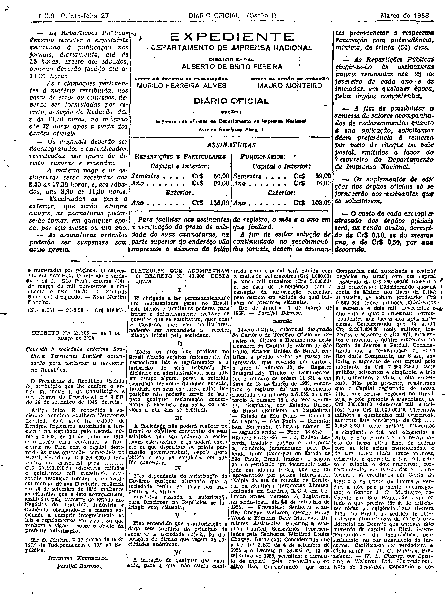

###DEC-043306-0-000-07-03-1958@@@

<strong>DECRETO Nº 43.306, DE 7 DE MARÇO DE 1958.</strong>

<em><strong>Concede à sociedade anônima Southern Territories Limited autorização para continuar a funcionar na República.</strong></em>

<strong>O PRESIDENTE DA REPÚBLICA</strong>, usando da atribuição que lhe confere o artigo 87, inciso I, da Constituição, e nos têrmos do Decreto-lei nº 2.627, de 26 de setembro de 1940,

<strong>DECRETA:</strong>

Artigo único. É concedida à sociedade anônima <em>Southern Territories Limited</em>, com sede na cidade de Londres, Inglaterra, autorizada a funcionar na República pelo Decreto número 9.663, de 10 de julho de 1912, autorização para continuar a funcionar no País, com o capital destinado às suas operações comerciais no Brasil, elevado de Cr$200.000,00 (duzentos mil cruzeiros), para Cr$19.500.000,00 (dezenove milhões e quinhentos mil cruzeiros), consoante resolução tomada e aprovada em reunião de sua Diretoria, realizada em 28 de setembro de 1956, mediante as cláusulas que a êste acompanham, assinadas pelo Ministro de Estado dos Negócios do Trabalho, Indústria e Comércio, obrigando-se a mesma sociedade a cumprir integralmente as leis e regulamentos em vigor, ou que venham a vigorar, sôbre o objeto da presente autorização.

Rio de Janeiro, 7 de março de 1958; 137º da Independência e 70º da República.

<strong>JUSCELINO KUBITSCHEK</strong>

Parsifal Barroso

<!-- fac-simile-oficial:inicio -->

## Fac-símile oficial: clausulas

A peça vinculada ao Decreto nº 43.306 é reproduzida nas imagens abaixo, a partir da publicação oficial da Imprensa Nacional. A reprodução é em fac-símile, sem transcrição por OCR nem reconstrução do conteúdo.

As imagens mostram páginas inteiras do Diário Oficial da União e podem conter outras matérias. Essas matérias vizinhas não são atribuídas a este decreto. A peça é identificada pelo seu título e pela referência ao ato nas páginas indicadas.

SHA-256 desta imagem: `b0cd390855606dcf875d0ed0ba0934e666d4d61b2227fad7e4ac7bb50847ae75`.

Fontes oficiais da publicação:

- [DO_1_19580327_071.PDF](https://biblioteca.in.gov.br/documents/271518/581421/DO_1_19580327_071.PDF/5aaa701e-a8bf-4918-4fa2-408c97ab0292?t=1574962355467&download=true) — SHA-256 do PDF: `4f5c1b29170780e4f469cc52d28dd2c75a76ad23eabfc1b62b96783c3212c502`.

<!-- fac-simile-oficial:fim -->
