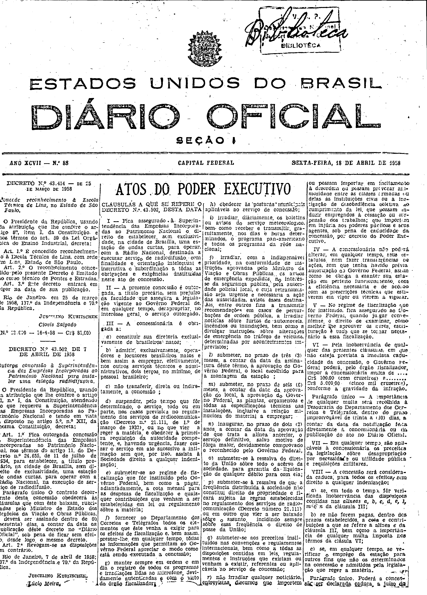
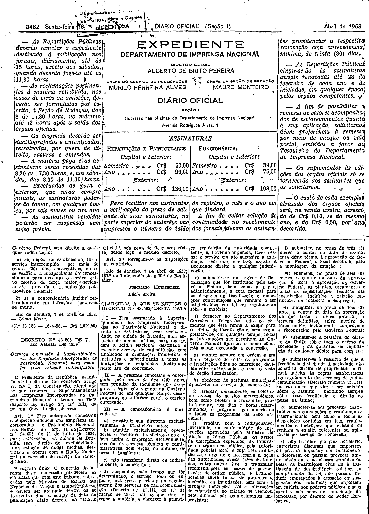

###DEC-043502-0-000-07-04-1958@@@

<strong>DECRETO Nº 43.502, DE 7 DE ABRIL DE 1958.</strong>

<em><strong>Outorga concessão à Superintendência das Emprêsas Incorporadas ao Patrimônio Nacional para instalar uma estação radiofusora.</strong></em>

<strong>O PRESIDENTE DA REPÚBLICA</strong>, usando da atribuição que lhe confere o artigo 87, nº I, da Constituição, atendendo ao que requereu a Superintendência das Emprêsas Incorporadas ao Patrimônio Nacional e tendo em vista o disposto no art. 5º, nº XII, da mesma Constituição,

<strong>DECRETA:</strong>

<strong>Art</strong>. 1º Fica outorgada concessão à Superintendência das Emprêsas Incorporadas ao Patrimônio Nacional, nos têrmos do artigo 11 do Decreto nº 24.655, de 11 de julho de 1934, para estabelecer, a título precário, na cidade de Brasília, sem direito de exclusividade, uma estação de ondas curtas, para operar com a Rádio Nacional, na execução de serviço de radiodifusão.

Parágrafo único. O contrato decorrente desta concessão obedecerá às cláusulas que com êste baixam, rubricadas pelo Ministro de Estados dos Negócios da Viação e Obras Públicas, e deverá ser assinado dentro de 60 (sessenta) dias, a contar da data da publicação dêste Decreto no “<em>Diário Oficial</em>”, sob pena de ficar sem efeito desde logo, o mesmo decreto.

<strong>Art</strong>. 2º Revogam-se as disposições em contrário.

Rio de Janeiro, 7 de abril de 1958; 137º da Independência e 70º da República.

<strong>JUSCELINO KUBITSCHEK</strong>

Lúcio Meira

<!-- fac-simile-oficial:inicio -->

## Fac-símile oficial: cláusulas

O texto acima não inclui as cláusulas a que se refere este decreto. A publicação oficial do anexo está em imagem, nas páginas do _Diário Oficial da União_ (Seção I) de 18 de abril de 1958: página 1 do PDF (capa do caderno) (a partir de «CLÁUSULAS A QUE SE REFERE O DECRETO N.º 43.502, DESTA DATA»); página 2 do PDF (até «N.º 13.186 — 16-4-58 — Cr$ 1.020,00»).

As imagens são as páginas inteiras, tal como digitalizadas pela Imprensa Nacional, sem recorte, sem redesenho e sem transcrição. Cada página traz também outros atos do mesmo dia; a peça deste decreto está apenas no trecho indicado, e o texto do anexo só existe na imagem. Não há OCR validado.

Fonte: Imprensa Nacional, Biblioteca Machado de Assis, arquivo `DO_1_19580418_088.PDF` (SHA-256 `9a033d1879f35cbd328a56059e1f0d85fb61912d8f247930a9be7b4ce558074a`), páginas 1, 2 do PDF. SHA-256 das imagens, na ordem: `98789610042f1f610d37789572f307a7a913fb3b2c2e35a95c78ebd3f76dbcfe`, `1bcbeff23d9fbf86c2ed2d5ba9251ec0524787b6a7eefc05cabfc1a1d5aab6dd`.

<!-- fac-simile-oficial:fim -->
