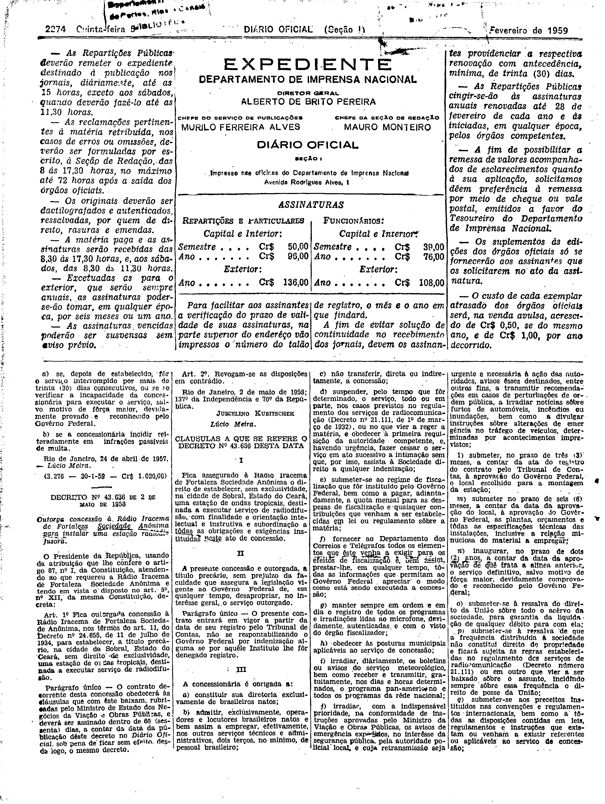
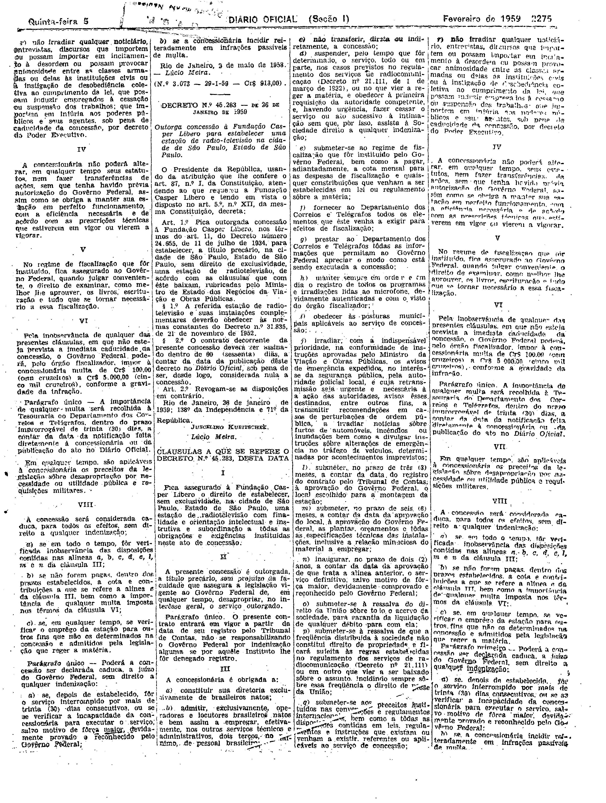

###DEC-043636-0-000-02-05-1958@@@

<strong>DECRETO Nº 43.636, DE 02 DE MAIO DE 1958.</strong>

<em><strong>Outorga concessão à Rádio Iracema de Fortaleza Sociedade Anônima para instalar uma estação radiodifusora.</strong></em>

<strong>O PRESIDENTE DA REPÚBLICA</strong>, usando da atribuição que lhe confere o artigo 87, nº I, da Constituição, atendendo ao que requereu a Rádio Iracema de Fortaleza Sociedade Anônima e tendo em vista o disposto no art. 5º nº XII, da mesma Constituição,

<strong>DECRETA:</strong>

<strong>Art</strong>. 1º Fica outorgada concessão à Rádio Iracema de Fortaleza Sociedade Anônima, nos têrmos do art. 11, do Decreto nº 24.655, de 11 de julho de 1934, para estabelecer, a título precário, na cidade de Sobral, Estado do Ceará, sem direito de exclusividade, uma estação de ondas tropicais, destinada a executar serviço de radiodifusão.

Parágrafo único - O contrato decorrente desta concessão obedecerá às cláusulas que com êste baixam, rubricadas pelo Ministro de Estado dos Negócios da Viação e Obras Pública, e deverá ser assinado dentro de 60 (sessenta) dias, a contar da data da publicação dêste decreto no <em>Diário Oficial</em>, sob pena de ficar sem efeito, desde logo, o mesmo decreto.

<strong>Art</strong>. 2º Revogam-se as disposições em contrário.

Rio de Janeiro, 2 de maio de 1958; 137º da Independência e 70º da República.

<strong>JUSCELINO KUBITSCHEK</strong>

Lúcio Meira

<!-- fac-simile-oficial:inicio -->

## Fac-símile oficial: cláusulas

O texto acima não inclui as cláusulas a que se refere este decreto. A publicação oficial do anexo está em imagem, nas páginas do _Diário Oficial da União_ (Seção I) de 5 de fevereiro de 1959: página 2 do PDF (a partir de «CLÁUSULAS A QUE SE REFERE O DECRETO N.º 43.636 DESTA DATA»); página 3 do PDF (até «N.º 3.073 — 29-1-59 — Cr$ 913,00»).

As imagens são as páginas inteiras, tal como digitalizadas pela Imprensa Nacional, sem recorte, sem redesenho e sem transcrição. Cada página traz também outros atos do mesmo dia; a peça deste decreto está apenas no trecho indicado, e o texto do anexo só existe na imagem. Não há OCR validado.

Fonte: Imprensa Nacional, Biblioteca Machado de Assis, arquivo `DO_1_19590205_030.PDF` (SHA-256 `06f4b5864b1cf364dd07bc5f1e426b74dd5f170d09326a0a8fddea6b76b45c17`), páginas 2, 3 do PDF. SHA-256 das imagens, na ordem: `45e4401a085d04f90863a3c97f029b16cd7517adb257055930df2975392dc0de`, `c7834a3028c99a7f0e79830d6c243112a157a6977d9cd680986b2934517202fa`.

<!-- fac-simile-oficial:fim -->
