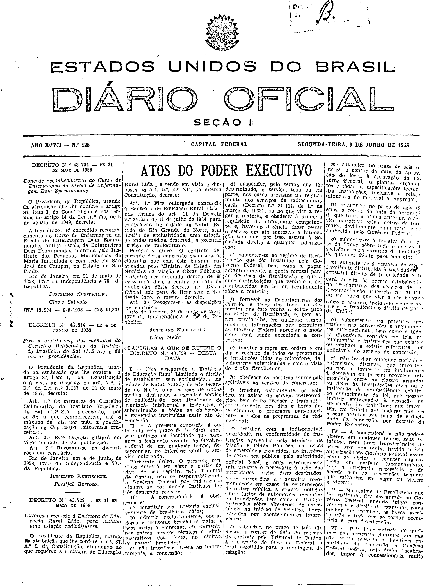
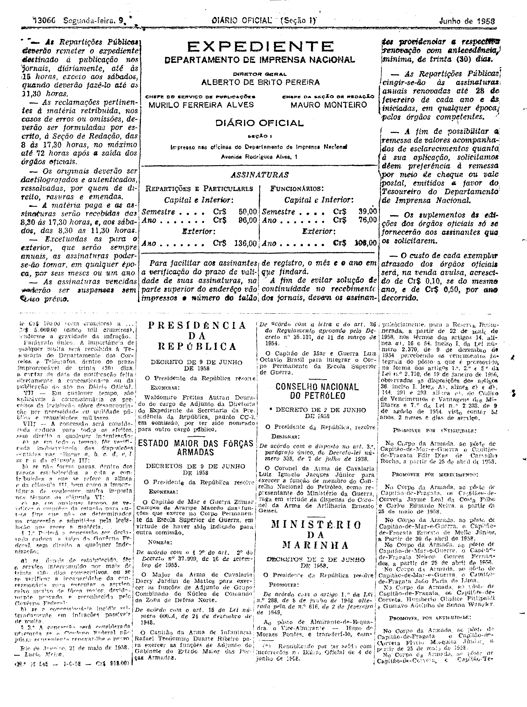

###DEC-043729-0-000-21-05-1958@@@

<strong>DECRETO Nº 43.729, DE 21 DE MAIO DE 1958.</strong>

<!-- fac-simile-oficial:inicio -->

## Fac-símile oficial do ato inteiro: cláusulas

Esta norma é reproduzida apenas em imagem. As páginas inteiras do _Diário Oficial da União_ (Seção I) de 9 de junho de 1958 trazem o decreto e o instrumento que o acompanha: PDF `DO_1_19580609_128.PDF`, p.1 do PDF (impressa 13065, inferida: capa sem folio visível), p.2 do PDF (impressa 13066).

O texto do Senado que antes constava aqui foi retirado para manter uma só versão do ato: não foi colacionado palavra a palavra com o impresso.

**Limites lidos nas imagens:** p.13065 (PDF 1): decreto col.1 base–col.2 (JUSCELINO KUBITSCHEK / Lúcio Meira); «CLÁUSULAS A QUE SE REFERE O DECRETO N.º 43.729» col.2 base–col.4 (I–VI cortada). p.13066 (PDF 2): col.1 conclui VI–VIII, «Rio de Janeiro, 21 de maio de 1958. — Lúcio Meira. (N.º 11.545 — 7-6-58 — Cr$ 918,00)», antes do Expediente. Impressão da col.1 da p.13066 muito degradada (partes ilegíveis no impresso).

**Assinatura(s):** Lúcio Meira

As imagens são as páginas inteiras, extraídas do PDF com `pdfimages -png` (imagem JBIG2 embutida, uma por página, sem reduzir), sem recorte, sem redesenho e sem transcrição. Cada página traz também outros atos do mesmo dia; a peça está apenas no trecho indicado. O texto do ato só existe na imagem. Não há OCR validado.

Fonte: Imprensa Nacional, Biblioteca Machado de Assis, `DO_1_19580609_128.PDF` (SHA-256 `871c67268958a48a1773662d009fd58e790dca149d6136896f1464bd19dea05b`). SHA-256 das imagens, na ordem: `2dac8765c01c0ce7b094593cc71ac9de8f3e7d9a4ac208039a384d5fa66850bb`, `77a1ab763e2b41b907a38b39dcd947b12002f88367c95aa0cc23e31124bb263c`.

[PDF da edição oficial](https://biblioteca.in.gov.br/documents/271518/581421/DO_1_19580609_128.PDF/cbb34132-5c54-69d2-025f-9e6f45ead6eb?t=1574963225677&download=true).

<!-- fac-simile-oficial:fim -->
