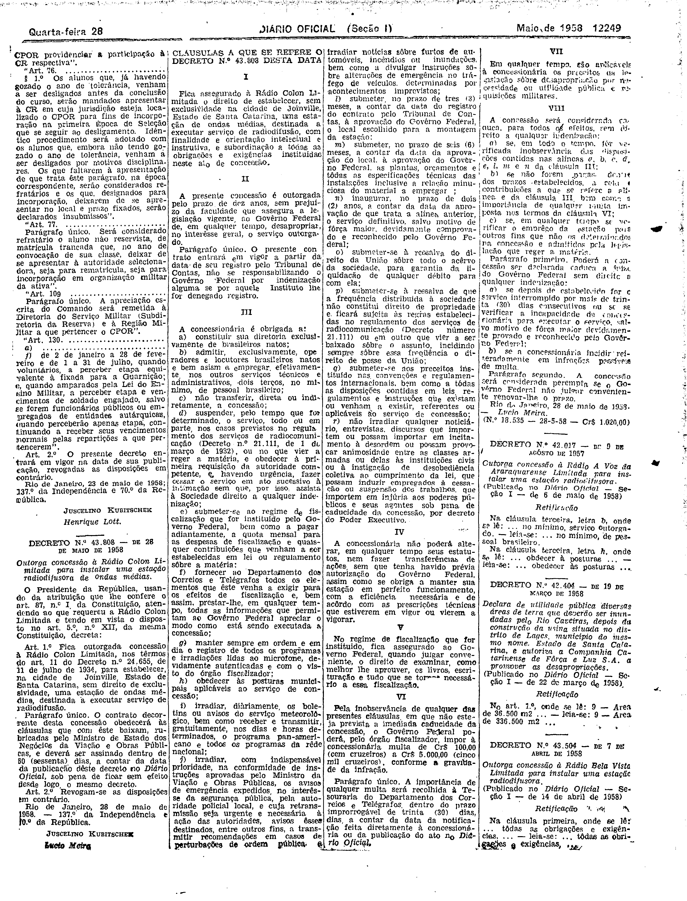

###DEC-043808-0-000-28-05-1958@@@

<strong>DECRETO Nº 43.808, DE 28 DE MAIO DE 1958.</strong>

<em><strong>Outorga concessão à Rádio Colon Limitada para instalar uma estação radiodifusora de ondas médias.</strong></em>

<strong>O PRESIDENTE DA REPÚBLICA</strong>, usando da atribuição que lhe confere o art. 87, nº I, da Constituição atendendo ao que requereu a Rádio Colon Limitada e tendo em vista o disposto no art. 5º, nº XII, da mesma Constituição,

<strong>DECRETA:</strong>

<strong>Art</strong>. 1º Fica outorgada concessão à Rádio Colon Limitada, nos têrmos do art. 11 do Decreto nº 24.655, de 11 de julho de 1934, para estabelecer, na cidade de Joinville Estado de Santa Catarina, sem direito de exclusividade, uma estação de ondas médias, destinadas a executar serviço de radiodifusão.

Parágrafo único. O contrato decorrente desta concessão obedecerá às clausulas que com êste baixam, rubricadas pelo Ministro de Estado dos Negócios da Viação e Obras Públicas, e deverá ser assinado dentro de 60 (sessenta) dias, a contar da data da publicação dêste decreto no <em>Diário Oficial</em>, sob pena de ficar em efeito desde logo o mesmo decreto.

<strong>Art</strong>. 2º Revogam-se as disposições em contrário.

Rio de Janeiro, 28 de setembro de 1958; 137º da Independência e 70º da República.

<strong>JUSCELINO KUBITSCHEK</strong>

Lú

cio Meira

<!-- fac-simile-oficial:inicio -->

## Fac-símile oficial: cláusulas

O texto acima não inclui as cláusulas a que se refere este decreto. A publicação oficial do anexo está em imagem, nas páginas do _Diário Oficial da União_ (Seção I) de 28 de maio de 1958: página 9 do PDF (a partir de «CLÁUSULAS A QUE SE REFERE O DECRETO N.º 43.808 DESTA DATA», até «N.º 18.535 — 28-5-58 — Cr$ 1.020,00»).

As imagens são as páginas inteiras, tal como digitalizadas pela Imprensa Nacional, sem recorte, sem redesenho e sem transcrição. Cada página traz também outros atos do mesmo dia; a peça deste decreto está apenas no trecho indicado, e o texto do anexo só existe na imagem. Não há OCR validado.

Fonte: Imprensa Nacional, Biblioteca Machado de Assis, arquivo `DO_1_19580528_119.PDF` (SHA-256 `00e9c02fa0f3d89af248303a8de53ef284dfe593861453387153d6cd9c339918`), páginas 9 do PDF. SHA-256 das imagens, na ordem: `597f7ccd3f1eb3abb64022192b67c53ffd73ba1db6ca4877bef5ecdc1f94c4e3`.

<!-- fac-simile-oficial:fim -->
