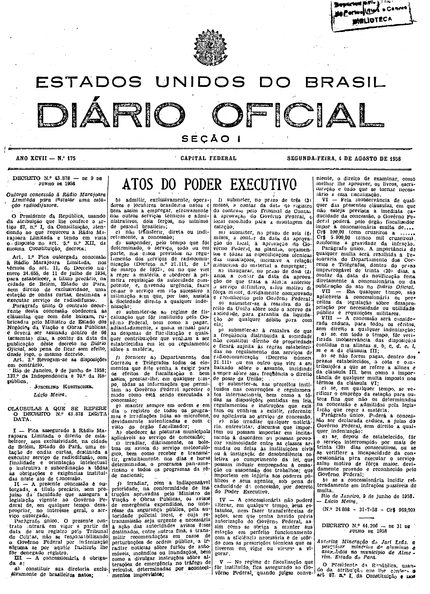

###DEC-043878-0-000-09-06-1958@@@

<strong>DECRETO Nº 43.878, DE 9 DE JUNHO DE 1958.</strong>

<em><strong>Outorga concessão à Rádio Marajoara Limitada para instalar uma estação radiodifusora.</strong></em>

<strong>O PRESIDENTE DA REPÚBLICA</strong>, usando da atribuição que lhe confere o artigo 87, nº I, da Constituição, atendendo ao que requereu a Rádio Marajoara Limitada e tendo em vista o disposto no art. 5º nº XII, da mesma Constituição,

<strong>DECRETA:</strong>

<strong>Art</strong>. 1º Fica outorgada concessão à Rádio Marajoara Limitada, nos têrmos do art. 11, do Decreto número 24.655, de 11 de julho de 1934, para estabelecer, a título precário, na cidade de Belém, Estado do Pará, sem direito de exclusividade, uma estação de ondas curtas, destinada a executar serviço de radiodifusão.

Parágrafo único. O contrato decorrente desta concessão obedecerá às cláusulas que com êste baixam, rubricadas pelo Ministro de Estado dos Negócios da Viação e Obras Públicas, e deverá ser assinado dentro de 60 (sessenta) dias, a contar da data da publicação dêste decreto no <em>Diário Oficial</em>, sob pena de ficar sem efeito, desde logo, o mesmo decreto.

<strong>Art</strong>. 2º Revogam-se as disposições em contrário.

Rio de Janeiro, 9 de junho de 1958; 137º da Independência e 70º da República.

<strong>JUSCELINO KUBITSCHEK</strong>

Lúcio Meira

<!-- fac-simile-oficial:inicio -->

## Fac-símile oficial: cláusulas

O texto acima não inclui as cláusulas a que se refere este decreto. A publicação oficial do anexo está em imagem, nas páginas do _Diário Oficial da União_ (Seção I) de 4 de agosto de 1958: página 1 do PDF (capa do caderno) (a partir de «CLÁUSULAS A QUE SE REFERE O DECRETO N.º 43.878 DESTA DATA», até «N.º 24.808 — 31-7-58 — Cr$ 969,00»).

As imagens são as páginas inteiras, tal como digitalizadas pela Imprensa Nacional, sem recorte, sem redesenho e sem transcrição. Cada página traz também outros atos do mesmo dia; a peça deste decreto está apenas no trecho indicado, e o texto do anexo só existe na imagem. Não há OCR validado.

Fonte: Imprensa Nacional, Biblioteca Machado de Assis, arquivo `DO_1_19580804_175.PDF` (SHA-256 `0f0add2b0b63a2dc5cdcea4a17d81037c6d541941022dd31ca42d4ffee74f4d7`), páginas 1 do PDF. SHA-256 das imagens, na ordem: `f3816b9cbbf9ec6568571dcf7e7246f714cad3b90c41236655c07e1c785cfb83`.

<!-- fac-simile-oficial:fim -->
