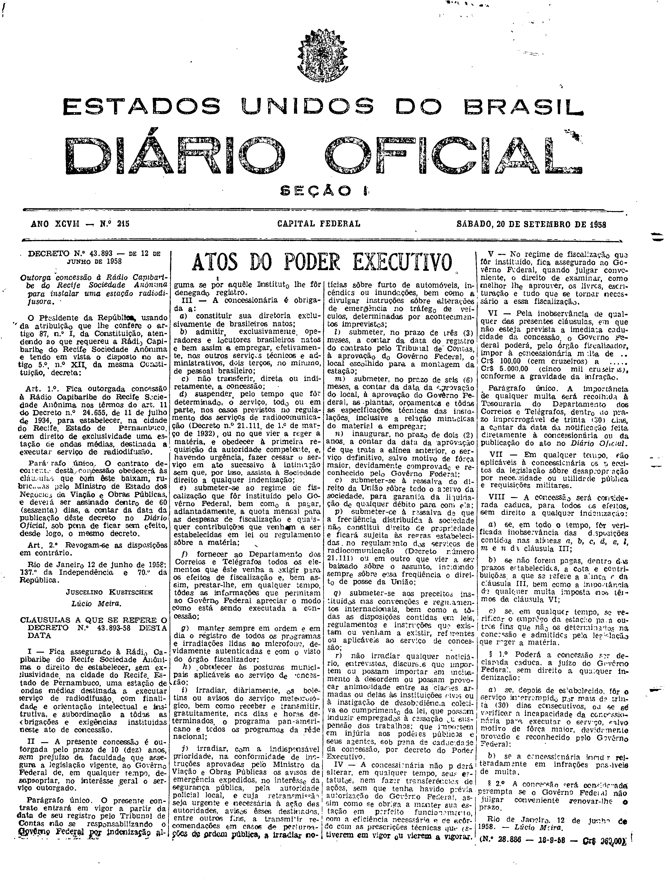

###DEC-043893-0-000-12-06-1958@@@

<strong>DECRETO Nº 43.893, DE 12 DE JUNHO DE 1958.</strong>

<em><strong>Outorga concessão à Rádio Capibaribe do Recife Sociedade Anônima para instalar uma estação radiodifusora.</strong></em>

<strong>O PRESIDENTE DA REPÚBLICA</strong>, usando da atribuição que lhe confere o artigo 87, nº I, da Constituição, atendendo ao que requereu a Rádio Capibaribe do Recife Sociedade Anônima e tendo em vista o disposto no artigo 5º XII, da mesma Constituição,

<strong>DECRETA:</strong>

<strong>Art</strong>. 1º Fica outorgado concessão à Rádio Capibaribe do Recife Sociedade Anônima nos têrmos do art. 11 do Decreto nº 24.655, de 11 de julho do Recife, Estado de Pernambuco sem direito de exclusividade uma estação de ondas médias, destinada a executar serviço de radiodifusão.

Parágrafo único. O contrato decorrente desta concessão obedecerá às cláusulas que com êste baixam, rubricadas pelo Ministro de Estado dos Negócios da Viação e Obras Públicas, e deverá ser assinado dentro de 60 (sessenta) dias, a contar da data da publicação dêste decreto no <em>Diário</em> <em>Oficial</em>, sob pena de ficar sem efeito, desde logo, o mesmo decreto.

<strong>Art</strong>. 2º Revogam-se as disposições em contrário.

Rio de Janeiro 12 de junho de 1958; 137º da Independência e 70º da República.

<strong>JUSCELINO KUBITSCHEK</strong>

Lúcio Meira

<!-- fac-simile-oficial:inicio -->

## Fac-símile oficial: cláusulas

O texto acima não inclui as cláusulas a que se refere este decreto. A publicação oficial do anexo está em imagem, nas páginas do _Diário Oficial da União_ (Seção I) de 20 de setembro de 1958: página 1 do PDF (capa do caderno) (a partir de «CLÁUSULAS A QUE SE REFERE O DECRETO N.º 43.893-58 DESTA DATA», até «N.º 28.886 — 18-9-58»).

As imagens são as páginas inteiras, tal como digitalizadas pela Imprensa Nacional, sem recorte, sem redesenho e sem transcrição. Cada página traz também outros atos do mesmo dia; a peça deste decreto está apenas no trecho indicado, e o texto do anexo só existe na imagem. Não há OCR validado.

Fonte: Imprensa Nacional, Biblioteca Machado de Assis, arquivo `DO_1_19580920_215.PDF` (SHA-256 `fc57838da86335556fe9d88b800771f3294c6f598dea4eb5b6b53bb2c34054f4`), páginas 1 do PDF. SHA-256 das imagens, na ordem: `74dffbcc21b1224cac8784d38cd8b253f663eaeb304a350f63372bca228970db`.

<!-- fac-simile-oficial:fim -->
