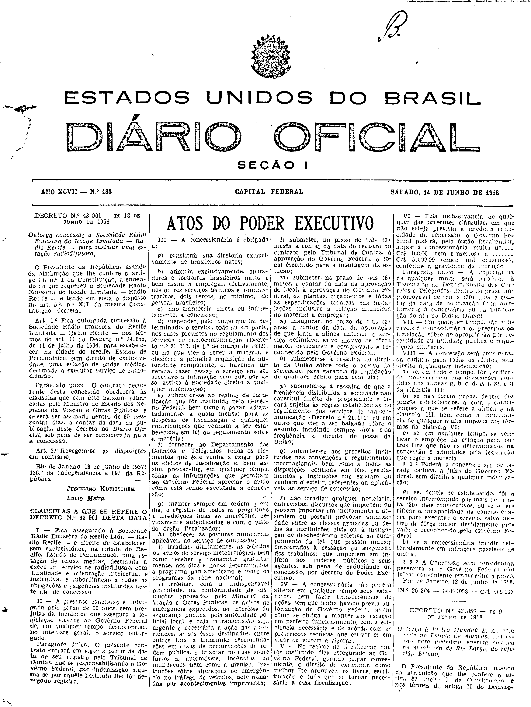

###DEC-043901-0-000-13-06-1958@@@

<strong>DECRETO Nº 43.901, DE 13 DE JUNHO DE 1958.</strong>

<em><strong>Outorga concessão à Sociedade Rádio Emissora do Recife Limitada - Rádio Recife - para instalar uma estação radiodifusora.</strong></em>

<strong>O PRESIDENTE DA REPÚBLICA</strong>, usando da atribuição que lhe confere o artigo 87, nº I, da Constituição, atendendo que requereu a Sociedade Rádio Emissora do Recife Limitada - Rádio Recife - e tendo em vista o disposto no art. 5º, nº XII, da mesma Constituição,

<strong>DECRETA:</strong>

<strong>Art</strong>. 1º Fica outorgada concessão à Sociedade Rádio Emissora do Recife - Rádio Recife - nos têrmos do art. 11 do Decreto nº 24.655, de 11 de julho de 1934, para estabelece, na cidade do Recife, Estado de Pernambuco, sem direito de exclusividade, uma estação de ondas médias, destinada a executar serviço de radiodifusão.

Parágrafo único. O contrato decorrente desta concessão obedecerá às cláusulas que com êste baixam, rubricadas pelo Ministro de Estado dos Negócios da Viação e Obras Públicas, e deverá ser assinado dentro de 60 (sessenta) dias, a contar da data da publicação dêste decreto no <em>Diário</em> <em>Oficial</em>, sob pena de ser considerada nula a concessão.

<strong>Art</strong>. 2º Revogam-se as disposições em contrário.

Rio de Janeiro, 13 de junho de 1958; 137º da Independência e 70º da República.

<strong>JUSCELINO KUBITSCHEK</strong>

Lúcio Meira

<!-- fac-simile-oficial:inicio -->

## Fac-símile oficial: cláusulas

O texto acima não inclui as cláusulas a que se refere este decreto. A publicação oficial do anexo está em imagem, nas páginas do _Diário Oficial da União_ (Seção I) de 14 de junho de 1958: página 1 do PDF (capa do caderno) (a partir de «CLÁUSULAS A QUE SE REFERE O DECRETO N.º 43.901 DESTA DATA», até «N.º 20.364 — 14-6-1958»).

As imagens são as páginas inteiras, tal como digitalizadas pela Imprensa Nacional, sem recorte, sem redesenho e sem transcrição. Cada página traz também outros atos do mesmo dia; a peça deste decreto está apenas no trecho indicado, e o texto do anexo só existe na imagem. Não há OCR validado.

Fonte: Imprensa Nacional, Biblioteca Machado de Assis, arquivo `DO_1_19580614_133.PDF` (SHA-256 `4b4be1f64762cad77064c439f41a9bfc2ef503bc286ad88d56043b73529a300d`), páginas 1 do PDF. SHA-256 das imagens, na ordem: `228e23a2961e08be1ff8b1e1c5a17e853af291656a457b018964cebc8751b726`.

<!-- fac-simile-oficial:fim -->
