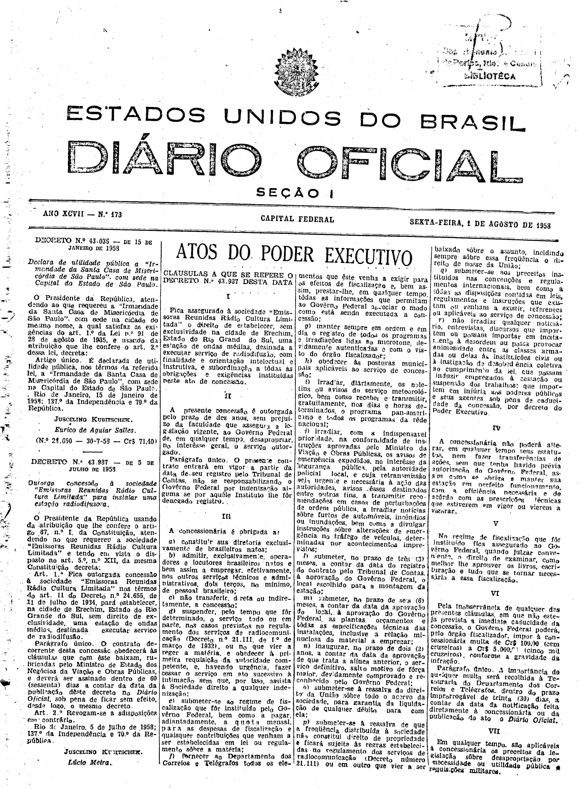
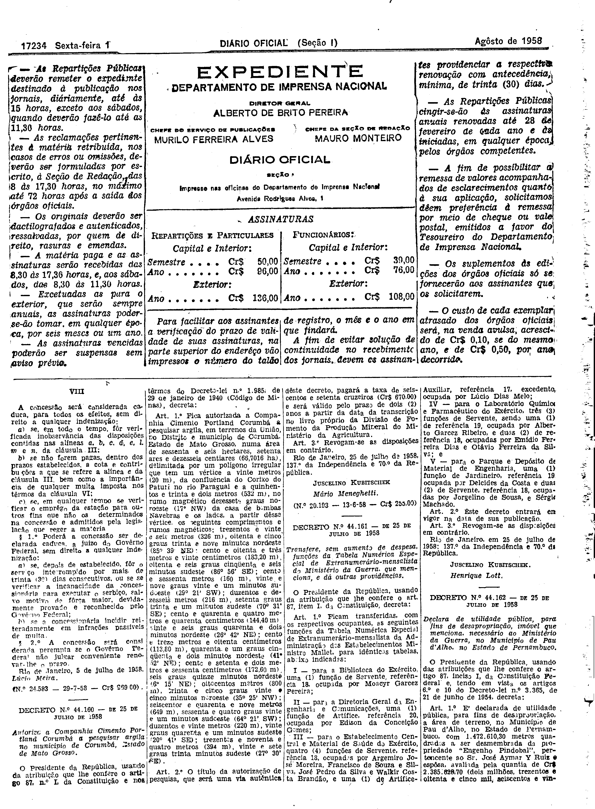

###DEC-043987-0-000-05-07-1958@@@

<strong>DECRETO Nº 43.987, DE 5 DE JULHO DE 1958.</strong>

<em><strong>Outorga concessão à sociedade “Emissoras Reunidas Rádio Cultura Limitada” para instalar uma estação radiodifusora.</strong></em>

<strong>O PRESIDENTE DA REPÚBLICA</strong>, usando da atribuição que lhe confere o artigo 87, nº I, da Constituição, atendendo ao que requereu a sociedade “Emissoras Reunidas Rádio Cultura Limitada” e tendo em vista o disposto no art. 5º, nº XII, da mesma Constituição,

<strong>DECRETA:</strong>

<strong>Art</strong>. 1º Fica outorgada concessão à sociedade “Emissoras Reunidas Rádio Cultura Limitada” nos têrmos do art. 11 do Decreto nº 24.655, de 11 de julho de 1934, para estabelecer, na cidade de Erechim, Estado do Rio Grande do Sul, sem direito de exclusividade, uma estação de ondas médias, destinada a executar serviço de radiodifusão.

Parágrafo único. O contrato decorrente desta concessão obedecerá às cláusulas que com êste baixam, rubricadas pelo Ministro de Estado dos Negócios da Viação e Obras Públicas, e deverá ser assinado dentro de 60 (sessenta) dias a contar da data da publicação dêste decreto no <em>Diário Oficial</em>, sob pena de ficar sem efeito, desde logo, o mesmo decreto.

<strong>Art</strong>. 2º Revogam-se as disposições em contrário.

Rio de Janeiro, 5 de julho de 1958; 137º da Independência e 70º da República.

<strong>JUSCELINO KUBITSCHEK</strong>

Lúcio Meira

<!-- fac-simile-oficial:inicio -->

## Fac-símile oficial: cláusulas

O texto acima não inclui as cláusulas a que se refere este decreto. A publicação oficial do anexo está em imagem, nas páginas do _Diário Oficial da União_ (Seção I) de 1 de agosto de 1958: página 1 do PDF (capa do caderno) (a partir de «CLÁUSULAS A QUE SE REFERE O DECRETO N.º 43.987 DESTA DATA»); página 2 do PDF (até «N.º 24.583 — 29-7-58 — Cr$ 969,00»).

As imagens são as páginas inteiras, tal como digitalizadas pela Imprensa Nacional, sem recorte, sem redesenho e sem transcrição. Cada página traz também outros atos do mesmo dia; a peça deste decreto está apenas no trecho indicado, e o texto do anexo só existe na imagem. Não há OCR validado.

Fonte: Imprensa Nacional, Biblioteca Machado de Assis, arquivo `DO_1_19580801_173.PDF` (SHA-256 `230f1d9ac6b5531cc4c1d6f81a7f19bfbda5eb3f386e4abea40d087e1e8fcf04`), páginas 1, 2 do PDF. SHA-256 das imagens, na ordem: `cb5cfb66223881ec7dac490b08f7849958a9fc80dd12232bc1f73cdfc51477c0`, `14439d2128b18f7d3302060ebf46dc4a8ed3613ff2fccc43c47914af60851688`.

<!-- fac-simile-oficial:fim -->
