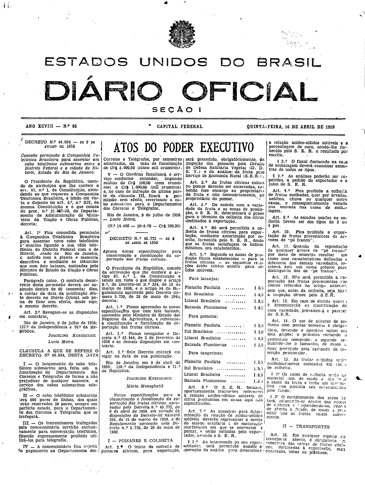

###DEC-044034-0-000-09-07-1958@@@

<strong>DECRETO Nº 44.034, DE 9 DE JULHO DE 1958.</strong>

<em><strong>Concede permissão à Companhia Telefônica Brasileira para assentar um cabo telefônico submarino entre o Distrito Federal e a cidade de Niterói, Estado do Rio de Janeiro.</strong></em>

<strong>O PRESIDENTE DA REPÚBLICA</strong>, usando da atribuição que lhe confere o art. 87, nº I, da Constituição, atendendo ao que requereu a Companhia Telefônica Brasileira, e tendo em vista o disposto no art. 5º, nº XII, da mesma Constituição e o que consta do proc. nº 21.887-58, do Departamento de Administração do Ministério da Viação e Obras Públicas,

<strong>DECRETA:</strong>

<strong>Art</strong>. 1º Fica concedida permissão à Companhia Telefônica Brasileira para assentar novo cabo telefônico submarino ligando a sua rede telefônica do Distrito Federal com a de Niterói, estado do Rio de Janeiro, de acôrdo com a planta e memória descritiva e mediante as cláusulas que com êste baixam, assinados pelo Ministro de Estado da Viação de Obras Públicas.

Parágrafo único. O contrato decorrente desta permissão deverá ser assinado dentro de 60 (sessenta) dias, a contar da data da publicação dêsse decreto no <em>Diário Oficial</em>, sob pena de ficar sem efeito, dêsse logo, o mesmo decreto.

<strong>Art</strong>. 2º Revogam-se as disposições em contrário.

Rio de Janeiro, 9 de julho de 1958; 137º da Independência e 70º da República.

<strong>JUSCELINO KUBITSCHEK</strong>

Lúcio Meira

<!-- fac-simile-oficial:inicio -->

## Fac-símile oficial: cláusulas

O texto acima não inclui as cláusulas a que se refere este decreto. A publicação oficial do anexo está em imagem, nas páginas do _Diário Oficial da União_ (Seção I) de 16 de abril de 1959: página 1 do PDF (capa do caderno) (a partir de «CLÁUSULA A QUE SE REFERE O DECRETO N.º 44.034, DESTA DATA», até «N.º 14.468 — 10-4-59 — Cr$ 306,00»).

As imagens são as páginas inteiras, tal como digitalizadas pela Imprensa Nacional, sem recorte, sem redesenho e sem transcrição. Cada página traz também outros atos do mesmo dia; a peça deste decreto está apenas no trecho indicado, e o texto do anexo só existe na imagem. Não há OCR validado.

Fonte: Imprensa Nacional, Biblioteca Machado de Assis, arquivo `DO_1_19590416_086.PDF` (SHA-256 `9e13b23d391d4e0e01a801d3959d3b9f67b2ffe5b8cfa6f2b9bf9f5b7f513367`), páginas 1 do PDF. SHA-256 das imagens, na ordem: `0e6a09bd5ff073a5cd5dbc0724f29de146d0c59541568a71ec32d2d9bcb2e36a`.

<!-- fac-simile-oficial:fim -->
