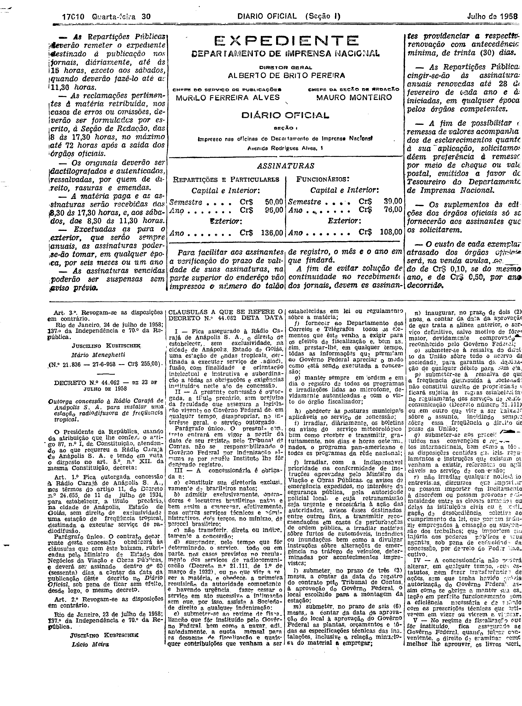
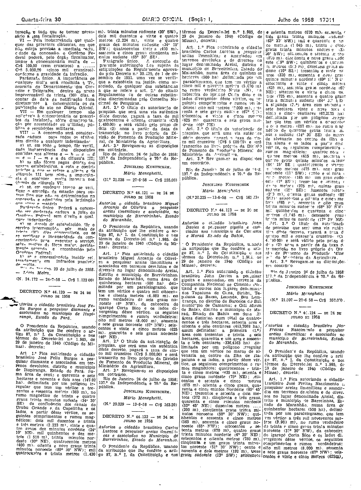

###DEC-044062-0-000-23-07-1958@@@

<strong>DECRETO Nº 44.062, DE 23 DE JULHO DE 1958.</strong>

<em><strong>Outorga concessão à Rádio Carajá de Anápolis S.A. para instalar uma estação radiodifusora de freqüência tropical.</strong></em>

<strong>O PRESIDENTE DA REPÚBLICA</strong>, usando da atribuição que lhe confere o artigo 87, nº I, da Constituição, atendendo ao que requereu a Rádio Carajá de Anápolis S.A. e tendo em vista o disposto no art. 5º, nº XII, da mesma Constituição,

<strong>DECRETA:</strong>

<strong>Art</strong>. 1º Fica outorgada concessão à Rádio Carajá de Anápolis S.A., nos têrmos do artigo 11, do Decreto nº 24.655, de 11 de julho de 1934, para estabelecer, a título precário, na cidade de Anápolis, Estado de Goiás, sem direito de exclusividade, uma estação de freqüência tropical, destinada a executar serviço de radiodifusão.

Parágrafo único. O contrato decorrente desta concessão obedecerá às cláusulas que com êste baixam, rubricadas pelo Ministro de Estado dos Negócios da Viação e obras Pública, e deverá ser assinado dentro de 60 (sessenta) dias a contar da data da publicação dêste decreto no <em>Diário Oficial</em>, sob pena de ficar sem efeito, desde logo, o mesmo decreto.

<strong>Art</strong>. 2º Revogam-se as disposições em contrário.

Rio de Janeiro, 23 de julho de 1958; 137º da Independência e 70º da República.

<strong>JUSCELINO KUBITSCHEK</strong>

Lúcio Meira

<!-- fac-simile-oficial:inicio -->

## Fac-símile oficial: cláusulas

O texto acima não inclui as cláusulas a que se refere este decreto. A publicação oficial do anexo está em imagem, nas páginas do _Diário Oficial da União_ (Seção I) de 30 de julho de 1958: página 2 do PDF (a partir de «CLÁUSULAS A QUE SE REFERE O DECRETO N.º 44.062 DESTA DATA»); página 3 do PDF (até «N. 24.172 — 24-7-58 — Cr$ 1.122,00»).

As imagens são as páginas inteiras, tal como digitalizadas pela Imprensa Nacional, sem recorte, sem redesenho e sem transcrição. Cada página traz também outros atos do mesmo dia; a peça deste decreto está apenas no trecho indicado, e o texto do anexo só existe na imagem. Não há OCR validado.

Fonte: Imprensa Nacional, Biblioteca Machado de Assis, arquivo `DO_1_19580730_171.PDF` (SHA-256 `0dac60133d931564c5500369eda0417dfbcff450e159ea9dc933bee8db783fb2`), páginas 2, 3 do PDF. SHA-256 das imagens, na ordem: `0040e24ee5eea8d811b778a82c2a8065d57466204966188c4a17176593af6537`, `222e474295dc85a732b8ffd998d1b5ff218be625943d0f6fa643b69420cbe480`.

<!-- fac-simile-oficial:fim -->
