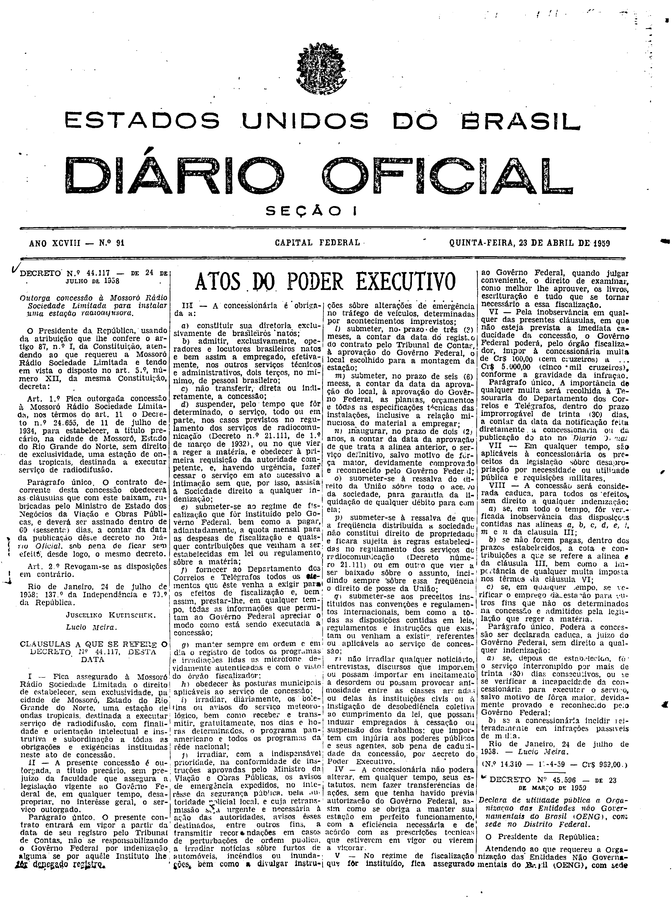

###DEC-044117-0-000-24-07-1958@@@

<strong>DECRETO Nº 44.117, DE 24 DE JULHO DE 1958.</strong>

<em><strong>Outorga concessão à Mossoró Rádio Sociedade Limitada para instalar uma estação radiodifusora.</strong></em>

<strong>O PRESIDENTE DA REPÚBLICA</strong>, usando da atribuição que lhe confere o artigo 87, nº I, da Constituição, atendendo ao que requereu a Mossoró Rádio Sociedade Limitada e tendo em vista o disposto no art. 5º, número XII, da mesma Constituição,

<strong>DECRETA:</strong>

<strong>Art</strong>. 1º Fica outorgada concessão à Mossoró Rádio Sociedade Limitada, nos têrmos do art. 11 o Decreto nº 24.655, de 11 de julho de 1934, para estabelecer a título precário, na cidade de Mossoró, Estado do Rio Grande do Norte, sem direito de exclusividade, uma estação de ondas tropicais, destinada a executar serviço de radiodifusão.

Parágrafo único. O contrato decorrente desta concessão obedecerá as cláusulas que com êste baixam, rubricadas pelo Ministro de Estado dos Negócios da Viação e Obras Públicas, e deverá ser assinado dentro de 60 (sessenta) dias, a contar da data da publicação dêste decreto no <em>Diário Oficial</em>, sob pena de ficar sem efeito, desde logo, o mesmo decreto.

<strong>Art</strong>. 2º revogam-se as disposições em contrário.

Rio de Janeiro, 24 de julho de 1958; 137º da Independência e 70º da República

<strong>JUSCELINO KUBITSCHEK</strong>

Lúcio Meira

<!-- fac-simile-oficial:inicio -->

## Fac-símile oficial: cláusulas

O texto acima não inclui as cláusulas a que se refere este decreto. A publicação oficial do anexo está em imagem, nas páginas do _Diário Oficial da União_ (Seção I) de 23 de abril de 1959: página 1 do PDF (capa do caderno) (a partir de «CLÁUSULAS A QUE SE REFERE O DECRETO Nº 44.117, DESTA DATA», até «N.º 14.340 — 14-4-59 — Cr$ 969,00»).

As imagens são as páginas inteiras, tal como digitalizadas pela Imprensa Nacional, sem recorte, sem redesenho e sem transcrição. Cada página traz também outros atos do mesmo dia; a peça deste decreto está apenas no trecho indicado, e o texto do anexo só existe na imagem. Não há OCR validado.

Fonte: Imprensa Nacional, Biblioteca Machado de Assis, arquivo `DO_1_19590423_091.PDF` (SHA-256 `e72d3533847aaa9517f04c4e5a2930974c0c56c9d3053fa25fcedd9544d34089`), páginas 1 do PDF. SHA-256 das imagens, na ordem: `c8241587336d2dfb60ff7abe74ef2d5b60f5d029602a2a3e89856d7604021197`.

<!-- fac-simile-oficial:fim -->
