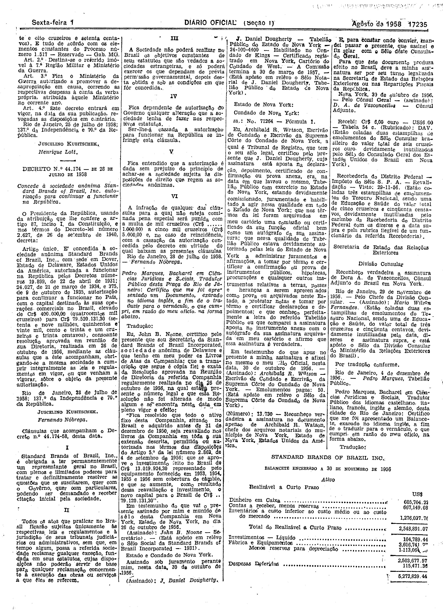

###DEC-044174-0-000-28-07-1958@@@

<strong>DECRETO Nº 44.174, DE 28 DE JULHO DE 1958.</strong>

<em><strong>Concede à sociedade anônima Standard Brands of Brazil. Inc. autorização para continuar a funcionar na República.</strong></em>

<strong>O PRESIDENTE DA REPÚBLICA</strong>, usando da atribuição que lhe confere o art. 87, inciso I, da Constituição, e nos têrmos do Decreto-lei número 2.627, de 26 de setembro de 1940,

<strong>DECRETA:</strong>

Artigo único. É concedida a sociedade anônima Standard Brands of Brazil, Inc., com sede em Dover, Estado de Delaware, Estados Unidos da América autorizada a funcionar na República pelos Decretos números 19.899, de 22 de abril de 1931; 24.027, de 21 de março de 1034, e 375, de 9 de outubro de 1935, autorização para continuar a funcionar no País, com capital destinado às suas operações comerciais no Brasil, elevado de Cr$ 400.000,00 (quatrocentos mil cruzeiros) para Cr$ 79.520.131,30 (setenta e nove milhões, quinhentos e vinte mil, cento e trinta e um cruzeiros e trinta centavos), consoante resolução aprovada em reunião de sua Diretoria, realizada em 26 de outubro de 1956, mediante as cláusulas que a êste acompanham obrigando-se a mesma sociedade a cumprir integralmente as leis e regulamentos em vigor, ou que venham a vigorar, sôbre o objeto da presente autorização.

Rio de Janeiro, 28 de julho de 1958; 137º da Independência e 70º da República.

<strong>JUSCELINO KUBITSCHEK.</strong>

Fernando Nóbrega.

<!-- fac-simile-oficial:inicio -->

## Fac-símile oficial: clausulas

A peça vinculada ao Decreto nº 44.174 é reproduzida nas imagens abaixo, a partir da publicação oficial da Imprensa Nacional. A reprodução é em fac-símile, sem transcrição por OCR nem reconstrução do conteúdo.

As imagens mostram páginas inteiras do Diário Oficial da União e podem conter outras matérias. Essas matérias vizinhas não são atribuídas a este decreto. A peça é identificada pelo seu título e pela referência ao ato nas páginas indicadas.

SHA-256 desta imagem: `2aaf4b22a175ea4c849e040eaa3333abe3c76ef7b41602d56e8624bdc2ce20a5`.

Fontes oficiais da publicação:

- [DO_1_19580801_173.PDF](https://biblioteca.in.gov.br/documents/271518/581421/DO_1_19580801_173.PDF/92626f0a-72d7-c65d-e9b7-198f7f9a5a01?t=1574963468960&download=true) — SHA-256 do PDF: `230f1d9ac6b5531cc4c1d6f81a7f19bfbda5eb3f386e4abea40d087e1e8fcf04`.

<!-- fac-simile-oficial:fim -->
