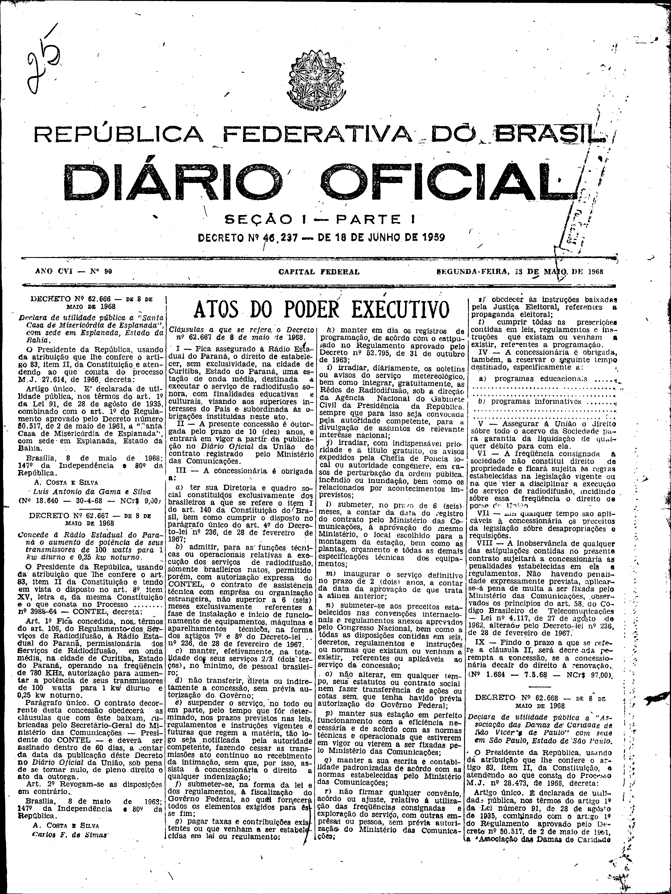

###DEC-062667-0-000-08-05-1968@@@

<strong>DECRETO Nº 62.667, DE 8 DE MAIO DE 1968.</strong>

<em><strong>Concede à Rádio Estadual do Paraná o aumento de potência de seus transmissores de 100 watts para 1 kw diurno e 0,25 kw noturno.</strong></em>

<strong>O PRESIDENTE DA REPÚBLICA</strong>, usando da atribuição que lhe confere o art. 83, item II, da Constituição e tendo em vista o disposto no art. 8º item XV, letra <em>a</em>, da mesma Constituição é o que consta no Processo nº 3988-64 - CONTEL,

<strong>DECRETA:</strong>

<strong>Art</strong>. 1º Fica concedida, nos têrmos do art. 106, do Regulamento dos Serviços de Radiodifusão, à Rádio Estadual do Paraná, permissionária dos Serviços de Radiodifusão, em onda média, na cidade de Curitiba, Estado do Paraná, operando na freqüência de 780 kHz, autorização para aumentar a potência de seus transmissores de 100 watts para 1 kw diurno e 0,25 kw noturno.

Parágrafo único. O contrato decorrente desta concessão obedecerá as cláusulas que com êste baixam, rubricadas pelo Secretário-Geral do Ministério das Comunicações - Presidente do CONTEL - e deverá ser assinado dentro de 60 dias, a contar da data da publicação dêste Decreto no <em>Diário</em> <em>Oficial</em> da União, sob pena de se tornar nulo, de pleno direito o ato da outorga.

<strong>Art</strong>. 2º Revogam-se as disposições em contrário.

Brasília, 8 de maio de 1968;147º da Independência e 80º da República.

<strong>A. COSTA E SILVA</strong>

Carlos F. de Simas

<!-- fac-simile-oficial:inicio -->

## Fac-símile oficial: cláusulas

O texto acima não inclui as cláusulas a que se refere este decreto. A publicação oficial do anexo está em imagem, nas páginas do _Diário Oficial da União_ (Seção I) de 13 de maio de 1968: página 1 do PDF (capa do caderno) (a partir de «Cláusulas a que se refere o Decreto nº 62.667 de 8 de maio de 1968», até «Nº 1.684 — 7.5.68 — NCr$ 97,00»).

As imagens são as páginas inteiras, tal como digitalizadas pela Imprensa Nacional, sem recorte, sem redesenho e sem transcrição. Cada página traz também outros atos do mesmo dia; a peça deste decreto está apenas no trecho indicado, e o texto do anexo só existe na imagem. Não há OCR validado.

Fonte: Imprensa Nacional, Biblioteca Machado de Assis, arquivo `DO_1_19680513_090.PDF` (SHA-256 `5f34ea74cd3f37799bd3b28654e0fba54f68156c92544f46aabee52a07b80a66`), páginas 1 do PDF. SHA-256 das imagens, na ordem: `f5630864fb1c55a2c8d3e99641b6388b76d4943f0aed307cc4308e4bac892024`.

<!-- fac-simile-oficial:fim -->
