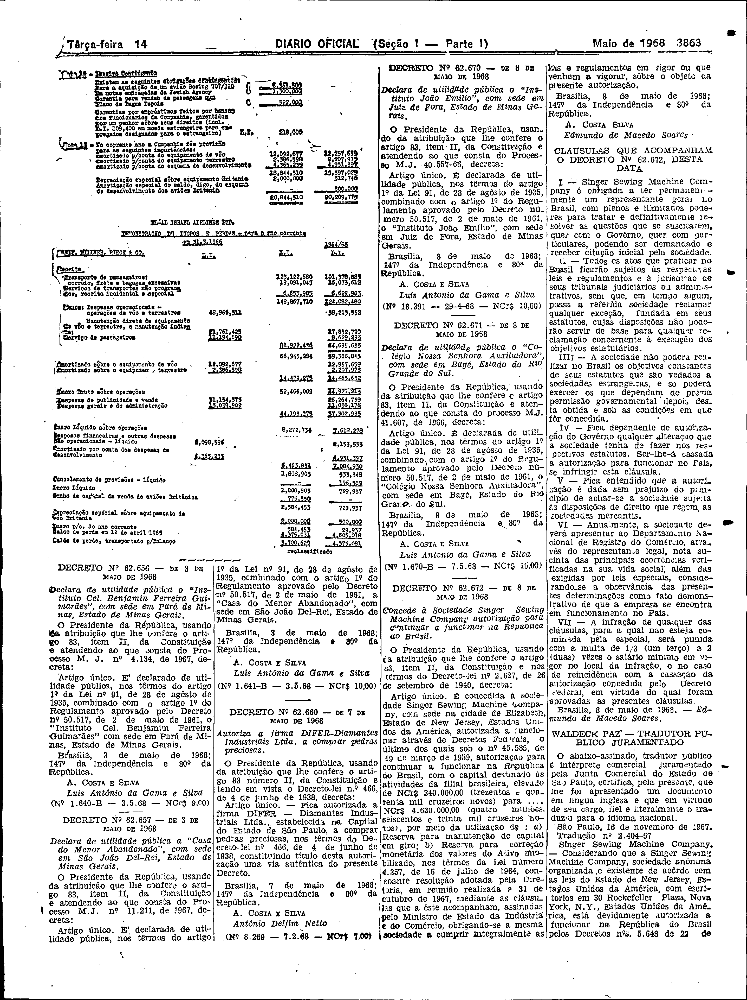

###DEC-062672-0-000-08-05-1968@@@

<strong>DECRETO Nº 62.672, DE 8 DE MAIO DE 1968.</strong>

<em><strong>Concede à Sociedade Singer Sewing Machine Company autorização para continuar a funcionar na República do Brasil.</strong></em>

<strong>O PRESIDENTE DA REPÚBLICA</strong>, usando da atribuição que lhe confere o artigo 83, item II, da Constituição e nos têrmos do Decreto-lei nº 2.627, de 26 de setembro de 1940,

<strong>DECRETA:</strong>

Artigo único. É concedida à sociedade <em>Singer Sewing Machine Company</em>, com sede na cidade de Elizabeth, Estado de New Jersey, Estados Unidos da América, autorizada a funcionar através de Decretos Federais, o último dos quais sob o nº 45.585, de 19 de março de 1959, autorização para continuar a funcionar na República do Brasil, com o capital destinado às atividades da filial brasileira, elevado de NCr$340.000,00 (trezentos e quarenta mil cruzeiros novos) para NCr$4.630.000,00 (quatro milhões, seiscentos e trinta mil cruzeiros novos), por meio da utilização de: a) Reserva para manutenção de capital em giro; b) Reserva para correção monetária dos valores do Ativo Imobilizado, nos têrmos da Lei número 4.357, de 16 de julho de 1964, consoante resolução adotada pela Diretoria, em reunião realizada a 31 de outubro de 1967, mediante as cláusulas que a êste acompanham, assinadas pelo Ministro de Estado da Indústria do Comércio, obrigando-se a mesma sociedade a cumprir integralmente as leis e regulamentos em vigor ou que venham a vigorar, sôbre o objeto da presente autorização.

Brasília, 8 de maio de 1968; 147º da Independência e 80º da República.

<strong>A. COSTA SILVA</strong>

Edmundo de Macedo Soares

<!-- fac-simile-oficial:inicio -->

## Fac-símile oficial: clausulas

A peça vinculada ao Decreto nº 62.672 é reproduzida nas imagens abaixo, a partir da publicação oficial da Imprensa Nacional. A reprodução é em fac-símile, sem transcrição por OCR nem reconstrução do conteúdo.

As imagens mostram páginas inteiras do Diário Oficial da União e podem conter outras matérias. Essas matérias vizinhas não são atribuídas a este decreto. A peça é identificada pelo seu título e pela referência ao ato nas páginas indicadas.

SHA-256 desta imagem: `6c760d731ada6b1d392908921df57175ec1a404effb8f51b4b1e4dce37cc8eaf`.

Fontes oficiais da publicação:

- [DO_1_19680514_091.PDF](https://biblioteca.in.gov.br/documents/271518/541144/DO_1_19680514_091.PDF/96ee459d-87fd-c03d-9ea9-ee6495e141d9?t=1574885060733&download=true) — SHA-256 do PDF: `86f02a28169dd4da085b983143840200cf67f7c3b2f884a2ef0688aa3b279072`.

<!-- fac-simile-oficial:fim -->
