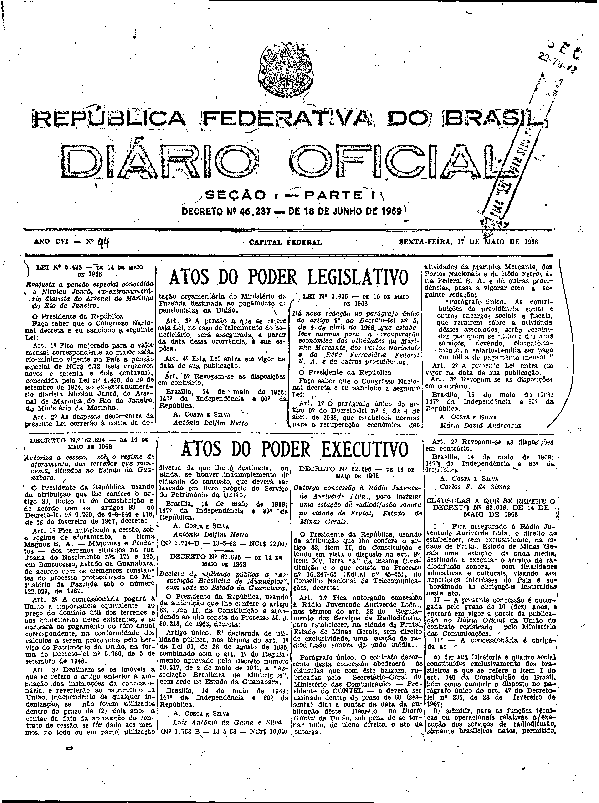
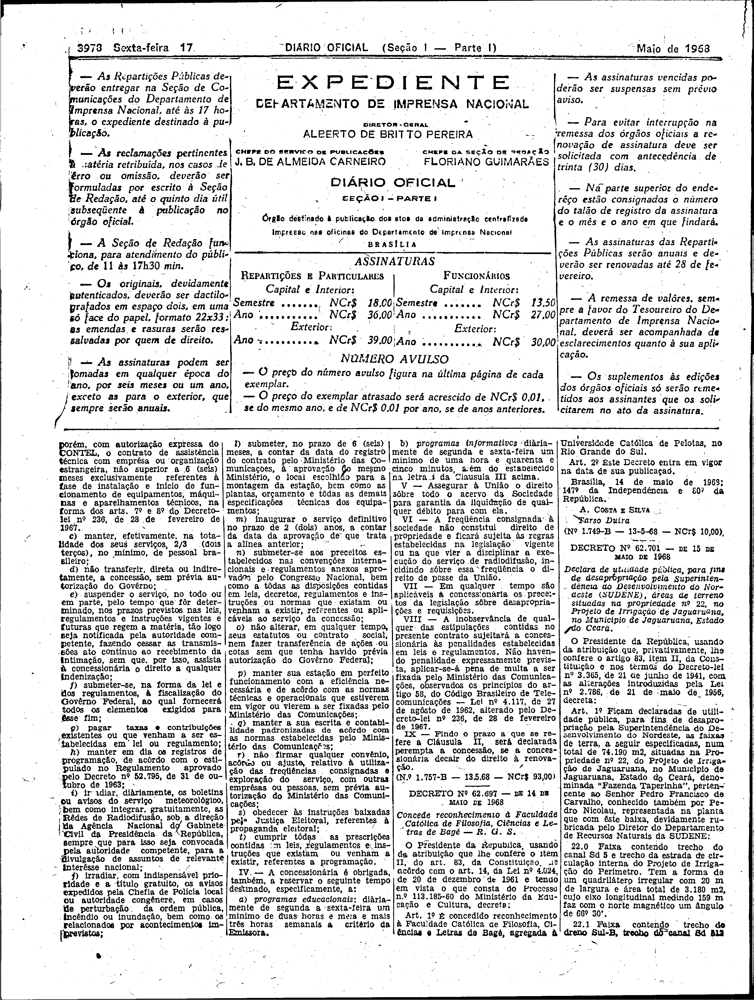

###DEC-062696-0-000-14-05-1968@@@

<strong>DECRETO Nº 62.696, DE 14 DE MAIO DE 1968.</strong>

<em><strong>Outorga concessão à Rádio Juventude Auriverde Ltda., para instalar uma estação de radiodifusão sonora na cidade de Frutal, Estado de Minas Gerais.</strong></em>

<strong>O PRESIDENTE DA REPÚBLICA</strong>, usando da atribuição que lhe confere o artigo 81, item II, da Constituição e tendo em vista o disposto no art. 8º, item XV, letra “<em>a</em>” da mesma Constituição e o que consta no Processo nº 16.247-65 (Edital nº 45-45), do Conselho Nacional de Telecomunicações,

<strong>DECRETA:</strong>

<strong>Art</strong>. 1º Fica outorgada concessão à Rádio Juventude Auriverde Ltda., nos têrmos do art 28 do Regulamento dos Servidores de Radiodifusão, para estabelecer, na cidade de Frutal, Estado de Minas Gerais, sem direito de exclusividade, uma estação de radiodifusão sonora de onda média.

Parágrafo único. O contrato decorrente desta concessão obedecerá as cláusulas que com êste baixam, rubricadas pelo Secretário-Geral do Ministério das Comunicações - Presidente do CONTEL - e deverá ser assinado dentro do prazo de 60 (sessenta) dias a contar da data da publicação dêste Decreto no <em>Diário</em> <em>Oficial</em> da União, sob pena de se tornar nulo, de pleno direito, o ato da outorga.

<strong>Art</strong>. 2º Revogam-se as disposições em contrário.

Brasília, 14 de maio de 1968; 147º da Independência e 80º da República.

<strong>A. COSTA E SILVA</strong>

Carlos F. de Simas

<!-- fac-simile-oficial:inicio -->

## Fac-símile oficial: cláusulas

O texto acima não inclui as cláusulas a que se refere este decreto. A publicação oficial do anexo está em imagem, nas páginas do _Diário Oficial da União_ (Seção I) de 17 de maio de 1968: página 1 do PDF (capa do caderno) (a partir de «CLÁUSULAS A QUE SE REFERE O DECRETO Nº 62.696, DE 14 DE MAIO DE 1968»); página 2 do PDF (até «Nº 1.757-B — 13.5.68 — NCr$ 93,00»).

As imagens são as páginas inteiras, tal como digitalizadas pela Imprensa Nacional, sem recorte, sem redesenho e sem transcrição. Cada página traz também outros atos do mesmo dia; a peça deste decreto está apenas no trecho indicado, e o texto do anexo só existe na imagem. Não há OCR validado.

Fonte: Imprensa Nacional, Biblioteca Machado de Assis, arquivo `DO_1_19680517_094.PDF` (SHA-256 `21b61edd39d4a78dd896e819f8102ba68f8f42a2914ad785c98134e053376d0b`), páginas 1, 2 do PDF. SHA-256 das imagens, na ordem: `4a6c09fda114c83780e3dc4f734893febc445c495dc1c638a34f3c975eaf04f2`, `b1fb1e8681dd58c2b2e1e27ef97fc375300ccb716e379983a6dfe15e08dc0649`.

<!-- fac-simile-oficial:fim -->
