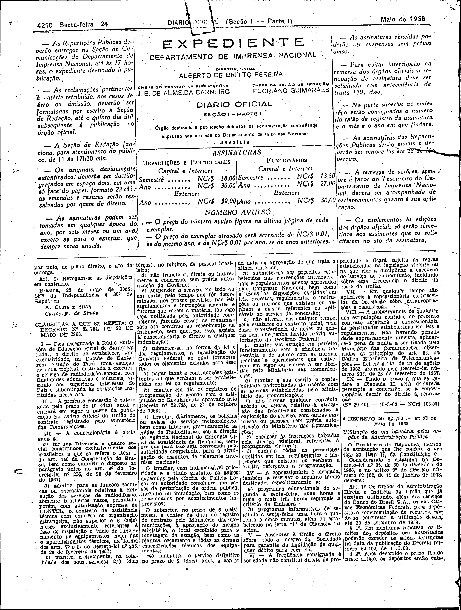

###DEC-062754-0-000-22-05-1968@@@

<strong>DECRETO Nº 62.754, DE 22 DE MAIO DE 1968.</strong>

<em><strong>Outorga concessão à Rádio Emissôra de Educação Rural de Santarém Ltda., para estabelecer uma estação de radiodifusão sonora na Cidade de Santarém, Estado do Pará.</strong></em>

<strong>O PRESIDENTE DA REPÚBLICA</strong>, usando da atribuição que lhe confere o artigo 83, item II, da Constituição e tendo em vista o disposto no artigo 8º, item XV, letra “<em>a</em>” da mesma Constituição e o que consta no Processo nº 51.293-64 (Edital nº 27-65), do Conselho Nacional de Telecomunicações,

<strong>DECRETA:</strong>

<strong>Art</strong>. 1º. Fica outorgada concessão à Rádio Emissora de Educação Rural de Santarém Ltda., nos têrmos do art. 28 do Regulamento dos Serviços de Radiodifusão, para estabelecer, na Cidade de Santarém, Estado do Pará, sem direito de exclusividade, uma estação de radiodifusão sonora de onda tropical.

Parágrafo único. O contrato decorrente desta concessão obedecerá as cláusulas que com êste baixam, rubricadas pelo Secretário-Geral do Ministério das Comunicações – Presidente do CONTEL – e deverá ser assinado dentro do prazo de 60 (sessenta) dias a contar da data da publicação dêste Decreto no <em>Diário Oficial</em> da União, sob pena de se tornar nulo, de pleno direito, o ato da outorga.

<strong>Art</strong>. 2º Revogam-se as disposições em contrário.

Brasília, 22 de maio de 1968; 147º da Independência e 80º da República.

<strong>A. COSTA E SILVA</strong>

Carlos F. de Simas

<!-- fac-simile-oficial:inicio -->

## Fac-símile oficial: cláusulas

O texto acima não inclui as cláusulas a que se refere este decreto. A publicação oficial do anexo está em imagem, nas páginas do _Diário Oficial da União_ (Seção I) de 24 de maio de 1968: página 2 do PDF (a partir de «CLÁUSULAS A QUE SE REFERE O DECRETO Nº 62.754, DE 22 DE MAIO DE 1968», até «Nº 20.401 — 15-5-68 — NCr$ 103,00»).

As imagens são as páginas inteiras, tal como digitalizadas pela Imprensa Nacional, sem recorte, sem redesenho e sem transcrição. Cada página traz também outros atos do mesmo dia; a peça deste decreto está apenas no trecho indicado, e o texto do anexo só existe na imagem. Não há OCR validado.

Fonte: Imprensa Nacional, Biblioteca Machado de Assis, arquivo `DO_1_19680524_099.PDF` (SHA-256 `bffe44749e8abc85c71186d302b55f176a8a3c6b7397a113a326406cecf7fd7b`), páginas 2 do PDF. SHA-256 das imagens, na ordem: `d493c73a200edd775e61591d812ee50f4e731a0cac78bc234907383e649b7817`.

<!-- fac-simile-oficial:fim -->
