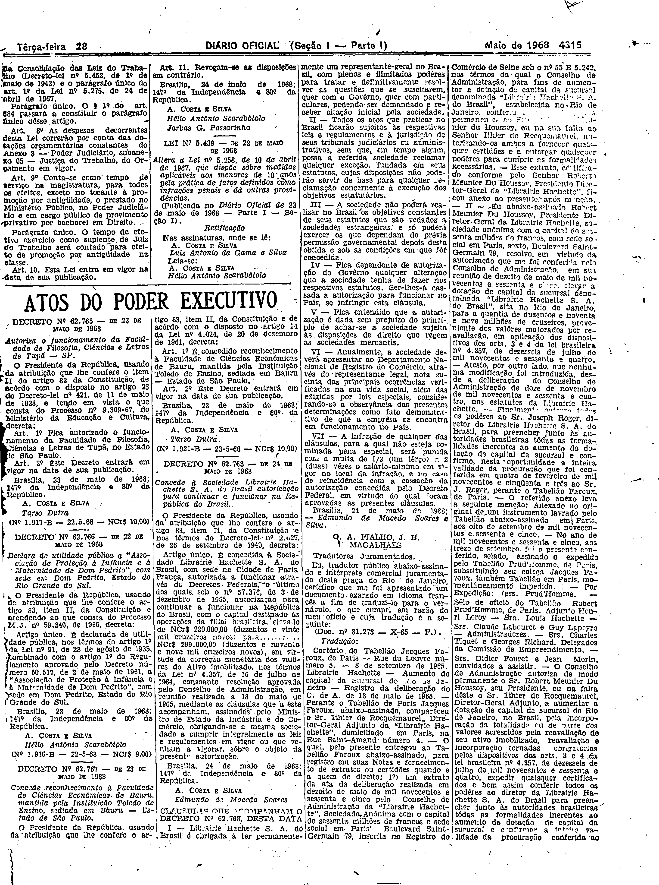

###DEC-062768-0-000-24-05-1968@@@

<strong>DECRETO Nº 62.768, DE 24 DE MAIO DE 1968.</strong>

<em><strong>Concede à Sociedade Librairie Hachette S.A. do Brasil autorização para continuar a funcionar na República do Brasil.</strong></em>

<strong>O PRESIDENTE DA REPÚBLICA</strong>, usando da atribuição que lhe confere o artigo 83, item II, da Constituição e nos têrmos do Decreto-lei nº 2.627, de 26 de setembro de 1940,

<strong>DECRETA:</strong>

Artigo único. É concedida à Sociedade <em>Librairie Hachette</em> S.A. do Brasil, com sede na Cidade de París, França, autorizada a funcionar através do Decretos Federais, o último dos quais sob o nº 57.376, de 3 de dezembro de 1965, autorização para continuar a funcionar na República do Brasil, com o capital destinado às operações da filial brasileira, elevado de NCr$220.000,00 (duzentos e vinte mil cruzeiros novos) para NCr$299.000,00 (duzentos e noventa e nove mil cruzeiros novos), em virtude da correção monetária dos valôres do Ativo imobilizado, nos têrmos da Lei nº 4.357, de 16 de julho de 1964, consoante resolução aprovada pelo Conselho de Administração, em reunião realizada a 18 de maio de 1965, mediante as cláusulas que a êste acompanham, assinadas pelo Ministro de Estado da Indústria e do Comércio, obrigando-se a mesma sociedade a cumprir integralmente as leis e regulamentos em vigor ou que venham a vigora, sôbre o objeto da presente autorização.

Brasília, 24 de maio de 1968; 147º da Independência e 80ºa República.

<strong>A. COSTA E SILVA</strong>

Edmundo de Macedo Soares

<!-- fac-simile-oficial:inicio -->

## Fac-símile oficial: clausulas

A peça vinculada ao Decreto nº 62.768 é reproduzida nas imagens abaixo, a partir da publicação oficial da Imprensa Nacional. A reprodução é em fac-símile, sem transcrição por OCR nem reconstrução do conteúdo.

As imagens mostram páginas inteiras do Diário Oficial da União e podem conter outras matérias. Essas matérias vizinhas não são atribuídas a este decreto. A peça é identificada pelo seu título e pela referência ao ato nas páginas indicadas.

SHA-256 desta imagem: `7bd613751da25a2a745777fe8dab79699b8ca7a30010337caf172e16aa2e122c`.

Fontes oficiais da publicação:

- [DO_1_19680528_101.PDF](https://biblioteca.in.gov.br/documents/271518/541144/DO_1_19680528_101.PDF/edd7e45a-d47d-7c54-644d-12bb2581b137?t=1574885159237&download=true) — SHA-256 do PDF: `a2d15c7219369d990742915151b122f06b084ec58f57cf51a85b84499d01738d`.

<!-- fac-simile-oficial:fim -->
