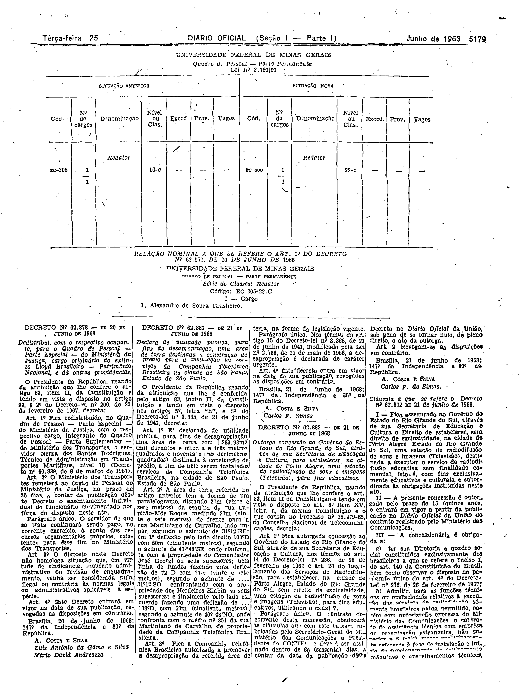
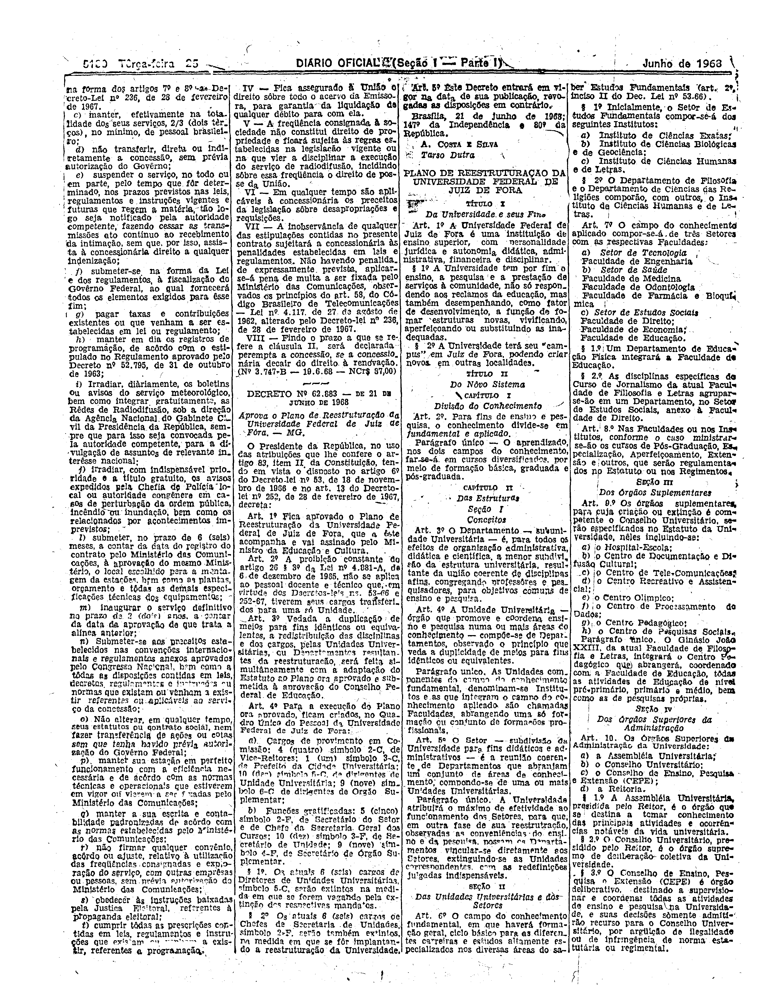

###DEC-062882-0-000-21-06-1968@@@

<strong>DECRETO Nº 62.882, DE 21 DE JUNHO DE 1968.</strong>

<em><strong>Outorga concessão ao Govêrno do Estado do Rio Grande do Sul, através de sua Secretária de Educação e Cultura para estabelecer na cidade de Pôrto Alegre uma estação de radiodifusão de sons e imagens (Televisão), para fins educativos.</strong></em>

<strong>O PRESIDENTE DA REPÚBLICA</strong>, usando da atribuição que lhe confere o art. 83, item ll, da Constituição e tendo em vista o disposto no art. 8º item XV, letra <em>a</em>, da mesma Constituição e o que consta no Processo nº 15.479-65, do Conselho Nacional de Telecomunicações,

<strong>DECRETA:</strong>

<strong>Art</strong><em>.</em> 1º Fica autorgada concessão ao Govêrno do Estado do Rio Grande do Sul, através de sua Secretária de Educação e Cultura, nos têrmos do art. 14 do Decreto-lei nº 236, de 28 de fevereiro de 1967 e art. 28 do Regulamento dos Serviços da Radiodifusão, para estabelecer, na cidade de Pôrto Alegre, Estado do Rio Grande do Sul sem direito de exclusividade, uma estação de radiodifusão de sons e imagens (Televisão), para fins educativos, utilizando o canal 7.

Parágrafo único. O contrato decorrente desta concessão, obedecerá às cláusulas que com êste baixam rubricadas pelo Secretário-Geral do Ministério das Comunicações e Presidente do CONTEL e deverá ser assinado dentro de 60 (sessenta) dias, a contar da data da publicação dêste Decreto no <em>Diário</em> <em>Oficial</em> da União sob pena de se tornar nulo, de pleno direito, o ato da outorgada.

<strong>Art</strong>. 2º Revogam-se as disposições em contrário.

Brasília, 21 de junho de 1968; 147º da Independência e 80º da República.

<strong>A. COSTA E SILVA</strong>

Carlos F de Simas

<!-- fac-simile-oficial:inicio -->

## Fac-símile oficial: cláusulas

O texto acima não inclui as cláusulas a que se refere este decreto. A publicação oficial do anexo está em imagem, nas páginas do _Diário Oficial da União_ (Seção I) de 25 de junho de 1968: página 11 do PDF (a partir de «Cláusula a que se refere o Decreto nº 62.872 de 21 de junho de 1968», cabeçalho impresso com o número «62.872», que difere do número «62.882» do decreto impresso na mesma página, e a cláusula I trata da mesma concessão ao Governo do Estado do Rio Grande do Sul); página 12 do PDF (até «Nº 3.747-B — 19-6-68 — NCr$ 87,00»).

As imagens são as páginas inteiras, tal como digitalizadas pela Imprensa Nacional, sem recorte, sem redesenho e sem transcrição. Cada página traz também outros atos do mesmo dia; a peça deste decreto está apenas no trecho indicado, e o texto do anexo só existe na imagem. Não há OCR validado.

Fonte: Imprensa Nacional, Biblioteca Machado de Assis, arquivo `DO_1_19680625_120.PDF` (SHA-256 `b895c63eee11627afcb96e00d8c4b8715630d8fd604bb58ad31e39728901e5f9`), páginas 11, 12 do PDF. SHA-256 das imagens, na ordem: `f74ef9bec11a39da9ff85d349af715e44c5561c31ed59888c528ba982934c476`, `3a3d6897204866c8d25eb92c0529030da99ac1e29f7e52b970e11b5f08376f13`.

<!-- fac-simile-oficial:fim -->
