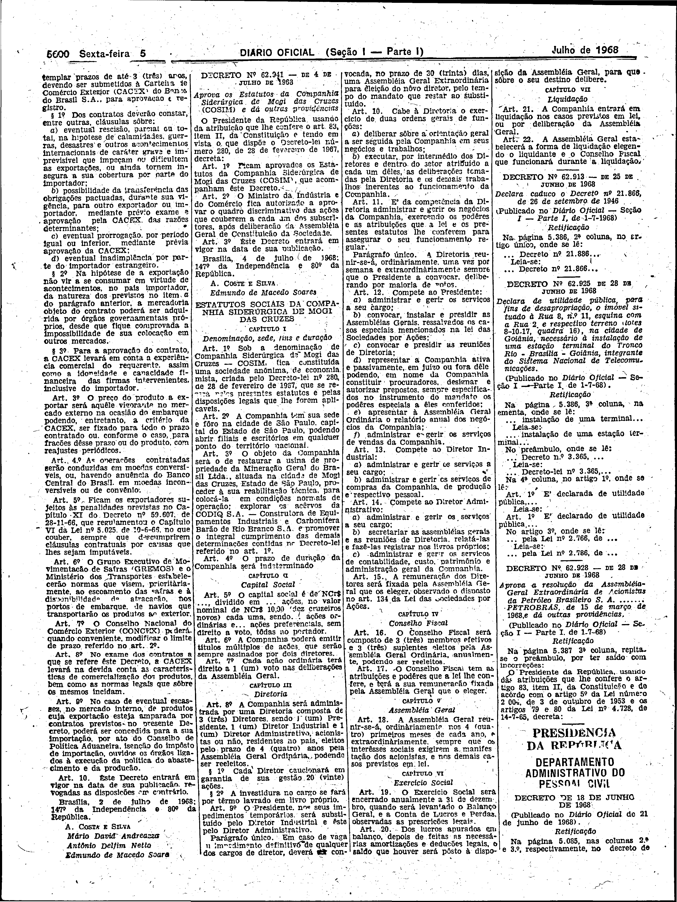

###DEC-062941-0-000-04-07-1968@@@

<strong>DECRETO Nº 62.941, DE 4 DE JULHO DE 1968.</strong>

<em><strong>Aprova os Estatutos da Companhia Siderúrgica de Mogi das Cruzes (COSIM) e dá outras providências.</strong></em>

<strong>O PRESIDENTE DA REPÚBLICA</strong>, usando da atribuição que lhe confere o art. 83, item II, da Constituição e tendo em vista o que dispõe o Decreto-lei número 280, de 28 de fevereiro de 1967,

<strong>DECRETA:</strong>

<strong>Art</strong>. 1º Ficam aprovados os Estatutos da Companhia Siderúrgica de Mogi das Cruzes (COSIM), que acompanham êste Decreto.

<strong>Art</strong>. 2º O Ministério da Indústria e do Comércio fica autorizado a aprovar o quadro discriminativo das ações que couberem a cada um dos subscritores, após deliberação da Assembléia Geral de Constituição da Sociedade.

<strong>Art</strong>. 3º Êste Decreto entrará em vigor na data de sua publicação.

Brasília, 4 de julho de 1968; 147º da Independência e 80º da República.

<strong>A. COSTA E SILVA</strong>

Edmundo de Macedo Soares

<!-- fac-simile-oficial:inicio -->

## Fac-símile oficial: estatuto

A peça vinculada ao Decreto nº 62.941 é reproduzida nas imagens abaixo, a partir da publicação oficial da Imprensa Nacional. A reprodução é em fac-símile, sem transcrição por OCR nem reconstrução do conteúdo.

As imagens mostram páginas inteiras do Diário Oficial da União e podem conter outras matérias. Essas matérias vizinhas não são atribuídas a este decreto. A peça é identificada pelo seu título e pela referência ao ato nas páginas indicadas.

SHA-256 desta imagem: `6a1c87aa237c98001337c3c994f2fc6c9c5c5043039c318e073bc98df6e1449f`.

Fontes oficiais da publicação:

- [DO_1_19680705_128.PDF](https://biblioteca.in.gov.br/documents/271518/541144/DO_1_19680705_128.PDF/9df9a740-d4b5-ecae-3f24-c3a4ef58e4a8?t=1574885394670&download=true) — SHA-256 do PDF: `41085b4633865ff0c065e498e0e267ab99cfaa23369fb556eed1152f55b9f546`.

<!-- fac-simile-oficial:fim -->
