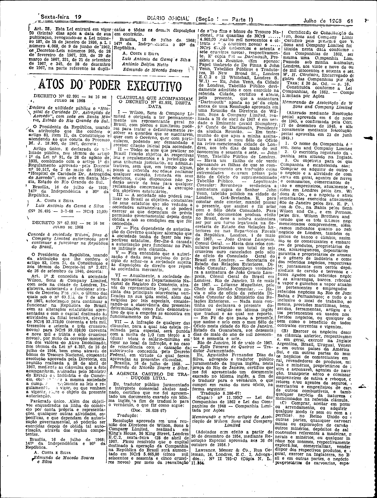

###DEC-062992-0-000-16-07-1968@@@

<strong>DECRETO Nº 62.992, DE 16 DE JULHO DE 1968.</strong>

<em><strong>Concede à sociedade Wilson, Sons & Company Limited autorização para continuar a funcionar na República do Brasil.</strong></em>

<strong>O PRESIDENTE DA REPÚBLICA</strong>, usando da atribuição que lhe confere o artigo 83, item II, da Constituição e nos têrmos do Decreto-lei nº 2.627, de 26 de setembro de 1940,

<strong>DECRETA:</strong>

<strong>Art</strong>. 1º É concedida à sociedade Wilson, Sons & <em>Company Limited</em>, com sede na cidade de Londres, Inglaterra, autorizada a funcionar através de Decretos Federais, o último dos quais sob o nº 60.556, de 7 de abril de 1967, autorização para continuar a funcionar na República do Brasil, com as alterações estatuárias apresentadas em o capital destinado às atividades da filial brasileira, elevado de NCr$93.373,00 (noventa e três mil, trezentos e setenta e três cruzeiros novos) para NCr$99.038,00 (noventa e nove mil e trinta e oito cruzeiros novos), por meio da correção monetária dos valôres do Ativo Imobilizado, nos têrmos da Lei nº 4.357, de 16 de julho de 1964, bem como através de bônus do Tesouro Nacional, consoante resolução aprovada pela Diretoria, em reunião realizada a 28 de abril de 1967, mediante as cláusulas que a êste acompanham, assinadas pelo Ministro de Estado da Indústria e do Comércio obrigando-se a mesma sociedade a cumprir integralmente as leis e regulamentos em vigor, ou que venham a vigorar sôbre o objeto da presente autorização.

Parágrafo único. Além dos objetivos enquadrados na linha do comércio por conta própria e representações quaisquer outras atividades, específicas, e que dependam de autorização governamental, só poderão ser exercidas depois de obtida tal autorização, através dos órgãos competentes.

Brasília, 16 de julho de 1968; 147º da Independência e 80º da República.

<strong>A. COSTA E SILVA</strong>

Edmundo de Macedo Soares e Silva

<!-- fac-simile-oficial:inicio -->

## Fac-símile oficial: clausulas

A peça vinculada ao Decreto nº 62.992 é reproduzida nas imagens abaixo, a partir da publicação oficial da Imprensa Nacional. A reprodução é em fac-símile, sem transcrição por OCR nem reconstrução do conteúdo.

As imagens mostram páginas inteiras do Diário Oficial da União e podem conter outras matérias. Essas matérias vizinhas não são atribuídas a este decreto. A peça é identificada pelo seu título e pela referência ao ato nas páginas indicadas.

Reprodução das cláusulas I–VII, completas na coluna 2 da página 3 do PDF (6123 por inferência), até a assinatura de Edmundo de Macedo Soares e Silva. O memorando e os artigos de associação publicados nas páginas seguintes não são apresentados como parte dessas cláusulas.

SHA-256 desta imagem: `67806fa55bc6350bd360f67a549a469f901113ecf13d9a973aa220ee9e13c6cf`.

Fontes oficiais da publicação:

- [DO_1_19680719_138.PDF](https://biblioteca.in.gov.br/documents/271518/541144/DO_1_19680719_138.PDF/fae84fd4-50a1-93f2-ad62-0434464f9583?t=1574885523563&download=true) — SHA-256 do PDF: `69e451464eafd9b50f85f77b5f2a2ed6b6373d2578e0aa36ec466bf2dc1e6b2a`.

<!-- fac-simile-oficial:fim -->
