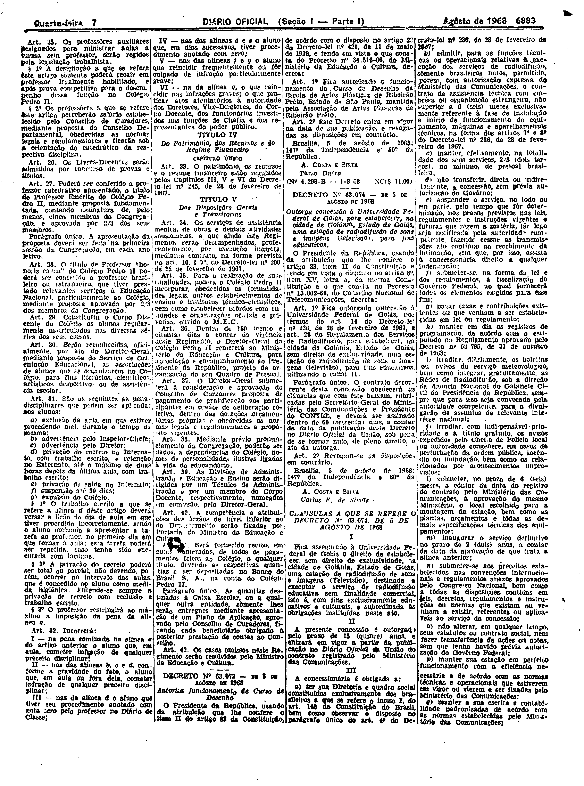
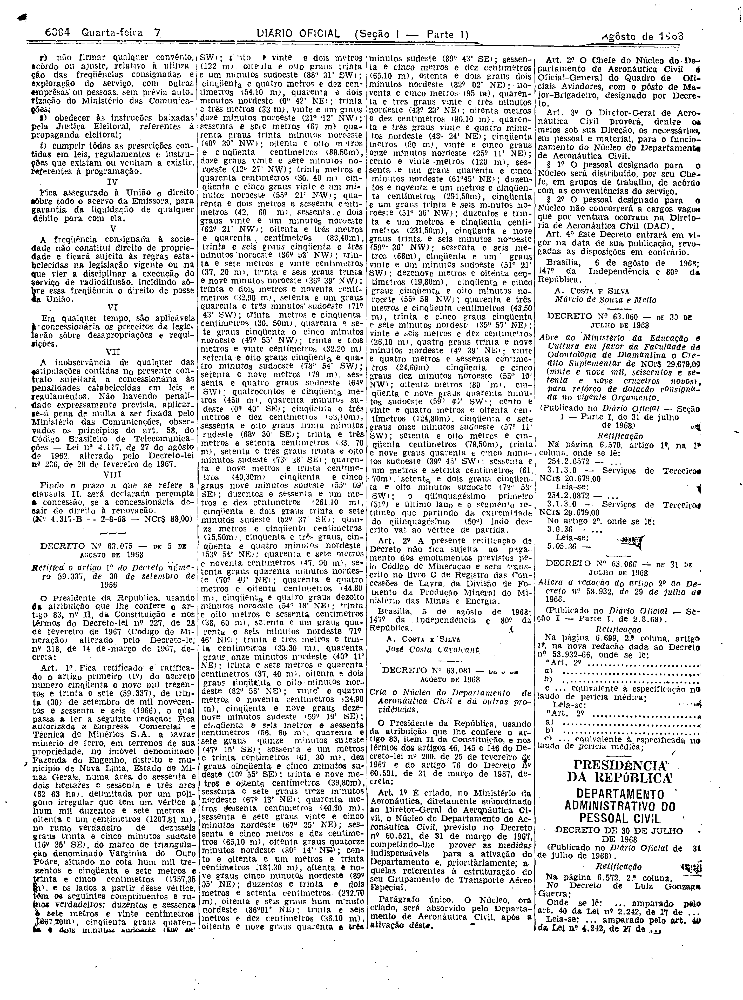

###DEC-063074-0-000-05-08-1968@@@

<strong>DECRETO Nº 63.074, DE 5 DE AGÔSTO DE 1968.</strong>

<em><strong>Outorga concessão à Universidade Federal de Goiás, para estabelecer, na cidade de Goiânia, Estado de Goiás, uma estação de radiodifusão de sons e imagens (televisão), para fins educativos.</strong></em>

<strong>O PRESIDENTE DA REPÚBLICA</strong>, usando da atribuição que lhe confere o artigo 83, item II da Constituição e tendo em vista o disposto no artigo 8º, item XV, letra <em>a</em>, da mesma Constituição e o que consta no Processo nº 15.002-66, do Conselho Nacional de Telecomunicações,

<strong>DECRETA:</strong>

<strong>Art</strong>. 1º Fica outorgada concessão à Universidade Federal de Goiás, nos têrmos do art. 14 do Decreto-lei nº 236, de 28 de fevereiro de 1967, e art. 28 do Regulamento dos Serviços de Radiodifusão, para estabelecer, na cidade de Goiânia, Estado de Goiás, sem direito de exclusividade, uma estação de radiodifusão de sons e imagens (televisão), para fins educativos, utilizando o canal 11.

Parágrafo único. O contrato decorrente desta concessão obedecerá as cláusulas que com êste baixam, rubricadas pelo Secretário-Geral do Ministério das Comunicações e Presidente do CONTEL, e deverá ser assinado dentro de 60 (sessenta) dias, a contar da data da publicação dêste Decreto no <em>Diário</em> <em>Oficial</em> da União, sob pena de se tornar nulo, de pleno direito, o ato da outorga.

<strong>Art</strong>. 2º Revogam-se as disposições em contrário.

Brasília, 5 de agôsto de 1968; 147º da Independência e 80º da República.

<strong>A. COSTA E SILVA</strong>

Carlos F. de Simas

<!-- fac-simile-oficial:inicio -->

## Fac-símile oficial: cláusulas

O texto acima não inclui as cláusulas a que se refere este decreto. A publicação oficial do anexo está em imagem, nas páginas do _Diário Oficial da União_ (Seção I) de 7 de agosto de 1968: página 3 do PDF (a partir de «CLÁUSULAS A QUE SE REFERE O DECRETO Nº 63.074, DE 5 DE AGOSTO DE 1968»); página 4 do PDF (até «Nº 4.317-B — 2-8-68 — NCr$ 88,00»).

As imagens são as páginas inteiras, tal como digitalizadas pela Imprensa Nacional, sem recorte, sem redesenho e sem transcrição. Cada página traz também outros atos do mesmo dia; a peça deste decreto está apenas no trecho indicado, e o texto do anexo só existe na imagem. Não há OCR validado.

Fonte: Imprensa Nacional, Biblioteca Machado de Assis, arquivo `DO_1_19680807_151.PDF` (SHA-256 `9c6676648bc1f8e6a08beb5e47e06d5e475b8ec9c24381f4edf3bd5e0ac000e7`), páginas 3, 4 do PDF. SHA-256 das imagens, na ordem: `beb1789997df1f886845ae2f8e8c082ec981db3b8b1a054e20e4aca69ca2979e`, `01d95ebdfcc321befc60d94ff588f781f4624195edd7a7fdbe6f818d22240437`.

<!-- fac-simile-oficial:fim -->
