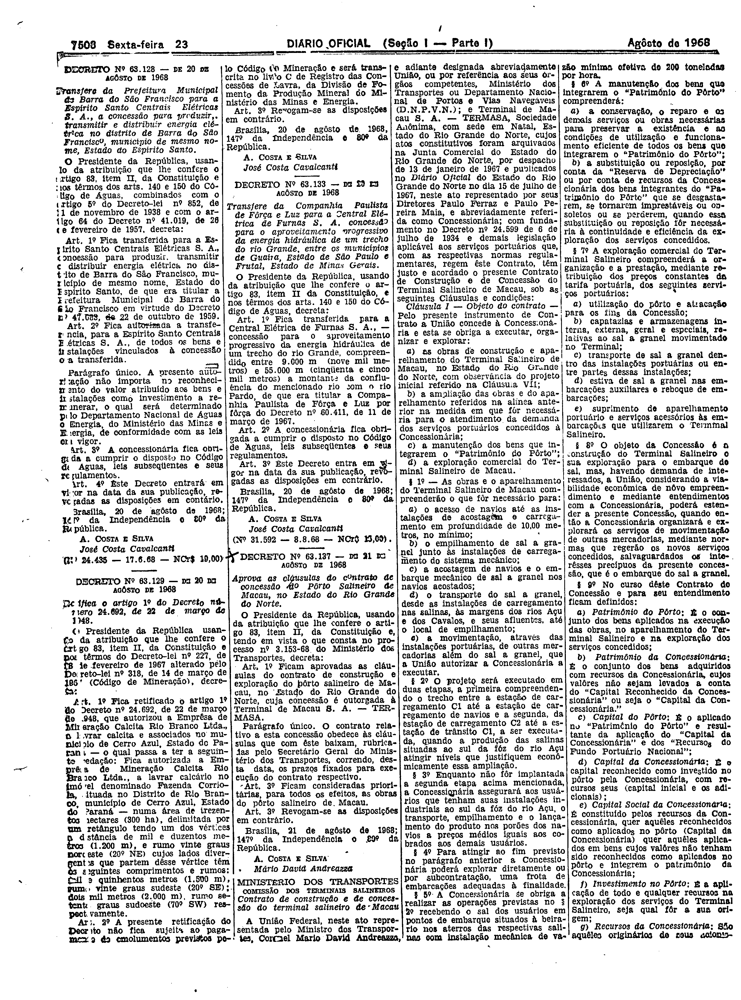
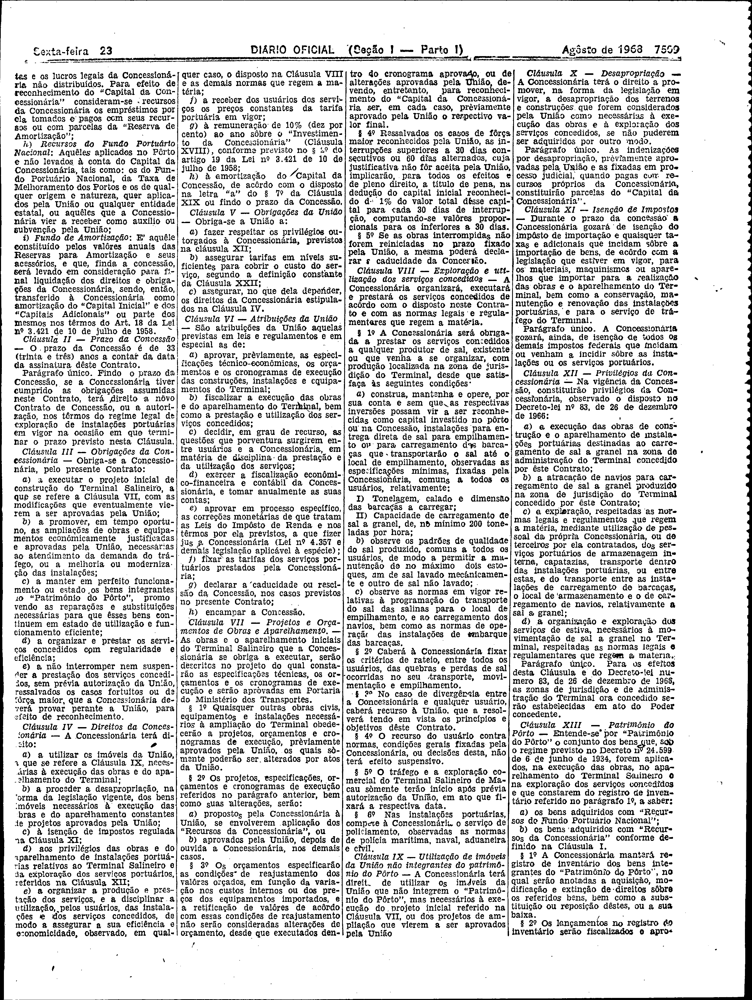
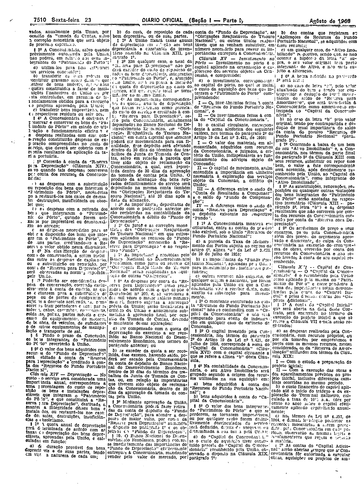
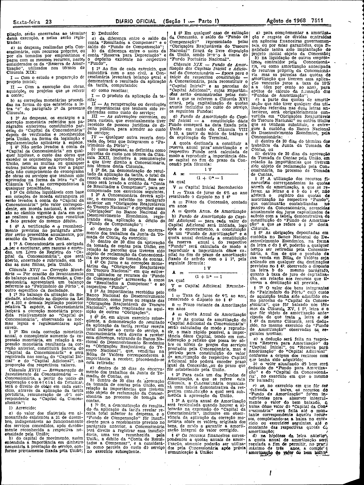
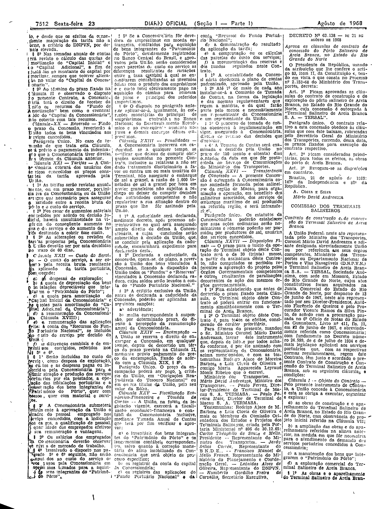

###DEC-063137-0-000-21-08-1968@@@

<strong>DECRETO Nº 63.137, DE 21 DE AGÔSTO DE 1968.</strong>

<em><strong>Aprova as cláusulas do contrato de concessão do Porto Salineiro de Macau, no Estado do Rio Grande do Norte.</strong></em>

<strong>O PRESIDENTE DE REPUBLICA</strong>, usando da atribuição que lhe confere o artigo 83, item II, da Constituição e, tendo em vista o que consta no processo nº 3.153-68 do Ministério dos Transportes,

<strong>DECRETA;</strong>

<strong>Art</strong>. 1º Ficam aprovados as clausulas do contrato de construção do pôrto salineiro de Macau, no Estado do Rio Grande do Norte, cuja concessão é outorgada à Terminal de Macau S.A. - TERMASA.

Parágrafo único. O contrato relativo e esta concessão obedece às cláusulas que com êste baixam, rubricadas pelo Secretario Geral do Ministério dos Transportes, correndo, desta data, prazo fixados para execução dos contrato respectivo.

<strong>Art</strong>. 2º Ficam consideradas prioritárias, para todos os efeitos, as obras do pôrto salineiro de Macau.

<strong>Art</strong>. 3º Revogam-se as disposições em contrário.

Brasília, 21 de agôsto de 1968; 147º da Independência e 80º da República.

<strong>A. COSTA E SILVA</strong>

Mário David Andreazza

As cláusulas do contrato mencionadas no art. 1º foram publicadas no <em>D.O.</em> de 22-8-68.

<!-- fac-simile-oficial:inicio -->

## Fac-símile oficial: cláusulas

O texto acima não inclui as cláusulas a que se refere este decreto. A publicação oficial do anexo está em imagem, nas páginas do _Diário Oficial da União_ (Seção I) de 23 de agosto de 1968: página 4 do PDF (a partir de «Contrato de construção e de concessão do terminal salineiro de Macau», Comissão dos Terminais Salineiros); página 5 do PDF (continuação do contrato); página 6 do PDF (continuação do contrato); página 7 do PDF (continuação do contrato); página 8 do PDF (até «Humberto Gordilho Freire de Carvalho, Secretário Executivo»).

As imagens são as páginas inteiras, tal como digitalizadas pela Imprensa Nacional, sem recorte, sem redesenho e sem transcrição. Cada página traz também outros atos do mesmo dia; a peça deste decreto está apenas no trecho indicado, e o texto do anexo só existe na imagem. Não há OCR validado.

Fonte: Imprensa Nacional, Biblioteca Machado de Assis, arquivo `DO_1_19680823_163.PDF` (SHA-256 `d15414f2a5e672097879cc8b9c4bdea273994dd18c0d28a9ea4a519c83f1afc4`), páginas 4, 5, 6, 7, 8 do PDF. SHA-256 das imagens, na ordem: `d0739ed3ece2f63821552f5774a714687dcf25125d8f8c8add20cca7ca3ef23a`, `fe70b34124f7f964c122f271c491ecc526b1c9a880e28f1600865781428b5548`, `cef94b8b551ae90ad9eca519502da227da42b487386957796844a134f3887388`, `3d646bc66145f96961a03ce63ef4d32793325fc10b155914a8d04cf86e7675e6`, `795a966d737cfeb6c3202ecc6512fc948764ea0025843af19cebbad96911a4e4`.

<!-- fac-simile-oficial:fim -->
