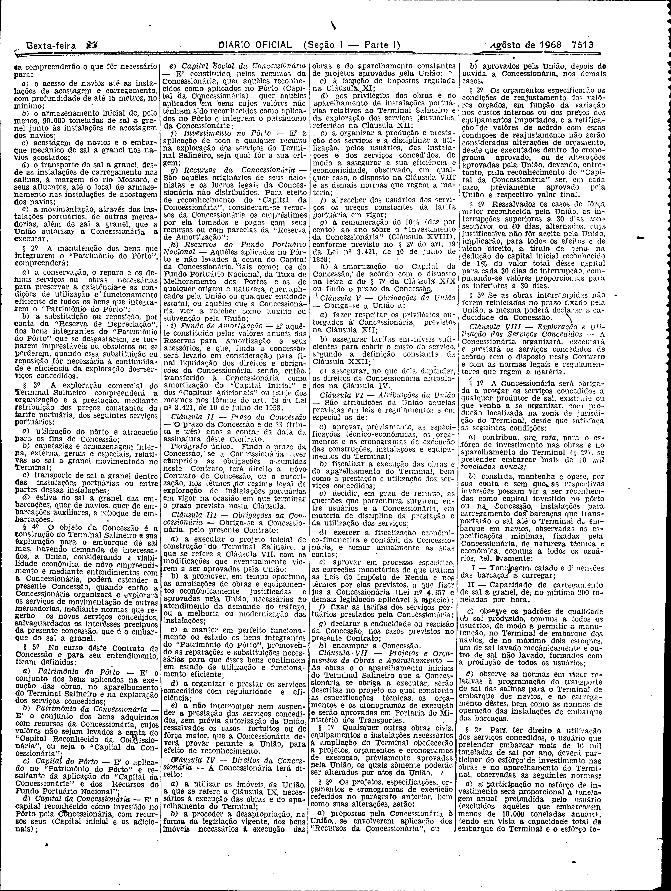
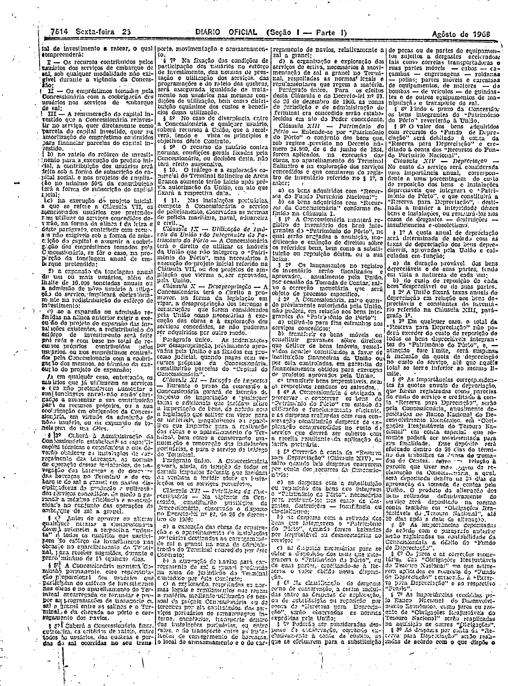
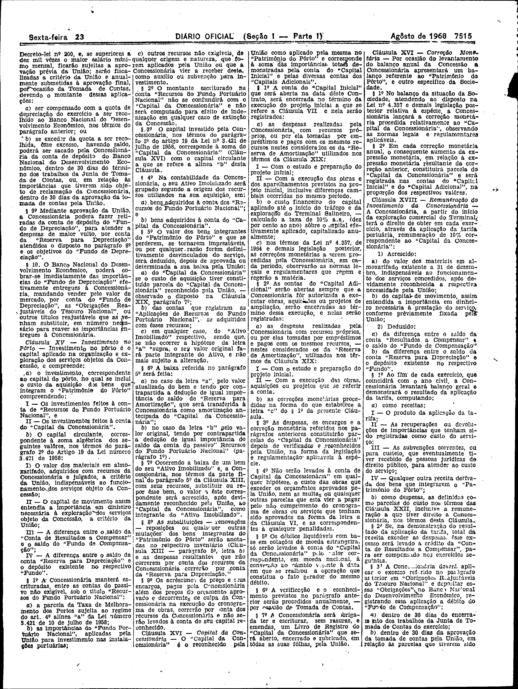
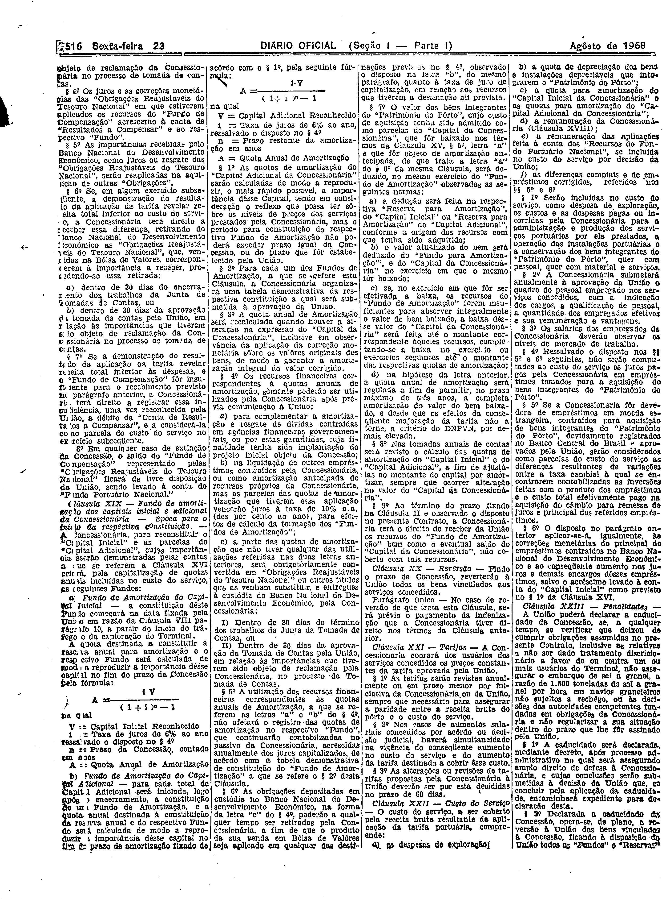
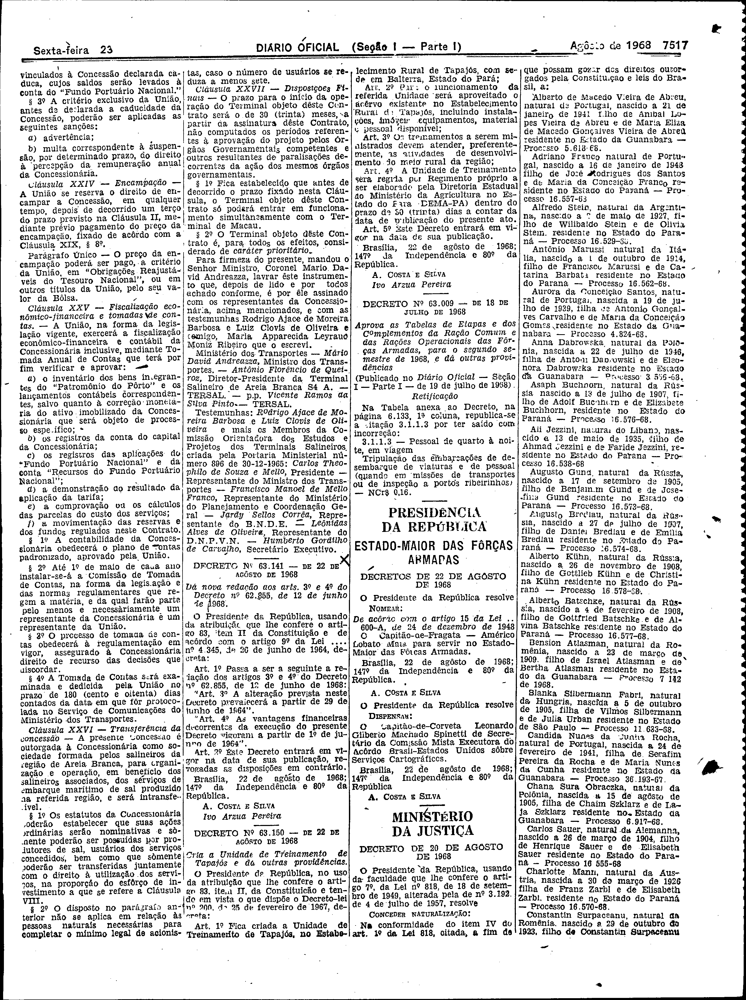

###DEC-063138-0-000-21-08-1968@@@

<strong>DECRETO Nº 63.138, DE 21 DE AGÔSTO DE 1968.</strong>

<em><strong>Aprova as cláusulas de contrato de concessão do Porto Salineiro de Areia Branca, no Estado do Rio Grande do Norte.</strong></em>

<strong>O PRESIDENTE DA REPUBLICA</strong>, usando da atribuição que lhe confere o artigo 83, item II da Constituição e tendo em vista o que consta no Processo nº 153-63 do Ministério dos Transportes,

<strong>DECRETA:</strong>

<strong>Art</strong>. 1º Ficam aprovadas as clausulas do contrato de construção e de exploração do porto salineiro de Areia Branca, no Estado do Rio Grande do Norte, cuja concessão e outorgada à “Terminal Salineiro de Areia Branca S.A. - TERSAL”.

Parágrafo único. O contrato relativo e esta concessão obedece às clausulas que com êste baixam, rubricadas pelo Secretário Geral do Ministério dos Transporte, correndo, desta data, o prazos fixados para execução do contrato respetivo.

<strong>Art</strong>. 2º Ficam consideradas prioritárias, para todos os efeitos, as obras do porto de Areia Branca.

<strong>Art</strong>. 3º Revogam-se as disposições em contrario.

Brasília, 21 de agôsto de 1968; 147º da Independência e 80º da República.

<strong>A. COSTA E SILVA</strong>

Mario David Andreazza

Cláusulas do contrato mencionadas no art. 1º foram publicadas no <em>D.O</em>. de 23-8-68.

<!-- fac-simile-oficial:inicio -->

## Fac-símile oficial: cláusulas

O texto acima não inclui as cláusulas a que se refere este decreto. A publicação oficial do anexo está em imagem, nas páginas do _Diário Oficial da União_ (Seção I) de 23 de agosto de 1968: página 8 do PDF (a partir de «Contrato de construção e de concessão do terminal salineiro de Areia Branca», Comissão dos Terminais Salineiros); página 9 do PDF (continuação do contrato); página 10 do PDF (continuação do contrato); página 11 do PDF (continuação do contrato); página 12 do PDF (continuação do contrato); página 13 do PDF (até «Humberto Gordilho de Carvalho, Secretário Executivo»).

As imagens são as páginas inteiras, tal como digitalizadas pela Imprensa Nacional, sem recorte, sem redesenho e sem transcrição. Cada página traz também outros atos do mesmo dia; a peça deste decreto está apenas no trecho indicado, e o texto do anexo só existe na imagem. Não há OCR validado.

Fonte: Imprensa Nacional, Biblioteca Machado de Assis, arquivo `DO_1_19680823_163.PDF` (SHA-256 `d15414f2a5e672097879cc8b9c4bdea273994dd18c0d28a9ea4a519c83f1afc4`), páginas 8, 9, 10, 11, 12, 13 do PDF. SHA-256 das imagens, na ordem: `795a966d737cfeb6c3202ecc6512fc948764ea0025843af19cebbad96911a4e4`, `06d732a2f51a0b8974b6237a2a45c0f027f87a0e0749e52ff76fe0b962a11266`, `ed10f36053750ae5428f976683885a5a541b7aaf9f67efc99e4822bc40f4023d`, `c0e66b4330a175a269c0f2ba2cccdc79e0901adba61569ee528467dab51e4c95`, `efa00ae2e52e841bbd36c943abd6351b36cfa3d611165718a48f9503bb99cb02`, `77668d59b874d2ed58541bc5e84bc4da20a0298a298e9bb43f10cdbc88983026`.

<!-- fac-simile-oficial:fim -->
