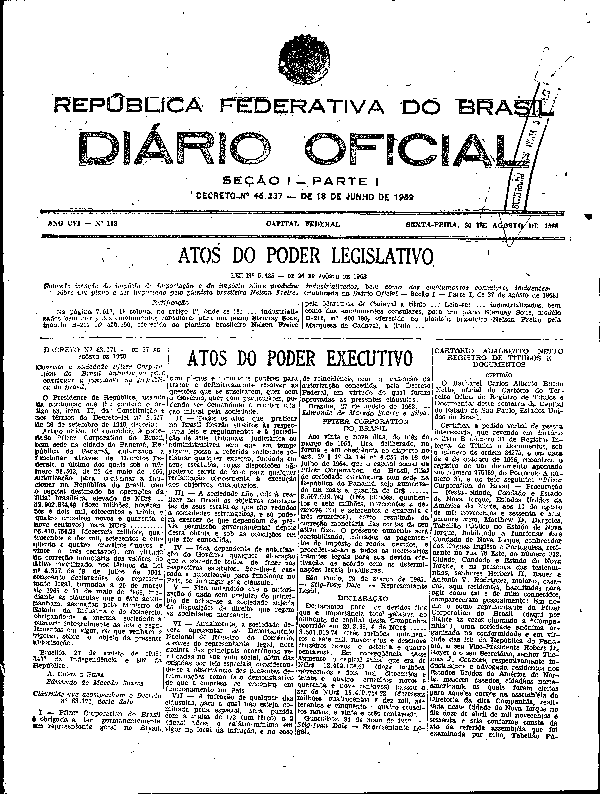

###DEC-063171-0-000-27-08-1968@@@

<strong>DECRETO Nº 63.171, DE 27 DE AGÔSTO DE 1968.</strong>

<em><strong>Concede à sociedade Pfizer Corporation do Brasil autorização para continuar a funcionar na República do Brasil.</strong></em>

<strong>O PRESIDENTE DA REPÚBLICA</strong>, usando da atribuição que lhe confere o artigo 83, item II, da Constituição e nos termos do Decreto-lei nº 2.627, de 26 de setembro de 1940,

<strong>DECRETA:</strong>

Artigo único. É concedida à sociedade <em>Pfizer Corporation</em> do Brasil, com sede na cidade do Panamá, República do Panamá, autorizada a funcionar através de Decretos Federais, o último dos quais sob o número 58.503, de 26 de maio de 1966, autorização para continuar a funcionar na República do Brasil, com o capital destinado às operações da filial brasileira, elevado de NCr$12.902.834,49 (doze milhões, novecentos e dois mil, oitocentos e trinta e quatro cruzeiros novos e quarenta e nove centavos) para NCr$16.410.754,23 (dezesseis milhões, quatrocentos e dez mil, setecentos e cinqüenta e quatro cruzeiros novos e vinte e três centavos), em virtude da correção monetária dos valores do Ativo imobilizado, nos termos da Lei nº 4.357, de 16 de julho de 1964, consoante declarações do representante legal, firmadas a 29 de março de 1965 e 31 de maio de 1968, mediante as cláusulas que a este acompanham, assinadas pelo Ministro de Estado da Indústria e do Comércio, obrigando-se a mesma sociedade a cumprir integralmente as leis e regulamentos em vigor, ou que venham a vigorar, sôbre o objeto da presente autorização.

Brasília, 27 de agôsto de 1968; 147º da Independência e 80º da República.

<strong>A. COSTA E SILVA</strong>

Edmundo de Macedo Soares

<!-- fac-simile-oficial:inicio -->

## Fac-símile oficial: clausulas

A peça vinculada ao Decreto nº 63.171 é reproduzida nas imagens abaixo, a partir da publicação oficial da Imprensa Nacional. A reprodução é em fac-símile, sem transcrição por OCR nem reconstrução do conteúdo.

As imagens mostram páginas inteiras do Diário Oficial da União e podem conter outras matérias. Essas matérias vizinhas não são atribuídas a este decreto. A peça é identificada pelo seu título e pela referência ao ato nas páginas indicadas.

SHA-256 desta imagem: `0926c7a85aab77479e9d8280cf1be0b4f72aabb2153abe4a1747035253584205`.

Fontes oficiais da publicação:

- [DO_1_19680830_168.PDF](https://biblioteca.in.gov.br/documents/271518/541144/DO_1_19680830_168.PDF/8f63035c-6ef6-1ce4-1f83-09b0aec4668e?t=1574885916590&download=true) — SHA-256 do PDF: `f5d8296982bf516f8d1d9ea7b869b690e1f19801810566716a2197dc3f6c0d0a`.

<!-- fac-simile-oficial:fim -->
