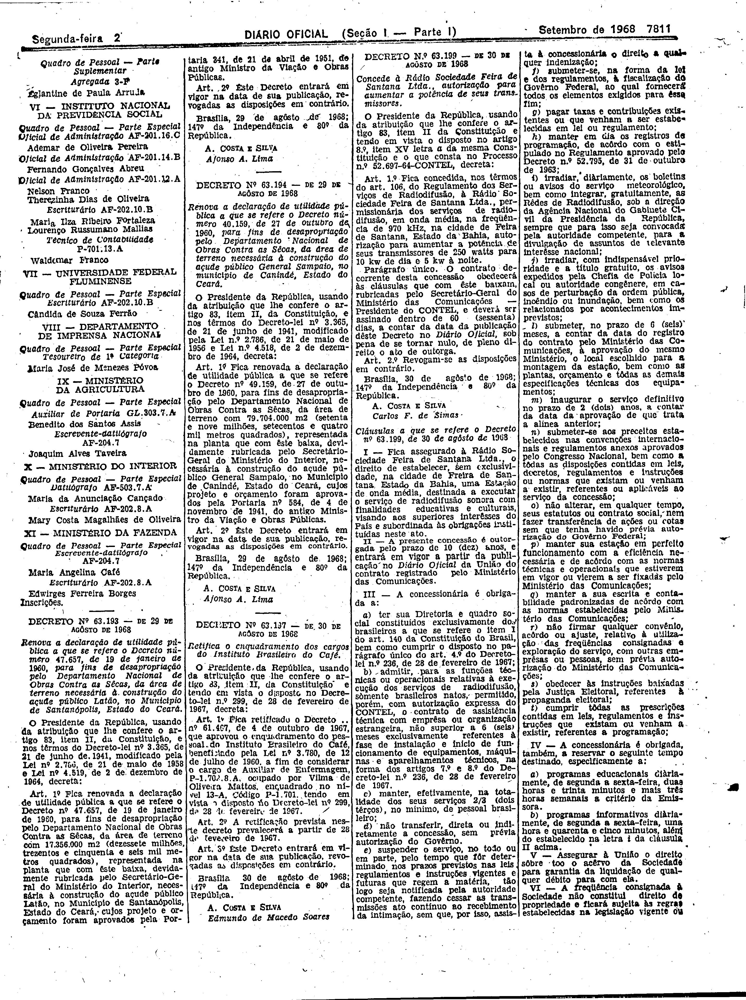
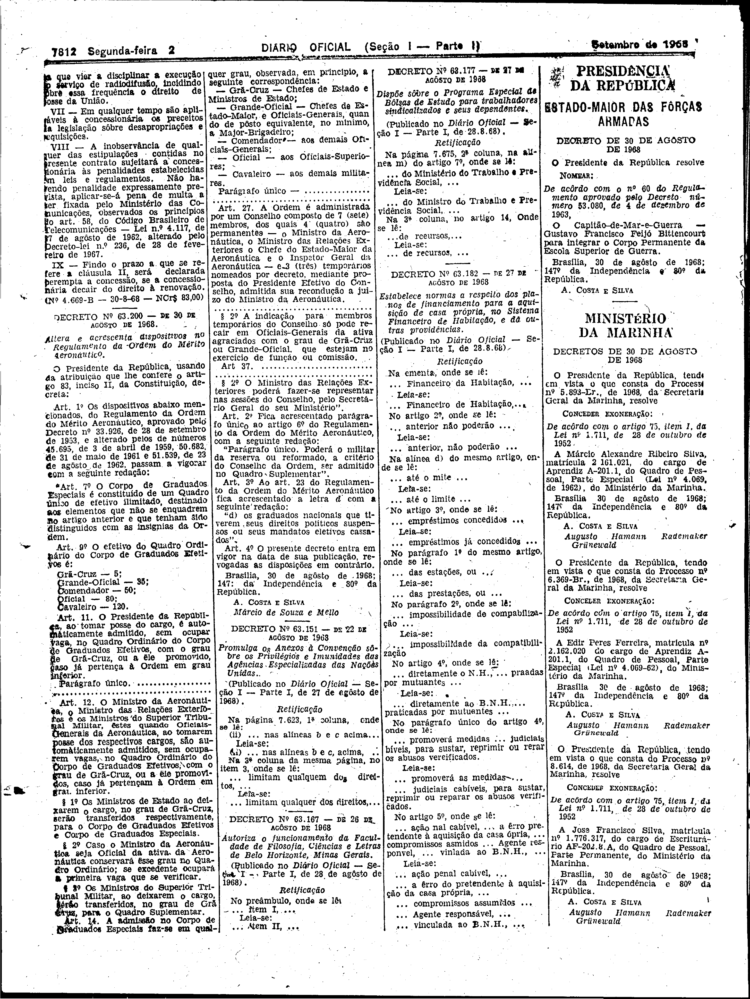

###DEC-063199-0-000-30-08-1968@@@

<strong>DECRETO Nº 63.199, DE 30 DE AGÔSTO DE 1968.</strong>

<em><strong>Concede à Rádio Sociedade Feira de Santana Ltda, autorização para aumentar a potência de seus transmissores.</strong></em>

<strong>O PRESIDENTE DA REPÚBLICA</strong>, usando da atribuição que lhe confere o artigo 83, item II da Constituição e tendo em vista o disposto no artigo 8º, item XV letra <em>a</em> da mesma Constituição e o que consta no Processo nº 52.697-64-CONTEL,

<strong>DECRETA:</strong>

<strong>Art</strong>. 1º Fica concedida, nos têrmos do art. 106, do Regulamento dos Serviços de Radiodifusão, à Rádio Sociedade Feira de Santana Ltda., permissionária dos serviços de radiodifusão, em onda média, na freqüência de 970 kHz, na cidade de Feira de Santana, Estado de Bahia, autorização para aumentar a potência de seus transmissores de 250 watts para 10 kw de dia e 5 kw à noite.

Parágrafo único. O contrato decorrente desta concessão obedecerá às cláusulas que com êste baixam, rubricadas pelo Secretário-Geral do Ministério das comunicações - Presidente do CONTEL, e deverá ser assinado dentro de 60 (sessenta) dias, a contar da data da publicação dêste Decreto no <em>Diário</em> <em>Oficial</em>, sob pena de se tornar nulo, de pleno direito o ato de outorga.

<strong>Art</strong>. 2º Revogam-se as disposições em contrário.

Brasília, 30 de agôsto de 1968; 147º da Independência e 80º da República.

<strong>A. COSTA E SILVA</strong>

Carlos F. de Simas

<!-- fac-simile-oficial:inicio -->

## Fac-símile oficial: cláusulas

O texto acima não inclui as cláusulas a que se refere este decreto. A publicação oficial do anexo está em imagem, nas páginas do _Diário Oficial da União_ (Seção I) de 2 de setembro de 1968: página 3 do PDF (a partir de «Cláusulas a que se refere o Decreto nº 63.199, de 30 de agosto de 1968»); página 4 do PDF (até «Nº 4.669-B — 30-8-68 — NCr$ 83,00»).

As imagens são as páginas inteiras, tal como digitalizadas pela Imprensa Nacional, sem recorte, sem redesenho e sem transcrição. Cada página traz também outros atos do mesmo dia; a peça deste decreto está apenas no trecho indicado, e o texto do anexo só existe na imagem. Não há OCR validado.

Fonte: Imprensa Nacional, Biblioteca Machado de Assis, arquivo `DO_1_19680902_169.PDF` (SHA-256 `25feaf727340e40e8465fae2ef1326c1f240247989e2194ae654185a1bd08c0d`), páginas 3, 4 do PDF. SHA-256 das imagens, na ordem: `5174d36a714919c51355cbb79297c589d04ed30c15dc04e3b799e85debd30d9b`, `c004c8f923f2c236ec500aa37d8f9ad7794ebee826d60c754928a9fa152bdc30`.

<!-- fac-simile-oficial:fim -->
