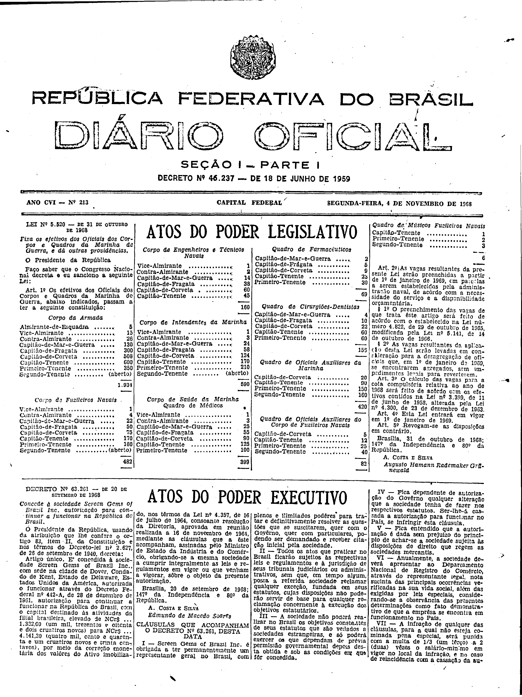
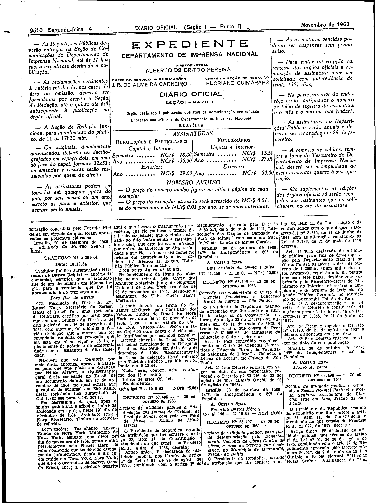

###DEC-063261-0-000-20-09-1968@@@

<strong>DECRETO Nº 63.261, DE 20 DE SETEMBRO DE 1968.</strong>

<!-- fac-simile-oficial:inicio -->

## Fac-símile oficial do ato inteiro: cláusulas + tradução

Esta norma é reproduzida apenas em imagem. As páginas inteiras do _Diário Oficial da União_ (Seção I) de 4 de novembro de 1968 trazem o decreto e o instrumento que o acompanha: PDF `DO_1_19681104_213.PDF`, p.1 do PDF (impressa 9609, inferida: capa sem folio visível), p.2 do PDF (impressa 9610).

O texto do Senado que antes constava aqui foi retirado para manter uma só versão do ato: não foi colacionado palavra a palavra com o impresso.

**Divergências constatadas entre o texto do Senado e o impresso:** A ementa do Senado dizia «autorizado para continuar»; o impresso traz «autorização para continuar a funcionar na República do Brasil».

**Limites lidos nas imagens:** p.9609 (PDF 1): decreto col.1–col.2; «CLÁUSULAS QUE ACOMPANHAM O DECRETO Nº 63.261» col.2 base–col.4 (I–VII, VII cortada em «cassação da au-»). p.9610 (PDF 2): col.1 topo fim de VII e «Brasília, 20 de setembro de 1968. — Edmundo de Macedo Soares e Silva» (como impresso); «TRADUÇÃO Nº 5.391-64» (Resolução da Diretoria, Russel Karp) e legalizações, até «(Nº 4.894-B — 19.9.68 — NCr$ 75,00)» (col.2), antes do Decreto 63.495.

**Assinatura(s):** Edmundo de Macedo Soares e Silva (como impresso; o autor escreveu «Edmundo de Macedo Soares»). Tradução nº 5.391-64: Hermann de Castro Reipert.

As imagens são as páginas inteiras, extraídas do PDF com `pdfimages -png` (imagem JBIG2 embutida, uma por página, sem reduzir), sem recorte, sem redesenho e sem transcrição. Cada página traz também outros atos do mesmo dia; a peça está apenas no trecho indicado. O texto do ato só existe na imagem. Não há OCR validado.

Fonte: Imprensa Nacional, Biblioteca Machado de Assis, `DO_1_19681104_213.PDF` (SHA-256 `0c069e440ea3de4a141025dbc0248eb9092f21d5a684be8eb92eacf2eeef05cd`). SHA-256 das imagens, na ordem: `a50dbc8de256e991eb43c043f741329e1041da5d4bf53e865d364ff5b09750e2`, `146c4dfb24a498818cc88d00f80ca1b38df2ab0033cf64364ab7e2ff52c0af7a`.

[PDF da edição oficial](https://biblioteca.in.gov.br/documents/271518/541144/DO_1_19681104_213.PDF/e81c2c6d-1415-1f66-dc31-ec59f2d84a54?t=1574886300073&download=true).

<!-- fac-simile-oficial:fim -->
