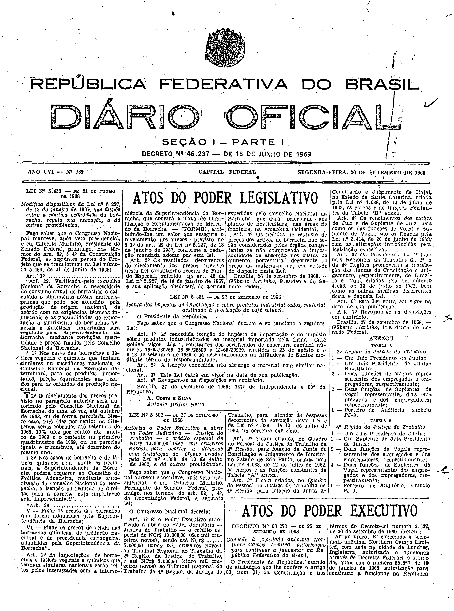
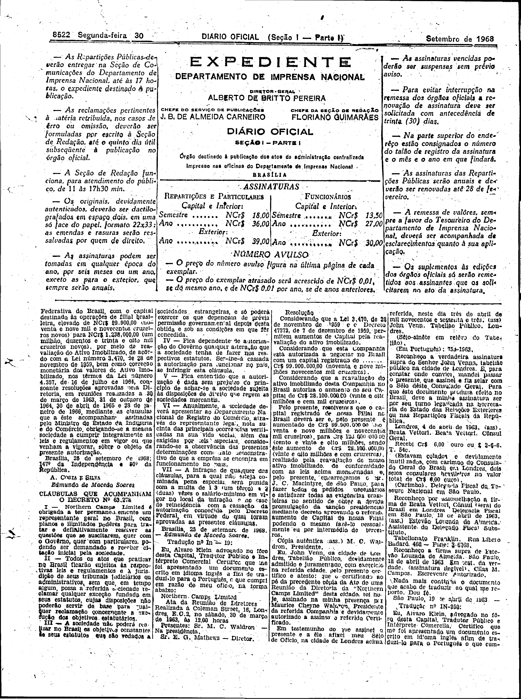
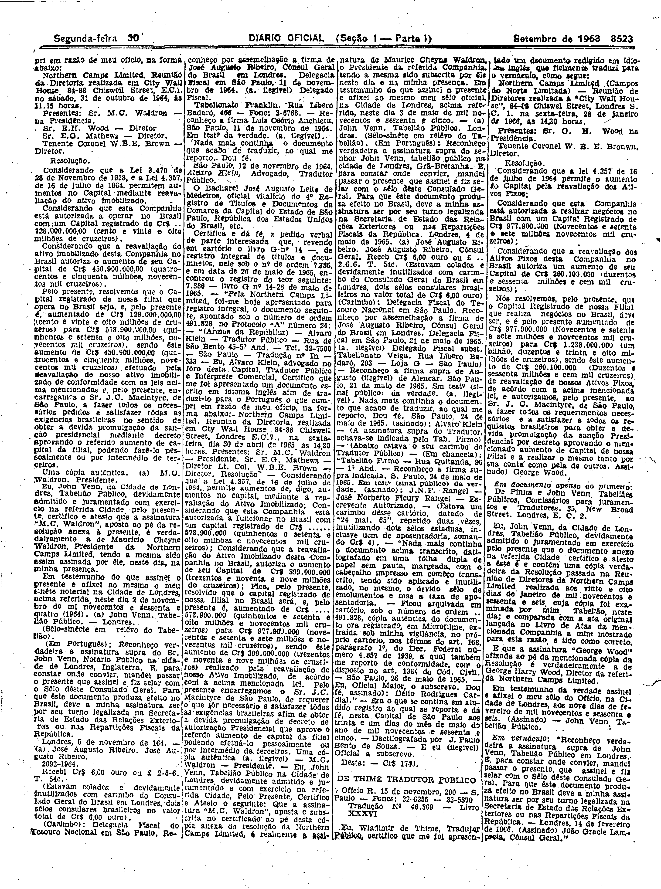
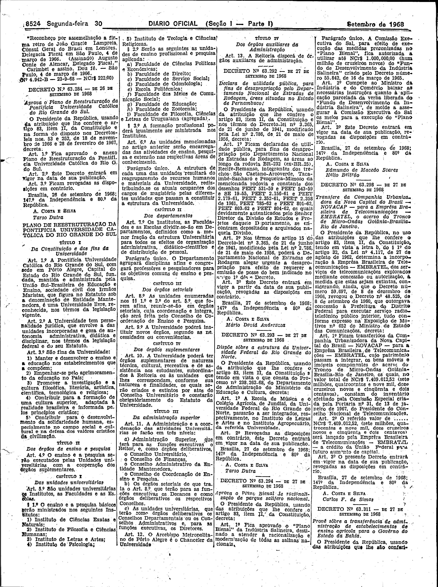

###DEC-063277-0-000-25-09-1968@@@

<strong>DECRETO Nº 63.277, DE 25 DE SETEMBRO DE 1968.</strong>

<!-- fac-simile-oficial:inicio -->

## Fac-símile oficial do ato inteiro: cláusulas + atas e certidões traduzidas

Esta norma é reproduzida apenas em imagem. As páginas inteiras do _Diário Oficial da União_ (Seção I) de 30 de setembro de 1968 trazem o decreto e o instrumento que o acompanha: PDF `DO_1_19680930_189.PDF`, p.1 do PDF (impressa 8521, inferida: capa sem folio visível), p.2 do PDF (impressa 8522), p.3 do PDF (impressa 8523), p.4 do PDF (impressa 8524).

O texto do Senado que antes constava aqui foi retirado para manter uma só versão do ato: não foi colacionado palavra a palavra com o impresso.

**Limites lidos nas imagens:** p.8521 (PDF 1): só o início do Decreto 63.277 (cols.3–4 base, «Artigo único. É concedida à sociedade anônima Northern Camps Limited…»); sem cláusulas. p.8522 (PDF 2): col.1 topo conclui o artigo único e traz «Brasília, 25 de setembro de 1968; … A. COSTA E SILVA / Edmundo de Macedo Soares»; «CLÁUSULAS QUE ACOMPANHAM O DECRETO Nº 63.277» col.1 base (I–III) e col.2 (III–VII, «Brasília, 25 de setembro de 1968. — Edmundo de Macedo Soares.»); depois «Tradução nº In-19» (Alvaro Klein) e atas/certidões cols.2–4. p.8523 (PDF 3): cols.1–4, continuação (atas de 1964–1966, certidões John Venn, consulado, Tradução nº 46.309 W. de Thime). p.8524 (PDF 4): col.1 topo conclui «… Dou fé. — São Paulo, 4 de março de 1966. (Nº 4.942-B — 23-9-68 — NCr$ 222,00)», antes do Decreto 63.284.

**Assinatura(s):** Edmundo de Macedo Soares (cláusulas); Alvaro Klein, Wladimir de Thime (tradutores)

As imagens são as páginas inteiras, extraídas do PDF com `pdfimages -png` (imagem JBIG2 embutida, uma por página, sem reduzir), sem recorte, sem redesenho e sem transcrição. Cada página traz também outros atos do mesmo dia; a peça está apenas no trecho indicado. O texto do ato só existe na imagem. Não há OCR validado.

Fonte: Imprensa Nacional, Biblioteca Machado de Assis, `DO_1_19680930_189.PDF` (SHA-256 `33b9c1cef9ae0e6b7c952e4d8df3dcb26d0d95869878e5fbfc76d7f0b6b87ab7`). SHA-256 das imagens, na ordem: `35c20e16230a865e15bc4544f2f639063111ae7bb7080278f83063ae4cf4fde4`, `25ba24acdd096c91f365b1378665389c0509db47e97dae5ed3f7153acc8a9450`, `764eacd3bd367f332c84e427188cdfe3d69705662b78921ab4760a78197c56ff`, `f6ba4bd3a0d7d7f303114f02ef774563a70beb3ec4acdab3ceb06c4107dcc9f7`.

[PDF da edição oficial](https://biblioteca.in.gov.br/documents/271518/541144/DO_1_19680930_189.PDF/249b42a6-77df-a917-5470-96ef8f95d713?t=1574886118753&download=true).

<!-- fac-simile-oficial:fim -->
