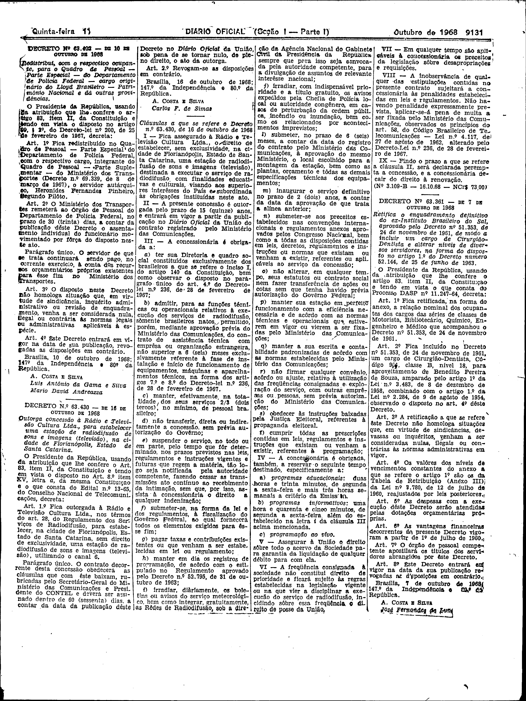

###DEC-063430-0-000-16-10-1968@@@

<strong>DECRETO Nº 63.430, DE 16 DE OUTUBRO DE 1968.</strong>

<em><strong>Outorga concessão à Rádio e Televisão Cultura Ltda., para estabelecer uma estação de radiodifusão de sons e imagens (televisão), na cidade de Florianópolis, Estado de Santa Catarina.</strong></em>

<strong>O PRESIDENTE DA REPUBLICA</strong>, usando da atribuição que lhe confere o Art, 83, item II, da Constituição e tendo em vista o disposto no Art.8º item XV, letra <em>a</em>, da mesma Constituição e o que consta do Edital nº 13-65, do Conselho Nacional de Telecomunicação,

<strong>DECRETA:</strong>

<strong>Art</strong>. 1º Fica outorgada à Radio e Televisão Cultura Ltda. nos têrmos do art. 28, do Regulamento dos Serviços de Radiodifusão, para estabelecer, na cidade de Florianópolis, Estado de Santa Catarina, sem direito de exclusividade, uma estação de radiodifusão de sons e imagens (televisão), utilizando o canal 6.

Parágrafo único. O contrato decorrente desta concessão obedecerá as cláusulas que com êste baixam, rubricadas pelo Secretário-Geral do Ministério das Comunicações e Presidente do CONTEL e deverá ser assinado dentro de 60 (sessenta) dias, a contar da data da publicação dêste Decreto no <em>Diário Oficial</em> da União, sob pena de se tornar nulo, de pleno direito, o ato da outorga.

<strong>Art</strong>. 2º Revogam-se as disposições em contrário.

Brasília, 16 de outubro de 1968; 147º de Independência e 80º da Republica.

<strong>A. COSTA E SILVA</strong>

Carlos F. de Simas

<!-- fac-simile-oficial:inicio -->

## Fac-símile oficial: cláusulas

O texto acima não inclui as cláusulas a que se refere este decreto. A publicação oficial do anexo está em imagem, nas páginas do _Diário Oficial da União_ (Seção I) de 17 de outubro de 1968: página 3 do PDF (a partir de «Cláusulas a que se refere o Decreto nº 63.430, de 16 de outubro de 1968», até «Nº 3.109-B — 16.10.68 — NCr$ 73,00», e a página seguinte, 9132, traz apenas quadros de pessoal de outro ato e não faz parte da peça).

As imagens são as páginas inteiras, tal como digitalizadas pela Imprensa Nacional, sem recorte, sem redesenho e sem transcrição. Cada página traz também outros atos do mesmo dia; a peça deste decreto está apenas no trecho indicado, e o texto do anexo só existe na imagem. Não há OCR validado.

Fonte: Imprensa Nacional, Biblioteca Machado de Assis, arquivo `DO_1_19681017_202.PDF` (SHA-256 `f22d189b099daa2ec7682074c1a3c03b45fde0f33211cb3c6e1bf5816e1c844f`), páginas 3 do PDF. SHA-256 das imagens, na ordem: `b1b2796d0cd6c7ad21ab2bc63b99c630ca17ea4f49228707ed75cce4c9f3ed64`.

<!-- fac-simile-oficial:fim -->
