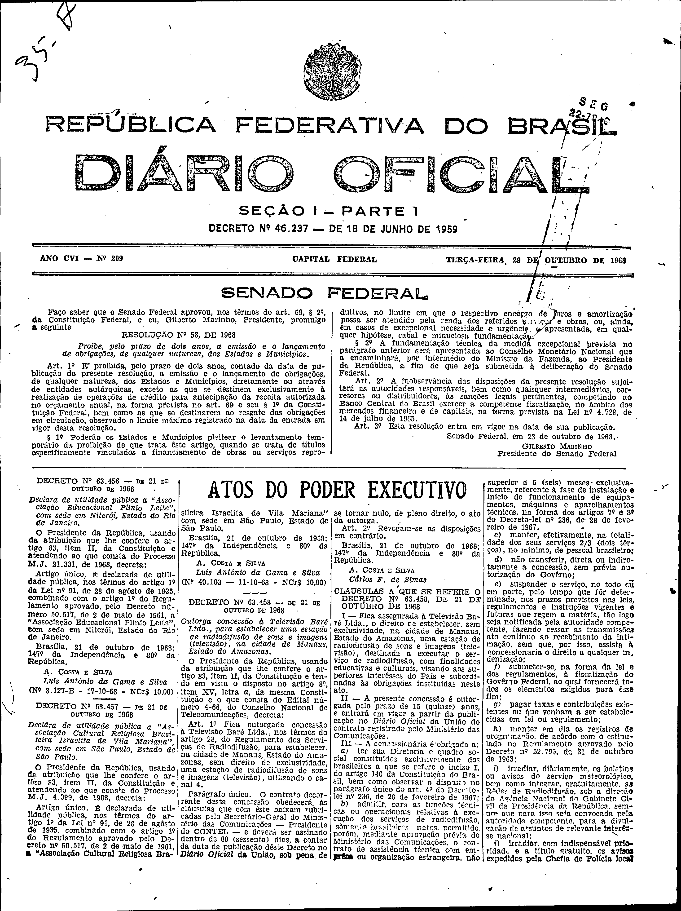
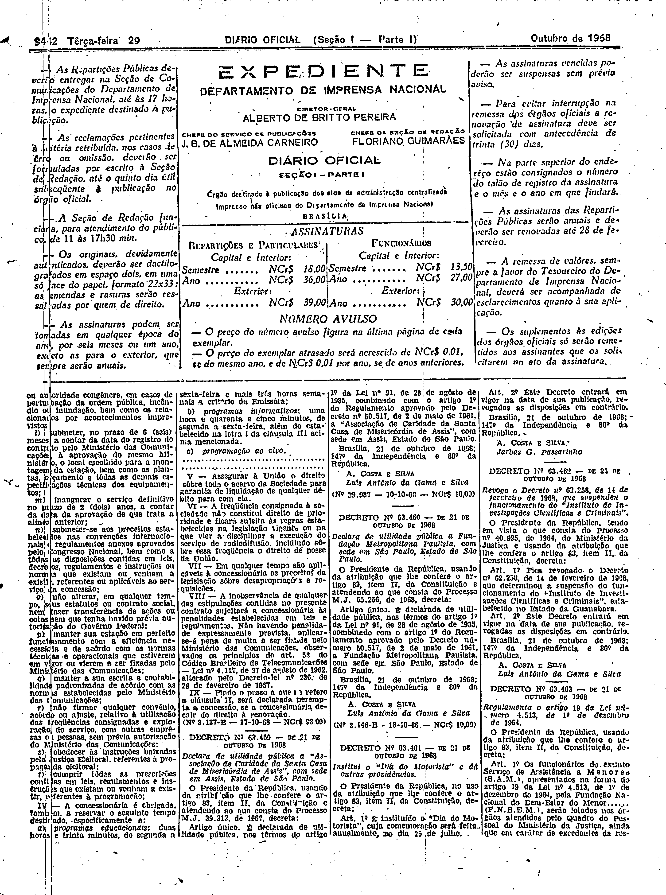

###DEC-063458-0-000-21-10-1968@@@

<strong>DECRETO Nº 63.458, DE 21 DE OUTUBRO DE 1968.</strong>

<em><strong>Outorga concessão à televisão Baré Ltda., para estabelecer uma estação de radiodifusão de sons e imagens (televisão), na cidade de Manaus, estado do Amazonas.</strong></em>

<strong>O PRESIDENTE DA REPÚBLICA</strong>, usando da atribuição que lhe confere o artigo 83, item II, da Constituição e tendo em vista o disposto no artigo 8º, item XV, letra <em>a</em>, da mesma Constituição e o que consta do Edital número 4-66, do Conselho Nacional de Telecomunicações,

<strong>DECRETA:</strong>

<strong>Art</strong>. 1º Fica outorgada concessão à Televisão Baré Ltda., nos têrmos do artigo 28, do Regulamento dos Serviços de Radiodifusão, para estabelecer, na cidade de Manaus, Estado do Amazonas, sem direito de exclusividade, uma estação de radiodifusão de sons e imagens (televisão), utilizando o canal 4.

Parágrafo único. O contrato decorrente desta concessão obedecerá às cláusulas que com êste baixam rubricadas pelo Secretário-Geral do Ministério das Comunicações - Presidente do CONTEL - e deverá ser assinado dentro de 60 (sessenta) dias, a contar da data da publicação dêste Decreto no <em>Diário Oficial</em> da União, sob pena de se tornar nulo, de pleno direito, o ato da outorga.

<strong>Art</strong>. 2ºRevogam-se as disposições em contrário.

Brasília, 21 de outubro de 1968; 147º da Independência e 80º da República.

<strong>A. COSTA E SILVA</strong>

Carlos F. de Simas

<!-- fac-simile-oficial:inicio -->

## Fac-símile oficial: cláusulas

O texto acima não inclui as cláusulas a que se refere este decreto. A publicação oficial do anexo está em imagem, nas páginas do _Diário Oficial da União_ (Seção I) de 29 de outubro de 1968: página 1 do PDF (capa do caderno) (a partir de «CLÁUSULAS A QUE SE REFERE O DECRETO Nº 63.458, DE 21 DE OUTUBRO DE 1968»); página 2 do PDF (até «Nº 3.137-B — 17-10-68 — NCr$ 93,00»).

As imagens são as páginas inteiras, tal como digitalizadas pela Imprensa Nacional, sem recorte, sem redesenho e sem transcrição. Cada página traz também outros atos do mesmo dia; a peça deste decreto está apenas no trecho indicado, e o texto do anexo só existe na imagem. Não há OCR validado.

Fonte: Imprensa Nacional, Biblioteca Machado de Assis, arquivo `DO_1_19681029_209.PDF` (SHA-256 `8adb15a45b00e92d43da6b55e69e1431959b0d54ff588ce2a15d874144ac24e2`), páginas 1, 2 do PDF. SHA-256 das imagens, na ordem: `80d7d1d3198efa76cdb125d25e0ab907fcd301534f72af92b133cc90f087de16`, `1773aa301a605e5c60f6d7fad35bd2564b2754cfda51f3e4ab86b6112aebcb5c`.

<!-- fac-simile-oficial:fim -->
