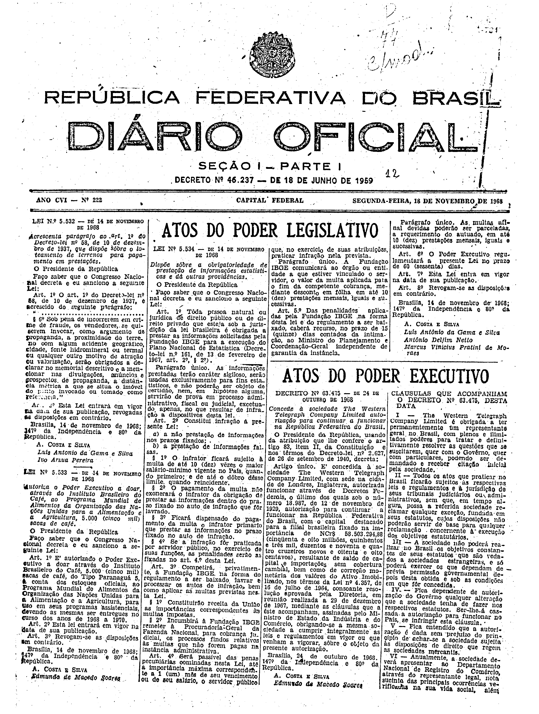
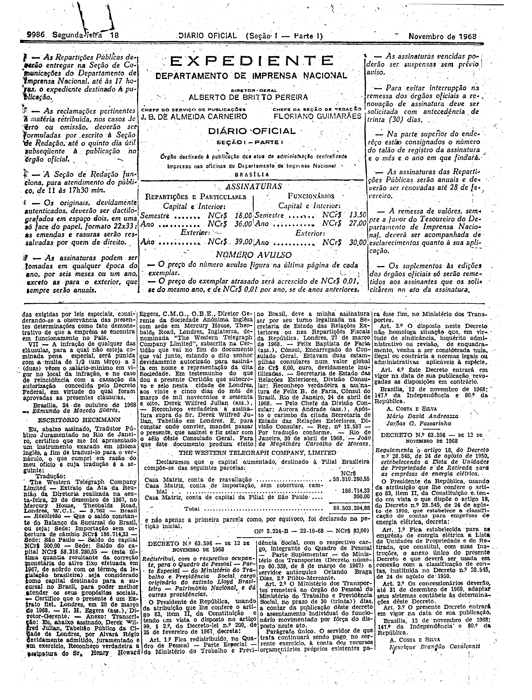

###DEC-063475-0-000-24-10-1968@@@

<strong>DECRETO Nº 63.475, DE 24 DE OUTUBRO DE 1968.</strong>

<!-- fac-simile-oficial:inicio -->

## Fac-símile oficial do ato inteiro: cláusulas + documentos traduzidos

Esta norma é reproduzida apenas em imagem. As páginas inteiras do _Diário Oficial da União_ (Seção I) de 18 de novembro de 1968 trazem o decreto e o instrumento que o acompanha: PDF `DO_1_19681118_222.PDF`, p.1 do PDF (impressa 9985, inferida: capa sem folio visível), p.2 do PDF (impressa 9986).

O texto do Senado que antes constava aqui foi retirado para manter uma só versão do ato: não foi colacionado palavra a palavra com o impresso.

**Divergências constatadas entre o texto do Senado e o impresso:** O corpo do Senado trazia «E concedida a sociedade» e «Decreto Federais»; o impresso traz «E' concedida à sociedade» e «Decretos Federais».

**Limites lidos nas imagens:** p.9985 (PDF 1): decreto na col.3 (metade inferior); «CLÁUSULAS QUE ACOMPANHAM O DECRETO Nº 63.475» começa no topo da metade inferior da col.4 e ocupa só a col.4 (I–VI, VI cortada). p.9986 (PDF 2): col.1 topo continua VI, traz VII e «Brasília, 24 de outubro de 1968 — Edmundo de Macedo Soares.»; em seguida (col.1 base–col.3) «ESCRITÓRIO HECKMANN» tradução (Ata da Diretoria de 29-12-1967; certidões; declaração do capital NCr$ 58.503.294,88) até «(Nº 3.224-B — 23-10-68 — NCr$ 82,00)», antes do Decreto 63.596 (col.2 base).

**Assinatura(s):** Edmundo de Macedo Soares (assinatura das cláusulas; o decreto é de A. Costa e Silva / Edmundo de Macedo Soares)

As imagens são as páginas inteiras, extraídas do PDF com `pdfimages -png` (imagem JBIG2 embutida, uma por página, sem reduzir), sem recorte, sem redesenho e sem transcrição. Cada página traz também outros atos do mesmo dia; a peça está apenas no trecho indicado. O texto do ato só existe na imagem. Não há OCR validado.

Fonte: Imprensa Nacional, Biblioteca Machado de Assis, `DO_1_19681118_222.PDF` (SHA-256 `c7c0df047ce38d1fec88adb5c121996329cf55238499a50f525beee7b8599715`). SHA-256 das imagens, na ordem: `d1469ab1412071c9f0f2b402706f546ef3cddd53dbc1a79f1bacbd31589282d3`, `97d2dd5914dee3b353d298c99b3c1b88b09493e74468dd52d7969bbf5713bc13`.

[PDF da edição oficial](https://biblioteca.in.gov.br/documents/271518/541144/DO_1_19681118_222.PDF/324bdbb1-10f8-5157-53e6-40ba6eb6ec38?t=1574886394820&download=true).

<!-- fac-simile-oficial:fim -->
