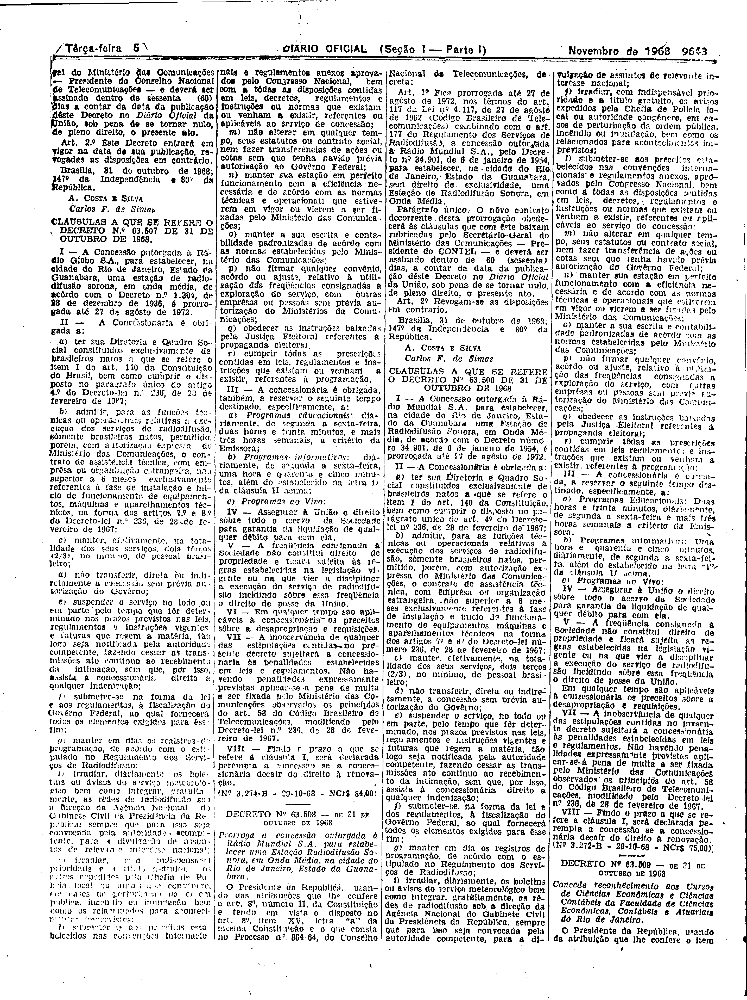

###DEC-063507-0-000-31-10-1968@@@

<strong>DECRETO Nº 63.507, DE 31 DE OUTUBRO DE 1968.</strong>

<em><strong>Prorroga a concessão outorgada a Rádio Globo S.A. para estabelecer uma estação de radiodifusão sonora, em onda média, na Cidade do Rio de Janeiro, Estado da Guanabara.</strong></em>

<strong>O PRESIDENTE DA REPÚBLICA</strong>, usando das atribuições que lhe confere o artigo 83, item II, da Constituição e tendo em vista o disposto no artigo 8º, item XV, letra “<em>a</em>” da mesma Constituição e o que consta no Processo n° 6.423.64, do Conselho Nacional de Telecomunicações,

<strong>DECRETA:</strong>

<strong>Art</strong>. 1º Fica prorrogada até 27 de agôsto de 1972, nos têrmos do artigo 117 da Lei n° 4.117, de 27 de agôsto de 1962 (Código Brasileiro de Telecomunicações), combinado com o artigo 177 do Regulamento dos Serviços de Radiodifusão, a concessão outorgada à Radio Globo S.A., pelo Decreto n° 1.304, de 28 de dezembro de 1936, para estabelecer, na Cidade do Rio de Janeiro, Estado da Guanabara sem direito de exclusividade, uma estação de radiodifusão sonora, em onda média, e prorrogada por dez (10) anos, pelo Decreto n° 26.331, de 9 de fevereiro de 1949.

Parágrafo único. O nôvo contrato decorrente desta prorrogação obedecerá as cláusulas que com êste baixam rubricadas pelo Secretário-Geral do Ministério das Comunicações – Presidente do Conselho Nacional de Telecomunicações – e deverá ser assinado dentro de sessenta (60) dias a contar da data da publicação dêste Decreto no <em>Diário Oficial</em> da União, sob pena de se tornar nulo, de pleno direito, o presente ato.

<strong>Art</strong>. 2º Êste Decreto entrará em vigor na data de sua publicação, revogadas as disposições em contrário.

Brasília, 31 de outubro de 1968; 147º da Independência e 80º da República.

<strong>A. COSTA E SILVA</strong>

Carlos F. de Simas

<!-- fac-simile-oficial:inicio -->

## Fac-símile oficial: cláusulas

O texto acima não inclui as cláusulas a que se refere este decreto. A publicação oficial do anexo está em imagem, nas páginas do _Diário Oficial da União_ (Seção I) de 5 de novembro de 1968: página 3 do PDF (a partir de «CLÁUSULAS A QUE SE REFERE O DECRETO Nº 63.507 DE 31 DE OUTUBRO DE 1968», até «Nº 3.274-B — 29-10-68 — NCr$ 84,00»).

As imagens são as páginas inteiras, tal como digitalizadas pela Imprensa Nacional, sem recorte, sem redesenho e sem transcrição. Cada página traz também outros atos do mesmo dia; a peça deste decreto está apenas no trecho indicado, e o texto do anexo só existe na imagem. Não há OCR validado.

Fonte: Imprensa Nacional, Biblioteca Machado de Assis, arquivo `DO_1_19681105_214.PDF` (SHA-256 `f102ab87b7ff4740cafce35210ddaefeddef7d8c4ece01b1ebccb6258ac1ce87`), páginas 3 do PDF. SHA-256 das imagens, na ordem: `174c28c4964eeab9a6cf060a07fe60dd30d015c19705895c90935ef5b27319e9`.

<!-- fac-simile-oficial:fim -->
