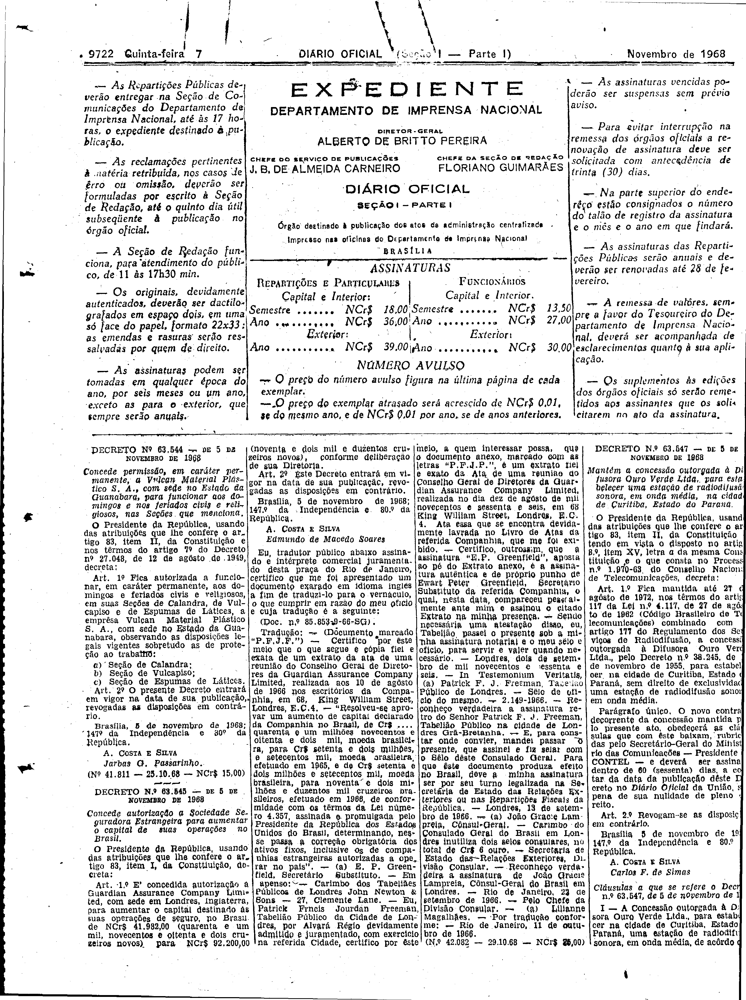
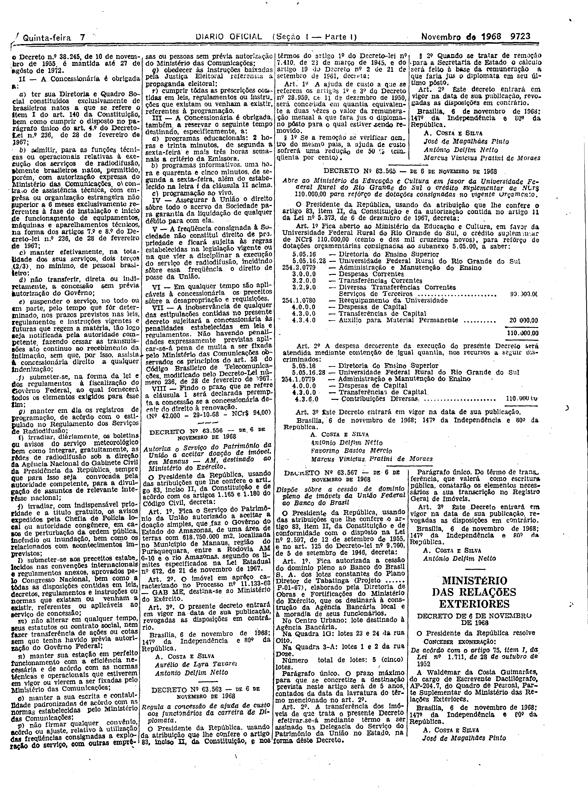

###DEC-063547-0-000-05-11-1968@@@

<strong>DECRETO Nº 63.547, DE 5 DE NOVEMBRO DE 1968.</strong>

<em><strong>Mantém a concessão outorgada à Difusora Ouro Verde Ltda., para estabelecer uma estação de radiodifusão sonora, em onda média, na cidade de Curitiba, Estado do Paraná.</strong></em>

<strong>O PRESIDENTE DA REPÚBLICA</strong>, usando das atribuições que lhe confere o artigo 83, item II, da Constituição e tendo em vista o disposto no artigo 8º, item XV, letra <em>a</em> da mesma Constituição e o que consta no Processo nº 1.970-63 do Conselho Nacional de Telecomunicações,

<strong>DECRETA:</strong>

<strong>Art</strong>. 1º Fica mantida até 27 de agôsto de 1972, nos têrmos do artigo 117 da Lei nº 4.117, de 27 de agôsto de 1962 (Código Brasileiro de Telecomunicações) combinado com o artigo 177 do Regulamento dos Serviços de Radiodifusão, a concessão outorgada à Difusora Ouro Verde Ltda., pelo Decreto nº 38.245 de 10 de novembro de 1955, para estabelecer na cidade de Curitiba, Estado do Paraná, sem direito de exclusividade, uma estação de radiodifusão sonora, em onda média.

Parágrafo único. O novo contrato decorrente da concessão mantida pelo presente ato, obedecerá as cláusulas que com êste baixam, rubricadas pelo Secretário-Geral do Ministério das Comunicações - Presidente do CONTEL - e deverá ser assinado dentro de 60 (sessenta) dias, a contar da data da publicação dêste Decreto no <em>Diário</em> <em>Oficial</em> da União, sob pena de sua nulidade de pleno direito.

<strong>Art</strong>. 2º Revogam-se as disposições em contrário.

Brasília, 5 de novembro de 1968; 147º da Independência e 80º da República.

<strong>A. COSTA E SILVA</strong>

Carlos F. de Simas

<!-- fac-simile-oficial:inicio -->

## Fac-símile oficial: cláusulas

O texto acima não inclui as cláusulas a que se refere este decreto. A publicação oficial do anexo está em imagem, nas páginas do _Diário Oficial da União_ (Seção I) de 7 de novembro de 1968: página 2 do PDF (a partir de «Cláusulas a que se refere o Decreto nº 63.547, de 5 de novembro de 1968», e a margem direita desta página está cortada na própria digitalização e as linhas da quarta coluna perdem os últimos caracteres); página 3 do PDF (até «Nº 42.000 — 29-10-68 — NCr$ 94,00»).

As imagens são as páginas inteiras, tal como digitalizadas pela Imprensa Nacional, sem recorte, sem redesenho e sem transcrição. Cada página traz também outros atos do mesmo dia; a peça deste decreto está apenas no trecho indicado, e o texto do anexo só existe na imagem. Não há OCR validado.

Fonte: Imprensa Nacional, Biblioteca Machado de Assis, arquivo `DO_1_19681107_216.PDF` (SHA-256 `c2a595c6e44d443b988df243d85e6973b5d6528de1651b55dd50466c21946be6`), páginas 2, 3 do PDF. SHA-256 das imagens, na ordem: `080f56c2bedad3622d39a75ad33466c508b960e84d036913674d4c8c7c7a25eb`, `e8a89d543579e6c8811452929fb5ec45f95416844209aea23281963bb9ea41e7`.

<!-- fac-simile-oficial:fim -->
