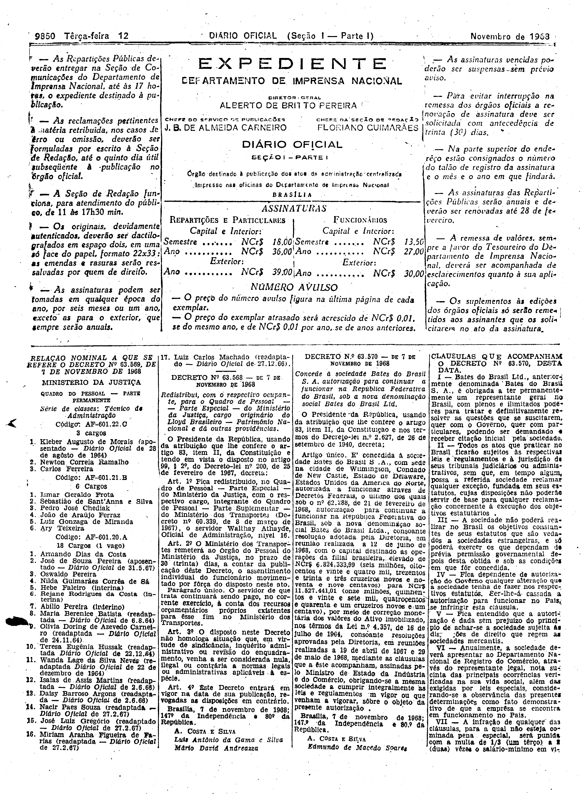
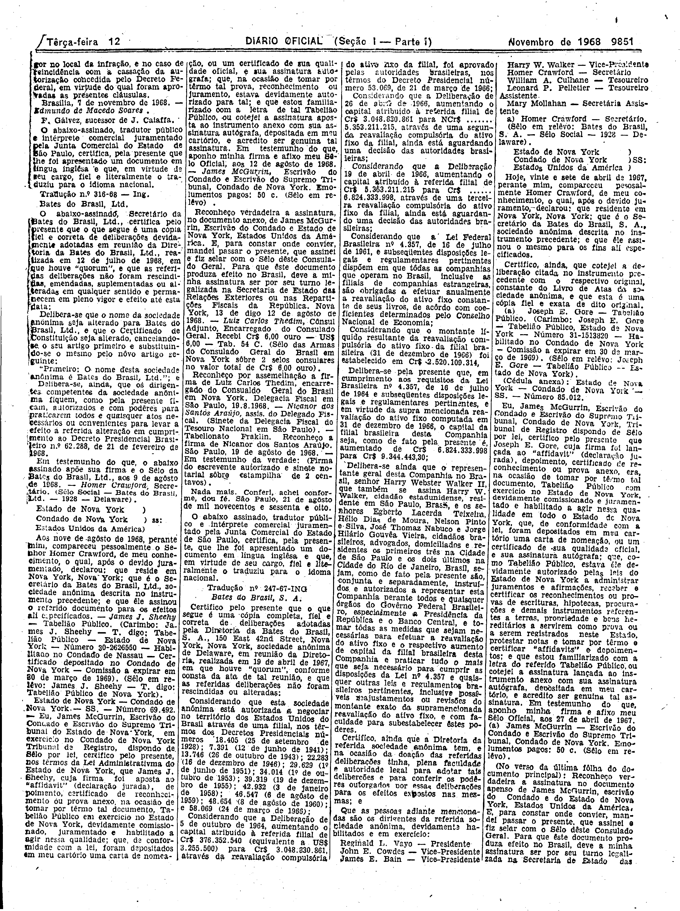
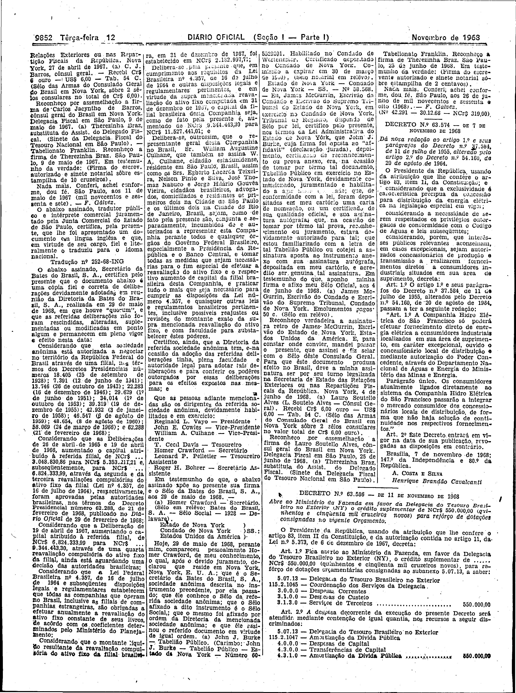

###DEC-063570-0-000-07-11-1968@@@

<strong>DECRETO Nº 63.570, DE 7 DE NOVEMBRO DE 1968.</strong>

<!-- fac-simile-oficial:inicio -->

## Fac-símile oficial do ato inteiro: cláusulas + traduções

Esta norma é reproduzida apenas em imagem. As páginas inteiras do _Diário Oficial da União_ (Seção I) de 12 de novembro de 1968 trazem o decreto e o instrumento que o acompanha: PDF `DO_1_19681112_219.PDF`, p.2 do PDF (impressa 9850), p.3 do PDF (impressa 9851), p.4 do PDF (impressa 9852).

O texto do Senado que antes constava aqui foi retirado para manter uma só versão do ato: não foi colacionado palavra a palavra com o impresso.

**Limites lidos nas imagens:** p.9850 (PDF 2): decreto col.3; «CLÁUSULAS QUE ACOMPANHAM O DECRETO Nº 63.570» col.4 (I–VII, VII cortada). p.9851 (PDF 3): col.1 fim de VII e «Brasília, 7 de novembro de 1968. — Edmundo de Macedo Soares.»; traduções nº 316-68 e nº 247-67 (cols.1–4). p.9852 (PDF 4): cols.1–3 Tradução nº 252-68, terminando col.4 topo em «(Nº 42.291 — 30.12.68 — NCr$ 319,00)», antes do Decreto 63.574.

**Assinatura(s):** Edmundo de Macedo Soares (cláusulas). Traduções nº 316-68, nº 247-67 e nº 252-68; esta última termina em «São Paulo, aos 26 de junho de 1968 — F. Gálvez».

As imagens são as páginas inteiras, extraídas do PDF com `pdfimages -png` (imagem JBIG2 embutida, uma por página, sem reduzir), sem recorte, sem redesenho e sem transcrição. Cada página traz também outros atos do mesmo dia; a peça está apenas no trecho indicado. O texto do ato só existe na imagem. Não há OCR validado.

Fonte: Imprensa Nacional, Biblioteca Machado de Assis, `DO_1_19681112_219.PDF` (SHA-256 `8004bc2cc9f71aae531ad96e334a25296f97fd1e0e1ce4b62da3d15a3e5b0cbe`). SHA-256 das imagens, na ordem: `8268f9d8b8b47fa7f592cfa14c392114f243fb3cf56a39671bde0df3dac73852`, `0056bb5b37e83ce6bd6f742c30627d2224a07285ac8d976132f5a7bc175523de`, `3896964fb4081c587611c9f7251bd82bcb06cabaa3b2e927ce04d0b16cecb5de`.

[PDF da edição oficial](https://biblioteca.in.gov.br/documents/271518/541144/DO_1_19681112_219.PDF/b994446a-f30f-07f4-e3c4-b45fecf701ae?t=1574886366200&download=true).

<!-- fac-simile-oficial:fim -->
