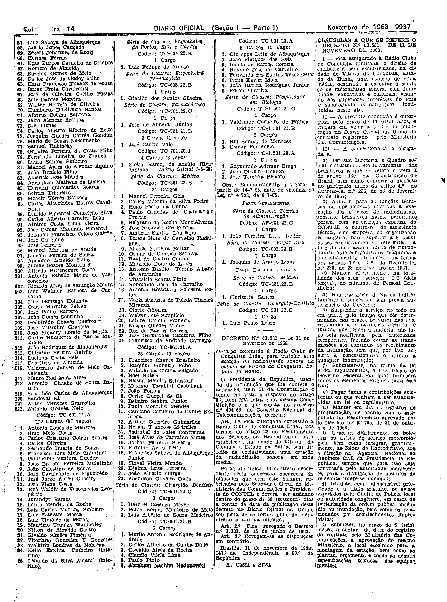
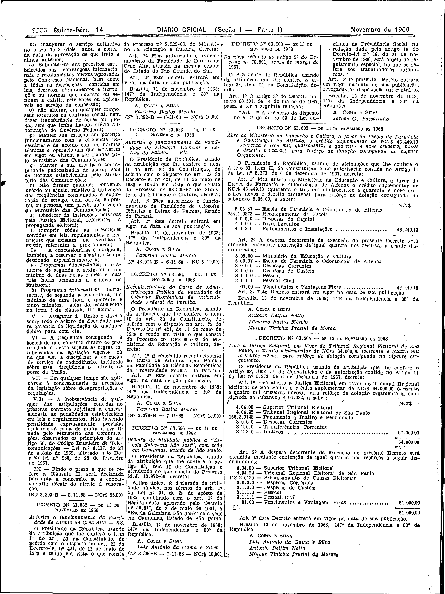

###DEC-063581-0-000-11-11-1968@@@

<strong>DECRETO Nº 63.581, DE 11 DE NOVEMBRO DE 1968.</strong>

<em><strong>Outorga concessão à Rádio Clube de Conquista Ltda., para instalar uma estação de radiodifusão sonora na cidade de Vitória da Conquista, Estado da Bahia.</strong></em>

<strong>O PRESIDENTE DA REPÚBLICA</strong>, usando da atribuição que lhe confere o artigo 83, item II da Constituição e tendo em vista o disposto no artigo 8º, item XV, letra <em>a</em> da mesma Constituição e o que consta no processo nº 494-63, do Conselho Nacional de Telecomunicações,

<strong>DECRETA:</strong>

<strong>Art</strong>. 1º Fica outorgada concessão à Rádio Clube de Conquista Ltda., nos têrmos do artigo 28 do Regulamento dos Serviços de Radiodifusão, para estabelecer, na cidade de Vitória da Conquista, Estado da Bahia, sem direito de exclusividade, uma estação da radiodifusão sonora em onda média.

Parágrafo único. O contrato decorrente desta concessão obedecerá às cláusulas que com êste baixam, rubricadas pelo Secretário-Geral do Ministério das Comunicações e Presidente do CONTEL e deverá ser assinado dentro do prazo de 60 (sessenta) dias a contar da data da publicação dêste decreto no <em>Diário Oficial</em> da União, sob pena de se tornar nulo, de pleno direito o ato da outorga.

<strong>Art</strong>. 2º Fica revogado o Decreto nº 1.183, de 15 de junho de 1962.

<strong>Art</strong>. 3º Revogam-se as disposições em contrário.

Brasília, 11 de novembro de 1968; 147º da Independência e 80º da República.

<strong>A. COSTA E SILVA</strong>

Carlos F. de Simas

<!-- fac-simile-oficial:inicio -->

## Fac-símile oficial: cláusulas

O texto acima não inclui as cláusulas a que se refere este decreto. A publicação oficial do anexo está em imagem, nas páginas do _Diário Oficial da União_ (Seção I) de 14 de novembro de 1968: página 9 do PDF (a partir de «CLÁUSULAS A QUE SE REFERE O DECRETO N.º 63.581, DE 11 DE NOVEMBRO DE 1968»); página 10 do PDF (até «Nº 3.393-B — 8.11.68 — NCr$ 95,00»).

As imagens são as páginas inteiras, tal como digitalizadas pela Imprensa Nacional, sem recorte, sem redesenho e sem transcrição. Cada página traz também outros atos do mesmo dia; a peça deste decreto está apenas no trecho indicado, e o texto do anexo só existe na imagem. Não há OCR validado.

Fonte: Imprensa Nacional, Biblioteca Machado de Assis, arquivo `DO_1_19681114_221.PDF` (SHA-256 `8c285943a7a3ba9569ddb5af31ff5f160754e13191acb5790ab21647dc5aa8b9`), páginas 9, 10 do PDF. SHA-256 das imagens, na ordem: `a16b401fd7026d4926fbafc34462a4e390927470cccbe95c7078d6b68257a53d`, `2c8f72493160c14d40c2d8cfaedf5c669a5903d01956e9e10f96042cb331298b`.

<!-- fac-simile-oficial:fim -->
