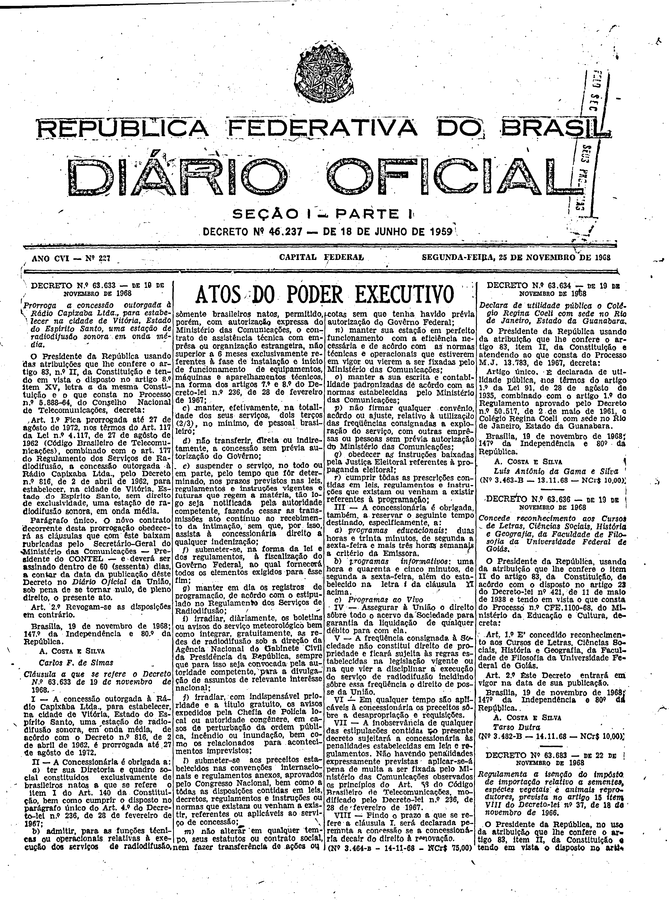

###DEC-063633-0-000-19-11-1968@@@

<strong>DECRETO Nº 63.633, DE 19 DE NOVEMBRO DE 1968.</strong>

<em><strong>Prorroga a concessão outorgada à Rádio Capixaba Ltda., para estabelecer na cidade de Vitória, Estado do Espírito Santo, uma estação de radiodifusão sonora em onda média.</strong></em>

<strong>O PRESIDENTE DA REPÚBLICA</strong>, usando das atribuições que lhe confere o artigo 83, nº II, da Constituição e tendo em vista o disposto no artigo 8º item XV, letra <em>a</em> da mesma Constituição e o que consta no Processo nº 5.888-64, do Conselho Nacional de Telecomunicações,

<strong>DECRETA:</strong>

<strong>Art</strong>. 1º Fica prorrogada até 27 de agôsto de 1972, nos têrmos do Art. 117 da Lei nº 4.117, de 27 de agôsto de 1962 (Código Brasileiro de Telecomunicações), combinado com o art. 177 do Regulamento dos Serviços de Radiodifusão, a concessão outorgada à Rádio Capixaba Ltda., pelo Decreto nº 816, de 2 de abril de 1962, para estabelecer, na cidade de Vitória, Estado do Espírito Santo, sem direito de exclusividade, uma estação de radiodifusão sonora, em onda média.

Parágrafo único. O nôvo contrato decorrente desta prorrogação obedecerá as cláusulas que com êste baixam rubricadas pelo Secretário-Geral do Ministério das Comunicações - Presidente do CONTEL - e deverá ser assinado dentro de 60 (sessenta) dias, a contar da data da publicação dêste Decreto no <em>Diário</em> <em>Oficial</em> da União, sob pena de se tornar nulo, de pleno direito, o presente ato.

<strong>Art</strong>. 2º Revogam-se as disposições em contrário.

Brasília, 19 de novembro de 1968; 147º da Independência e 80º da República.

<strong>A. COSTA E SILVA</strong>

Carlos F. de Simas

<!-- fac-simile-oficial:inicio -->

## Fac-símile oficial: cláusulas

O texto acima não inclui as cláusulas a que se refere este decreto. A publicação oficial do anexo está em imagem, nas páginas do _Diário Oficial da União_ (Seção I) de 25 de novembro de 1968: página 1 do PDF (capa do caderno) (a partir de «Cláusula a que se refere o Decreto Nº 63.633 de 19 de novembro de 1968», até «Nº 3.464-B — 14-11-68 — NCr$ 75,00»).

As imagens são as páginas inteiras, tal como digitalizadas pela Imprensa Nacional, sem recorte, sem redesenho e sem transcrição. Cada página traz também outros atos do mesmo dia; a peça deste decreto está apenas no trecho indicado, e o texto do anexo só existe na imagem. Não há OCR validado.

Fonte: Imprensa Nacional, Biblioteca Machado de Assis, arquivo `DO_1_19681125_227.PDF` (SHA-256 `3121cae460ae99c2716b5d207b482a0add127e3633df081051e453da89f3f957`), páginas 1 do PDF. SHA-256 das imagens, na ordem: `b88a12d14ec8a58aa74ed53e3cfcdc1b841b4d832313b87993079b3c43ae4886`.

<!-- fac-simile-oficial:fim -->
