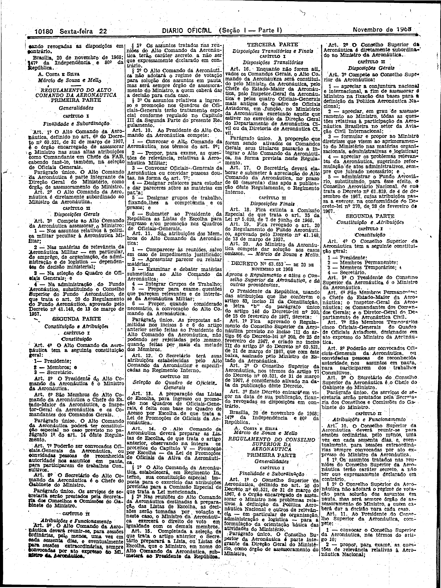
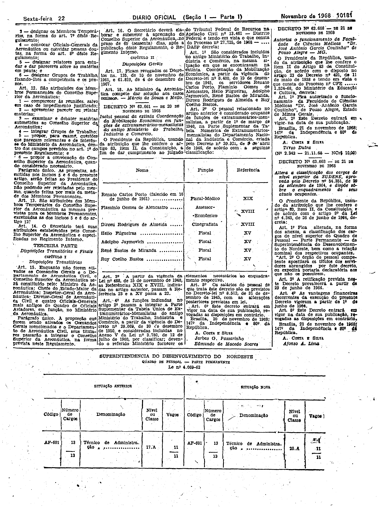

###DEC-063653-0-000-20-11-1968@@@

<strong>DECRETO Nº 63.653, DE 20 DE NOVEMBRO DE 1968.</strong>

<em><strong>Aprova o Regulamento e ativa o Conselho Superior da Aeronáutica, e dá outras providências.</strong></em>

<strong>O PRESIDENTE DA REPÚBLICA</strong>, usando das atribuições que lhe conferem o artigo 83, inciso II da Constituição, e letra <em>“b”</em> do parágrafo único do artigo 146 do Decreto-lei nº 200, de 25 de fevereiro de 1967,

<strong>DECRETA:</strong>

<strong>Art</strong>. 1º Fica aprovado o Regulamento do Conselho Superior da Aeronáutica previsto no inciso III do artigo 66 do Decreto-lei nº 200, de 25 de fevereiro de 1967, e criado no inciso III do artigo 5º do Decreto nº 60.521, de 31 de março de 1967, que com êste baixa, assinado pelo Ministro de Estado da Aeronáutica.

<strong>Art</strong>. 2º O Conselho Superior da Aeronáutica, nos têrmos do artigo 77 do Decreto nº 60.521, de 31 de março de 1967, é considerado ativado da data na publicação dêste Decreto.

<strong>Art</strong>. 3º Êste Decreto entrará em vigor na data de sua publicação, ficando revogadas as disposições em contrário.

Brasília, 20 de novembro de 1968; 147º da Independência e 80º da República.

<strong>A. COSTA E SILVA</strong>

Márcio de Souza e Mello

O regulamento a que se refere o presente Decreto foi publicado no <em>Diário Oficial</em> de 22-11-68.

<!-- fac-simile-oficial:inicio -->

## Fac-símile oficial: instrumento

A peça vinculada ao Decreto nº 63.653 é reproduzida nas imagens abaixo, a partir da publicação oficial da Imprensa Nacional. A reprodução é em fac-símile, sem transcrição por OCR nem reconstrução do conteúdo.

As imagens mostram páginas inteiras do Diário Oficial da União e podem conter outras matérias. Essas matérias vizinhas não são atribuídas a este decreto. A peça é identificada pelo seu título e pela referência ao ato nas páginas indicadas.

SHA-256 desta imagem: `1ef3038af7586946ab41cb255df9995a3078f1d16836e8a633cc5e37aeb35587`.

SHA-256 desta imagem: `bbbcb7507d83c1f03bc39b0efae1a52909d613d2ce439e033e716c20a223e391`.

Fontes oficiais da publicação:

- [DO_1_19681122_226.PDF](https://biblioteca.in.gov.br/documents/271518/541144/DO_1_19681122_226.PDF/914c0df5-0b65-cfeb-3935-04055f07f82f?t=1574886438857&download=true) — SHA-256 do PDF: `ef1c2179057747fb6b5922aee03d77e770cb78f56ad2af496883537d3dbcf963`.

<!-- fac-simile-oficial:fim -->
