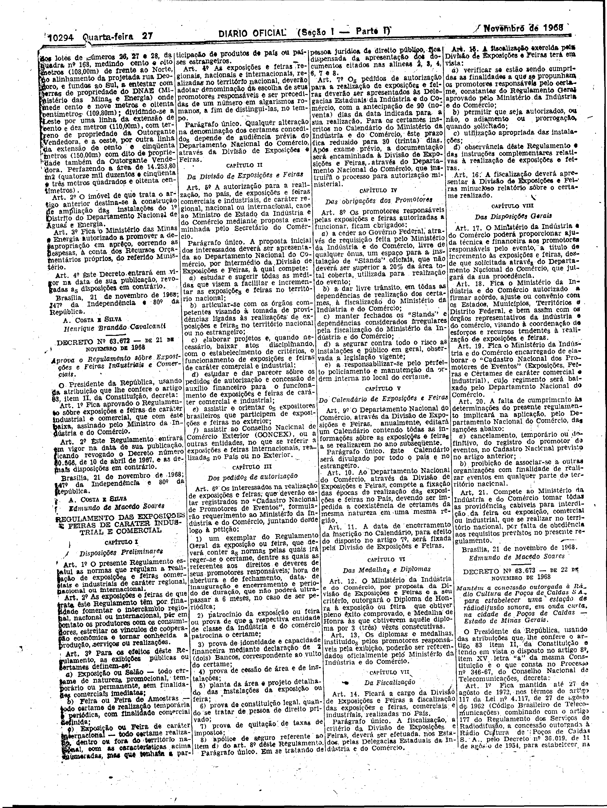

###DEC-063672-0-000-21-11-1968@@@

<strong>DECRETO Nº 63.672, DE 21 DE NOVEMBRO DE 1968.</strong>

<em><strong>Aprova o Regulamento sôbre Exposições e Feiras Industriais e Comerciais.</strong></em>

<strong>O PRESIDENTE DA REPÚBLICA</strong>, usando da atribuição que lhe confere o artigo 83, item II, da Constituição,

<strong>DECRETA:</strong>

<strong>Art</strong>. 1º Fica aprovado o Regulamento sôbre exposições e feiras de caráter industrial e comercial, que com êste baixa, assinado pelo Ministro da Indústria e do Comércio.

<strong>Art</strong>. 2º Êste Regulamento entrará em vigor na data de sua publicação, ficando revogado o Decreto número 60.566, de 10 de abril de 1967, e as demais disposições em contrário.

Brasília, 21 de novembro de 1968; 147º da Independência 80º da República.

<strong>A. COSTA E SILVA</strong>

Edmundo de Macedo Soares

O regulamento a que se refere o presente Decreto foi publicado no <em>Diário Oficial</em> de 27-11-68.

<!-- fac-simile-oficial:inicio -->

## Fac-símile oficial: instrumento

A peça vinculada ao Decreto nº 63.672 é reproduzida nas imagens abaixo, a partir da publicação oficial da Imprensa Nacional. A reprodução é em fac-símile, sem transcrição por OCR nem reconstrução do conteúdo.

As imagens mostram páginas inteiras do Diário Oficial da União e podem conter outras matérias. Essas matérias vizinhas não são atribuídas a este decreto. A peça é identificada pelo seu título e pela referência ao ato nas páginas indicadas.

SHA-256 desta imagem: `31f1b771fb97663a1e5344ccc27a9399d1d339fa6438fec56a97ce362cd2a194`.

Fontes oficiais da publicação:

- [DO_1_19681127_229.PDF](https://biblioteca.in.gov.br/documents/271518/541144/DO_1_19681127_229.PDF/51a01f84-cb1c-15a5-7b19-7935f9ab3a3d?t=1574886468433&download=true) — SHA-256 do PDF: `3be66a7072397100b4edb4b323d163199d34980f56da8f4f3448f370e4ba6a6d`.

<!-- fac-simile-oficial:fim -->
