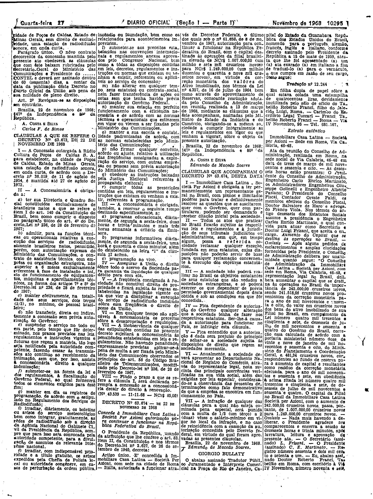

###DEC-063674-0-000-22-11-1968@@@

<strong>DECRETO Nº 63.674, DE 22 DE NOVEMBRO DE 1968.</strong>

<em><strong>Concede à Immobiliare Casa Latina Società Per Azioni autorização para continuar a funcionar na República Federativa do Brasil.</strong></em>

<strong>O PRESIDENTE DA REPÚBLICA</strong>, usando da atribuição que lhe confere o art. 83, item II, da Constituição e nos têrmos do Decreto-lei nº 2.627, de 26 de setembro de 1940,

<strong>DECRETA:</strong>

Artigo único. É concedida à Immobiliare Casa Latina Società Per Azioni, com sede na cidade de Roma - Itália, autorizada a funcionar através de Decretos Federais, o último dos quais sob o nº 61.658, de 8 de novembro de 1967, autorização para continuar a funcionar na República Federativa do Brasil, com o capital destinado às operações da filial brasileira elevado de NCr$1.007.000,00 (um milhão e sete mil cruzeiros novos) para NCr$1.249.000,00 (um milhão duzentos e quarenta e nove mil cruzeiros novos), em virtude da correção monetária dos valôres do Ativo imobilizado, nos têrmos das Lei nº 4.357, de 16 julho de 1964 bem como através do aproveitamento de Reservas, consoante resolução adotada pelo Conselho de Administração, em reunião realizada a 13 de março de 1968, mediante as cláusulas que a êste acompanham, assinadas pelo Ministro de Estado da Indústria e do Comércio, obrigando-se a mesma sociedade a cumprir integralmente as leis e regulamentos em vigor ou que venham a vigorar, sôbre o objeto da presente autorização.

Brasília, 22 de novembro de 1968; 147º da Independência e 80º da República.

<strong>A. COSTA E SILVA</strong>

Edmundo de Macedo Soares

<!-- fac-simile-oficial:inicio -->

## Fac-símile oficial: clausulas

A peça vinculada ao Decreto nº 63.674 é reproduzida nas imagens abaixo, a partir da publicação oficial da Imprensa Nacional. A reprodução é em fac-símile, sem transcrição por OCR nem reconstrução do conteúdo.

As imagens mostram páginas inteiras do Diário Oficial da União e podem conter outras matérias. Essas matérias vizinhas não são atribuídas a este decreto. A peça é identificada pelo seu título e pela referência ao ato nas páginas indicadas.

SHA-256 desta imagem: `090a2560dbb1a081a12a630119b13649a140ce1baa575846e98b6b145445b7a1`.

Fontes oficiais da publicação:

- [DO_1_19681127_229.PDF](https://biblioteca.in.gov.br/documents/271518/541144/DO_1_19681127_229.PDF/51a01f84-cb1c-15a5-7b19-7935f9ab3a3d?t=1574886468433&download=true) — SHA-256 do PDF: `3be66a7072397100b4edb4b323d163199d34980f56da8f4f3448f370e4ba6a6d`.

<!-- fac-simile-oficial:fim -->
