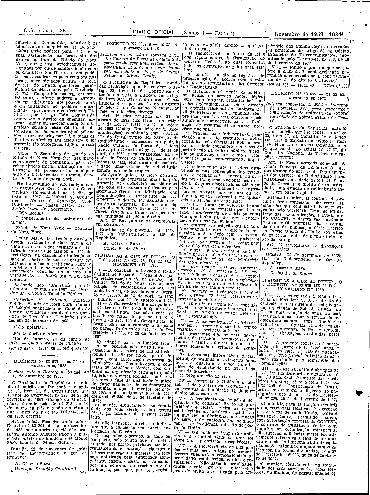
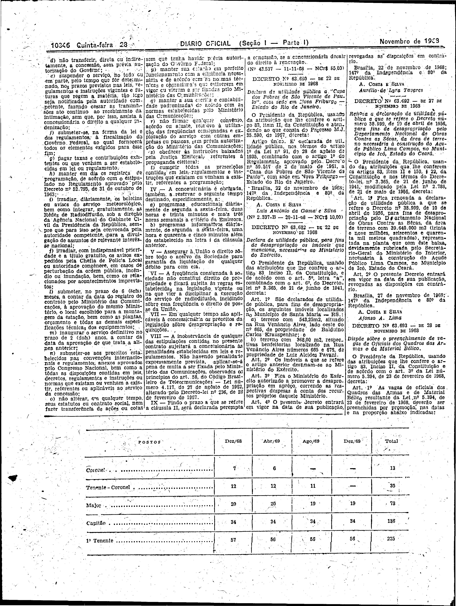

###DEC-063679-0-000-22-11-1968@@@

<strong>DECRETO Nº 63.679, DE 22 DE NOVEMBRO DE 1968.</strong>

<em><strong>Outorga concessão à Rádio Iracema, de Fortaleza S/A, para estabelecer uma estação de radiodifusão sonora na cidade de Sobral, Estado do Ceará.</strong></em>

<strong>O PRESIDENTE DA REPÚBLICA</strong>, usando da atribuição que lhe confere o artigo 83, item II, da Constituição e tendo em vista o disposto no artigo 8º, item XV, letra <em>a</em>, da mesma Constituição e o que consta no Edital nº 27-66, do Conselho Nacional de Telecomunicações,

<strong>DECRETA:</strong>

<strong>Art</strong>. 1º Fica outorgada concessão à Rádio Iracema de Fortaleza S.A., nos têrmos do art. 28 do Regulamento dos Serviços de Radiodifusão, para estabelecer na cidade de Sobral, Estado do Ceará, sem direito de exclusividade, uma estação de radiodifusão sonora, em onda tropical.

Parágrafo único. O contato decorrente desta concessão obedecerá as cláusulas que com êste baixam rubricadas pelo Secretário-Geral do Ministério das Comunicações e Presidente do CONTEL e deverá ser assinado dentro de 60 (sessenta) dias, a contar da data da publicação dêste Decreto no <em>Diário Oficial</em> da União, sob pena de se tornar nulo, de pleno direito, o ato da outorga.

<strong>Art</strong>. 2º Revogam-se as disposições em contrário.

Brasília, 22 de novembro de 1968; 147º da Independência e 80º da República.

<strong>A. COSTA E SILVA</strong>

Carlos F. de Simas

<!-- fac-simile-oficial:inicio -->

## Fac-símile oficial: cláusulas

O texto acima não inclui as cláusulas a que se refere este decreto. A publicação oficial do anexo está em imagem, nas páginas do _Diário Oficial da União_ (Seção I) de 28 de novembro de 1968: página 17 do PDF (a partir de «CLÁUSULAS A QUE SE REFERE O DECRETO Nº 63.679 DE 22 DE NOVEMBRO DE 1968»); página 18 do PDF (até «Nº 43.537 — 11-11-68 — NCr$ 85,00»).

As imagens são as páginas inteiras, tal como digitalizadas pela Imprensa Nacional, sem recorte, sem redesenho e sem transcrição. Cada página traz também outros atos do mesmo dia; a peça deste decreto está apenas no trecho indicado, e o texto do anexo só existe na imagem. Não há OCR validado.

Fonte: Imprensa Nacional, Biblioteca Machado de Assis, arquivo `DO_1_19681128_230.PDF` (SHA-256 `634f80195bcd6078564c316b548ab81051a57c3f87aa46837654360a44302284`), páginas 17, 18 do PDF. SHA-256 das imagens, na ordem: `ba54c4a390bde6373def27fd1ed0e28617e3a38db57a66bc534b2c00119ed9ad`, `7b34b9d7cf91f14a744388a4c041df5f233f79c7b4e047ae46f9b97692a1a058`.

<!-- fac-simile-oficial:fim -->
