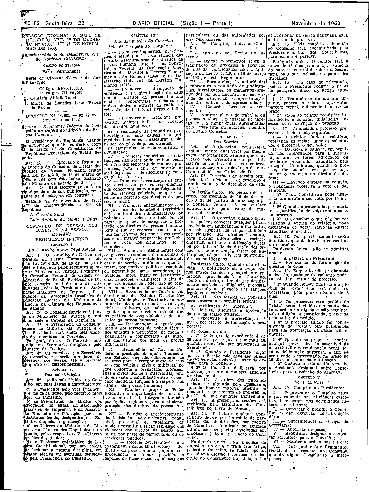
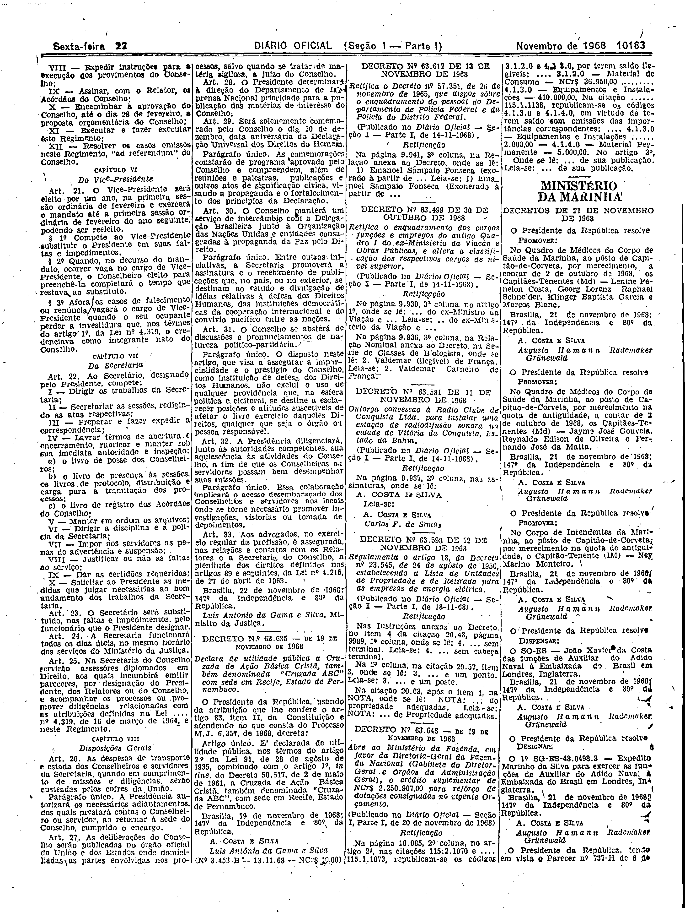

###DEC-063681-0-000-22-11-1968@@@

<strong>DECRETO Nº 63.681, DE 22 DE NOVEMBRO DE 1968.</strong>

<em><strong>Aprova o Regimento Interno do Conselho de Defesa dos Direitos da Pessoa Humana.</strong></em>

<strong>O PRESIDENTE DA REPÚBLICA</strong>, usando da atribuição que lhe confere o item II do artigo 83 da Constituição da República Federativa do Brasil,

<strong>DECRETA:</strong>

<strong>Art</strong>. 1º Fica aprovado o Regimento Interno do Conselho de Defesa dos Direitos da Pessoa Humana, criado pela Lei nº 4.319, de 16 de março de 1964, e que com êste baixa, assinado pelo Ministro de Estado da Justiça.

<strong>Art</strong>. 2º Êste Decreto entrará em vigor na data de sua publicação, revogadas as disposições em contrário.

Brasília, 22 de novembro de 1968; 147º da Independência e 80º da República.

<strong>A. COSTA E SILVA</strong>

Luís Antônio da Gama e Silva

O regulamento a que se refere o presente Decreto foi publicado no <em>Diário Oficial</em> de 22-11-68.

<!-- fac-simile-oficial:inicio -->

## Fac-símile oficial: instrumento

A peça vinculada ao Decreto nº 63.681 é reproduzida nas imagens abaixo, a partir da publicação oficial da Imprensa Nacional. A reprodução é em fac-símile, sem transcrição por OCR nem reconstrução do conteúdo.

As imagens mostram páginas inteiras do Diário Oficial da União e podem conter outras matérias. Essas matérias vizinhas não são atribuídas a este decreto. A peça é identificada pelo seu título e pela referência ao ato nas páginas indicadas.

SHA-256 desta imagem: `2941e3c6d348d6926ce85249c37910000c0a54b26e34405392a443db5af0dcb6`.

SHA-256 desta imagem: `8d62f8d655a024ccedd85acddb7837ef5c60bcfcf241e2f4daf3b1475f1c6fba`.

Fontes oficiais da publicação:

- [DO_1_19681122_226.PDF](https://biblioteca.in.gov.br/documents/271518/541144/DO_1_19681122_226.PDF/914c0df5-0b65-cfeb-3935-04055f07f82f?t=1574886438857&download=true) — SHA-256 do PDF: `ef1c2179057747fb6b5922aee03d77e770cb78f56ad2af496883537d3dbcf963`.

<!-- fac-simile-oficial:fim -->
